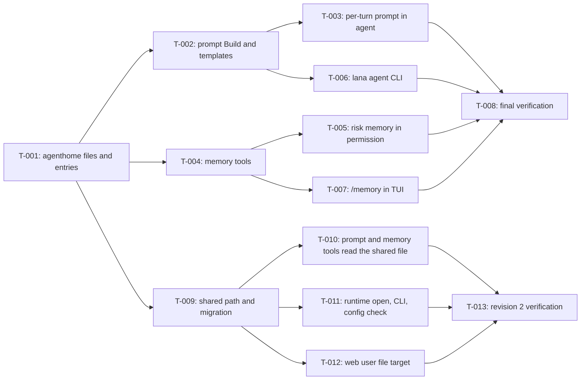

# Tasks: Agent home, memory, and onboarding

- **Issue**: —
- **Requirements**: [requirements.md](requirements.md)
- **Contract**: [api-contract.md](api-contract.md) — Required
- **Design**: [design.md](design.md)
- **Requirements revision**: 4
- **Contract revision**: 3
- **Design revision**: 4
- **Status**: In Progress (revision 2 slices `T-009` to `T-013`; `T-001` to `T-008` completed in revision 1)

## Execution rules

- Work in task order unless the graph allows parallel work.
- Each task keeps `go test ./...` green.
- Required verification is never optional.
- Mark a task complete only after verification evidence has been recorded.

## Coverage

| Acceptance criterion | Contract operation | Evidence owner | Issue/PR | Verification | Evidence |
|---|---|---|---|---|---|
| `AC-HOME-001` through `AC-HOME-003` | `API-HOME-001` | `T-003` | — | `agent` turn tests | Pass |
| `AC-PROMPT-001` | `API-HOME-002` | `T-002` | — | `agenthome` golden test | Pass |
| `AC-PROMPT-002` through `AC-PROMPT-004` | `API-HOME-002` | `T-003` | — | `agent` turn tests | Pass |
| `AC-ONB-001`, `AC-ONB-002` | `API-HOME-002` | `T-002` | — | `agenthome` tests | Pass |
| `AC-MEM-001` through `AC-MEM-006` | `API-MEM-001`, `API-MEM-002` | `T-004` | — | `tools/memory_test.go` | Pass |
| `AC-MEM-007`, `AC-MEM-008` | `API-MEM-002` | `T-005` | — | `tools/permission` tests | Pass |
| `AC-AGCLI-001` through `AC-AGCLI-006`, `AC-TPL-001`, `AC-ONB-003` | `API-AGENT-001` through `004` | `T-006` | — | `cmd/lana/agent_test.go` | Pass |
| `AC-TUI-001` | `API-TUI-001` | `T-007` | — | TUI program test | Pass |
| `AC-HOME-004`, `AC-HOME-005` | `API-HOME-003` | `T-010` | — | `agent` turn tests | Pending |
| `AC-HOME-006` | `API-HOME-003` | `T-011` | — | `cmd/lana` `agent show` test | Pass |
| `AC-HOME-007` through `AC-HOME-009` | `API-HOME-003` | `T-009` | — | `agenthome` migration tests | Pending |
| `AC-HOME-010` | `API-HOME-003` | `T-011` | — | `config` check test | Pass |
| `AC-MEM-009` | `API-MEM-002` | `T-010` | — | `tools/memory_test.go` | Pass |

## Task graph

## Tasks

- [x] `T-001` Create package `agenthome` with paths, name validation, entry parsing, and atomic locked writes
  - Issue/PR: `—`
  - Depends on: `None`
  - Requirements: `REQ-HOME-001`, `REQ-MEM-002`, `REQ-MEM-003`, `REQ-MEM-004`
  - Acceptance criteria: covered through `T-004`
  - Contract operations: `API-HOME-001`
  - Scope:
    - `Paths`, `ValidName`, `ReadEntries`, `Size`, `Apply` with typed errors, `WriteEntries` with `flock` and rename.
    - Add the package to the import rule test in `internal/archtest`.
  - Verification:
    - `go test ./agenthome/...` including the 20-writer concurrency test.
  - Completion evidence:
    - Status: Completed
    - Command/test: `go test ./internal/agenthome/` (TestValidName, TestParseAndJoin, TestApply, TestApplyOverLimit, TestUpdateConcurrent, TestUpdateKeepsFileOnError); `go test -race`
    - Result: pass
    - PR/commit: —
    - Deviation: Package lives at `internal/agenthome` instead of `agenthome/`: the import rule test only allows implementation packages to import `core` and `internal/*`. Design updated.

- [x] `T-002` Implement `agenthome.Build` and the embedded templates
  - Issue/PR: `—`
  - Depends on: `T-001`
  - Requirements: `REQ-PROMPT-001`, `REQ-PROMPT-003`, `REQ-PROMPT-004`, `REQ-ONB-001`, `REQ-TPL-001`
  - Acceptance criteria: `AC-PROMPT-001`, `AC-ONB-001`, `AC-ONB-002`
  - Contract operations: `API-HOME-002`
  - Scope:
    - Section order, headings, truncation marker, onboarding text, runtime context with a clock parameter for tests.
    - `templates/assistant.md`, `worker.md`, `coder.md` and the tool/permission table.
  - Verification:
    - Golden test of `Build` with a fixed clock and timezone.
  - Completion evidence:
    - Status: Completed
    - Command/test: `go test ./internal/agenthome/` (TestBuild golden, TestBuildTruncationWithoutOnboarding, TestTemplates); revision 2 removed the onboarding section
    - Result: pass
    - PR/commit: —
    - Deviation: None

- [x] `T-003` Build the system prompt once per turn in `agent`
  - Issue/PR: `—`
  - Depends on: `T-002`
  - Requirements: `REQ-HOME-001`, `REQ-HOME-002`, `REQ-PROMPT-002`, `REQ-PROMPT-004`
  - Acceptance criteria: `AC-HOME-001` through `AC-HOME-003`, `AC-PROMPT-002` through `AC-PROMPT-004`
  - Contract operations: `API-HOME-002`
  - Scope:
    - Replace `readPrompt` per step with `buildPrompt` per turn; `prompt_file` wins over `AGENT.md`.
    - Add `core.ToolCtx.Home` and fill it from `Registry.home`.
  - Verification:
    - Turn tests with `MockLlm` inspecting `ChatRequest.System`; existing `agent` tests stay green.
  - Completion evidence:
    - Status: Completed
    - Command/test: `go test ./agent/` (TestPromptWithoutAgentHome, TestPromptFromAgentHome, TestPromptFileWinsOverAgentHome, TestPromptBuiltOncePerTurn); TestTurnPlainAnswer now expects `system/message` because runtime context is always present
    - Result: pass
    - PR/commit: —
    - Deviation: None

- [x] `T-004` Implement tools `memory_read` and `memory_write`
  - Issue/PR: `—`
  - Depends on: `T-001`
  - Requirements: `REQ-MEM-001` through `REQ-MEM-004`
  - Acceptance criteria: `AC-MEM-001` through `AC-MEM-006`
  - Contract operations: `API-MEM-001`, `API-MEM-002`
  - Scope:
    - `tools/memory.go`, registration in `tools/module.go`, `core.RiskMemory`, config validation of the tool names.
  - Verification:
    - `go test ./tools/...` with a temp home.
  - Completion evidence:
    - Status: Completed
    - Command/test: `go test ./tools/` (TestMemoryTools, TestMemoryUnavailableWithoutHome)
    - Result: pass
    - PR/commit: —
    - Deviation: None

- [x] `T-005` Allow risk `memory` without approval except under `never`
  - Issue/PR: `—`
  - Depends on: `T-004`
  - Requirements: `REQ-MEM-005`
  - Acceptance criteria: `AC-MEM-007`, `AC-MEM-008`
  - Contract operations: `API-MEM-002`
  - Scope:
    - `tools/permission/evaluator.go` and the default gate in `tools/registry.go`.
  - Verification:
    - Evaluator tests for `ask`, `trust`, `never`, and a deny rule on `memory_write`.
  - Completion evidence:
    - Status: Completed
    - Command/test: `go test ./tools/permission/` (TestMemoryRiskPolicies)
    - Result: pass
    - PR/commit: —
    - Deviation: None

- [x] `T-006` Implement `lana agent new|list|edit|show`
  - Issue/PR: `—`
  - Depends on: `T-002`
  - Requirements: `REQ-AGCLI-001` through `REQ-AGCLI-004`, `REQ-TPL-001`, `REQ-ONB-002`
  - Acceptance criteria: `AC-AGCLI-001` through `AC-AGCLI-006`, `AC-TPL-001`, `AC-ONB-003`
  - Contract operations: `API-AGENT-001` through `API-AGENT-004`
  - Scope:
    - `cmd/lana/agent.go`, help text, wizard, config append, route update, rollback on failure, size warnings in `lana config check`.
  - Verification:
    - `cmd/lana/agent_test.go` with temp `LANA_HOME`, `--yes`, piped stdin for the wizard, `EDITOR=true`.
  - Completion evidence:
    - Status: Completed
    - Command/test: `go test ./cmd/lana/` (TestAgentNewYes, TestAgentNewWorkerTemplate, TestAgentNewErrors, TestAgentNewWizard, TestAgentListShowEdit, TestSetCLIRoute)
    - Result: pass
    - PR/commit: —
    - Deviation: Persona path for `edit`/`show` follows `prompt_file` when set

- [x] `T-007` Add `/memory` to the TUI
  - Issue/PR: `—`
  - Depends on: `T-004`
  - Requirements: `REQ-TUI-001`
  - Acceptance criteria: `AC-TUI-001`
  - Contract operations: `API-TUI-001`
  - Scope:
    - `Backend.Memory`, runtime method in `lana.go`, command table entry, rendering.
  - Verification:
    - TUI program test with the fake backend.
  - Completion evidence:
    - Status: Completed
    - Command/test: `go test ./channels/cli/tui/` (TestInteractiveSlashAndMenus `/memory` step)
    - Result: pass
    - PR/commit: —
    - Deviation: `Backend.Memory` is implemented in `cmd/lana/chat.go` from the agent home files instead of a new `lana.go` runtime method

- [x] `T-008` Run final verification and a manual onboarding smoke test
  - Issue/PR: `—`
  - Depends on: `T-003`, `T-005`, `T-006`, `T-007`
  - Requirements: all
  - Acceptance criteria: all
  - Contract operations: all
  - Scope:
    - Full test suite, `gofmt`, `golangci-lint`, release build; manual `lana agent new` + onboarding with a real provider.
  - Verification:
    - `nix develop -c go test -count=1 ./...`
  - Completion evidence:
    - Status: Completed
    - Command/test: `go test -count=1 ./...`, `golangci-lint run ./...` (0 issues), `go test -race` on agenthome/tools/agent, `make release`; manual smoke with DeepSeek in a temp `LANA_HOME`: `lana agent new helper --yes`, onboarding turn saved 4 entries to USER.md, a new session answered name and work from memory
    - Result: pass
    - PR/commit: —
    - Deviation: Smoke test found that `secretInFile` used the first `KEY=` line while the config loader uses the last; fixed in `cmd/lana/main.go` with TestSecretInFileLastWins

- [x] `T-009` Add the shared `USER.md` path and the migration to package `agenthome` (revision 2)
  - Issue/PR: `—`
  - Depends on: `T-001`
  - Requirements: `REQ-HOME-003`, `REQ-HOME-004`
  - Acceptance criteria: `AC-HOME-007` through `AC-HOME-009`
  - Contract operations: `API-HOME-003`
  - Scope:
    - Remove the `User` field from `Home`; add `SharedUser(lanaHome)` returning `$LANA_HOME/USER.md`.
    - `MigrateUser(lanaHome, candidates, defaultAgent)` implements the copy rule of `API-HOME-003` with a byte copy through the existing atomic write, mode `0600`.
  - Target files: `internal/agenthome/agenthome.go`, `internal/agenthome/migrate.go` (new), `internal/agenthome/agenthome_test.go`, `internal/agenthome/migrate_test.go` (new).
  - Verification: `nix develop -c go test -count=1 ./internal/agenthome/`
  - Completion evidence:
    - Status: Completed

- [x] `T-010` Read the shared file in the prompt and in the memory tools (revision 2)
  - Issue/PR: `—`
  - Depends on: `T-009`
  - Requirements: `REQ-HOME-003`, `REQ-MEM-006`
  - Acceptance criteria: `AC-HOME-004`, `AC-HOME-005`, `AC-MEM-009`
  - Contract operations: `API-HOME-002`, `API-HOME-003`, `API-MEM-002`
  - Scope:
    - `agent/turn.go` `buildPrompt` reads the user entries from `agenthome.SharedUser`.
    - `tools/memory.go` target `user` reads and writes the shared file for `memory_read` and `memory_write`.
    - Update fixtures in `agent/home_test.go` that wrote a per-agent `USER.md`.
  - Target files: `agent/turn.go`, `agent/home_test.go`, `tools/memory.go`, `tools/memory_test.go`.
  - Verification: `nix develop -c go test -count=1 ./agent/ ./tools/`
  - Completion evidence:
    - Status: Completed

- [x] `T-011` Run the migration at runtime open; move the CLI and `config check` to the shared file (revision 2)
  - Issue/PR: `—`
  - Depends on: `T-009`
  - Requirements: `REQ-HOME-004`, `REQ-AGCLI-001`, `REQ-AGCLI-002`, `REQ-AGCLI-003`
  - Acceptance criteria: `AC-HOME-006`, `AC-HOME-010`, `AC-AGCLI-005`
  - Contract operations: `API-HOME-003`, `API-AGENT-001` through `API-AGENT-003`
  - Scope:
    - `lana.go`: the runtime open path calls `MigrateUser` once per process with the config's agents and the `cli` route agent.
    - `cmd/lana/agent.go`: `new` writes no `USER.md`; `edit <name> user` opens the shared file; `list` and `show` read the shared size.
    - `cmd/lana/chat.go` (`Memory`) and `cmd/lana/daemon.go` (`Memory`) read `SharedUser`.
    - `config/check.go`: warning per per-agent `USER.md` that still has entries.
  - Target files: `lana.go`, `cmd/lana/agent.go`, `cmd/lana/agent_test.go`, `cmd/lana/chat.go`, `cmd/lana/daemon.go`, `config/check.go`, `config/check_test.go`.
  - Verification: `nix develop -c go test -count=1 . ./cmd/lana/ ./config/`
  - Completion evidence:
    - Status: Completed

- [x] `T-012` Point the web agent-file `user` target at the shared file (revision 2)
  - Issue/PR: `—`
  - Depends on: `T-009`
  - Requirements: `REQ-HOME-003`
  - Acceptance criteria: `AC-HOME-004` (web side of the shared read)
  - Contract operations: `API-HOME-003`
  - Scope:
    - `web/agentfiles.go` `agentFileTarget` case `user` uses `agenthome.SharedUser(store.SettingsHome())`.
    - Only the path changes here. The endpoint shape belongs to spec #9 rev 2.
  - Target files: `web/agentfiles.go`, `web/agentfiles_test.go`.
  - Verification: `nix develop -c go test -count=1 ./web/`
  - Completion evidence:
    - Status: Completed

- [ ] `T-013` Revision 2 final verification and smoke test (revision 2)
  - Issue/PR: `—`
  - Depends on: `T-010`, `T-011`, `T-012`
  - Requirements: `REQ-HOME-003`, `REQ-HOME-004`, `REQ-MEM-006`
  - Acceptance criteria: all revision 2 criteria
  - Contract operations: `API-HOME-003`
  - Scope:
    - Full suite and lint; manual smoke in a temp `LANA_HOME` with two agents, one of them holding `agents/<name>/USER.md`.
  - Verification:
    - `nix develop -c go test -count=1 ./...`
    - `nix develop -c golangci-lint run ./...`
  - Completion evidence:
    - Status: In progress

## Final verification

- [x] Every acceptance criterion has passing evidence.
- [x] No observable behavior exists without a requirement ID.
- [x] No behavior is outside scope.
- [x] ADRs and diagrams match the implementation.
- [x] `gofmt -l .` is empty, `golangci-lint run ./...`, `go test -race` (changed packages), and the release build pass.
- [x] Deviations are resolved in requirements or design, not only recorded here.

## Final verification (revision 2)

- [ ] Every revision 2 acceptance criterion (`AC-HOME-004` to `AC-HOME-010`, `AC-MEM-009`) has passing evidence.
- [ ] `nix develop -c go test -count=1 ./...` and `golangci-lint` pass.

## Approval

- [x] Requirements and design are Approved and their revisions are recorded.
- [x] Contract is Approved.
- [x] Every acceptance criterion has exactly one evidence owner.
- [x] Every task has a limited scope, dependencies, and verification.
- [x] No task introduces new behavior.
- **Approved by**: Ridho ("oke sekarang implement", 2026-10-29) for revision 1; Ridho, lifted gate 2026-10-30 for the revision 2 slices (agent recommendations `Q-008`, `Q-009`)
- **Approved on**: 2026-10-29 (revision 1); 2026-10-30 (revision 2)
