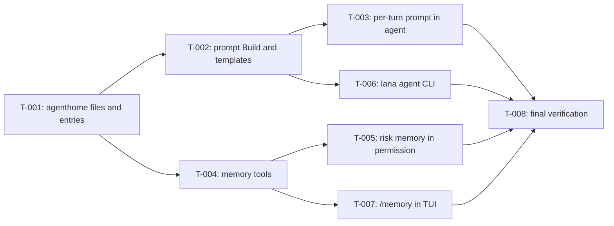

# Tasks: Agent home, memory, and onboarding

- **Issue**: —
- **Requirements**: [requirements.md](requirements.md)
- **Contract**: [api-contract.md](api-contract.md) — Required
- **Design**: [design.md](design.md)
- **Requirements revision**: 1
- **Contract revision**: 1
- **Design revision**: 1
- **Status**: Completed

## Execution rules

- Work in task order unless the graph allows parallel work.
- Each task keeps `go test ./...` green.
- Required verification is never optional.
- Mark a task complete only after verification evidence has been recorded.

## Coverage

| Acceptance criterion | Contract operation | Evidence owner | Issue/PR | Verification | Evidence |
|---|---|---|---|---|---|
| `AC-HOME-001` through `AC-HOME-003` | `API-HOME-001` | `T-003` | — | `agent` turn tests | Pass |
| `AC-PROMPT-001` | `API-HOME-002` | `T-002` | — | `agenthome` golden test | Pass |
| `AC-PROMPT-002` through `AC-PROMPT-004` | `API-HOME-002` | `T-003` | — | `agent` turn tests | Pass |
| `AC-ONB-001`, `AC-ONB-002` | `API-HOME-002` | `T-002` | — | `agenthome` tests | Pass |
| `AC-MEM-001` through `AC-MEM-006` | `API-MEM-001`, `API-MEM-002` | `T-004` | — | `tools/memory_test.go` | Pass |
| `AC-MEM-007`, `AC-MEM-008` | `API-MEM-002` | `T-005` | — | `tools/permission` tests | Pass |
| `AC-AGCLI-001` through `AC-AGCLI-006`, `AC-TPL-001`, `AC-ONB-003` | `API-AGENT-001` through `004` | `T-006` | — | `cmd/lana/agent_test.go` | Pass |
| `AC-TUI-001` | `API-TUI-001` | `T-007` | — | TUI program test | Pass |

## Task graph

## Tasks

- [x] `T-001` Create package `agenthome` with paths, name validation, entry parsing, and atomic locked writes
  - Issue/PR: `—`
  - Depends on: `None`
  - Requirements: `REQ-HOME-001`, `REQ-MEM-002`, `REQ-MEM-003`, `REQ-MEM-004`
  - Acceptance criteria: covered through `T-004`
  - Contract operations: `API-HOME-001`
  - Scope:
    - `Paths`, `ValidName`, `ReadEntries`, `Size`, `Apply` with typed errors, `WriteEntries` with `flock` and rename.
    - Add the package to the import rule test in `internal/archtest`.
  - Verification:
    - `go test ./agenthome/...` including the 20-writer concurrency test.
  - Completion evidence:
    - Status: Completed
    - Command/test: `go test ./internal/agenthome/` (TestValidName, TestParseAndJoin, TestApply, TestApplyOverLimit, TestUpdateConcurrent, TestUpdateKeepsFileOnError); `go test -race`
    - Result: pass
    - PR/commit: —
    - Deviation: Package lives at `internal/agenthome` instead of `agenthome/`: the import rule test only allows implementation packages to import `core` and `internal/*`. Design updated.

- [x] `T-002` Implement `agenthome.Build` and the embedded templates
  - Issue/PR: `—`
  - Depends on: `T-001`
  - Requirements: `REQ-PROMPT-001`, `REQ-PROMPT-003`, `REQ-PROMPT-004`, `REQ-ONB-001`, `REQ-TPL-001`
  - Acceptance criteria: `AC-PROMPT-001`, `AC-ONB-001`, `AC-ONB-002`
  - Contract operations: `API-HOME-002`
  - Scope:
    - Section order, headings, truncation marker, onboarding text, runtime context with a clock parameter for tests.
    - `templates/assistant.md`, `worker.md`, `coder.md` and the tool/permission table.
  - Verification:
    - Golden test of `Build` with a fixed clock and timezone.
  - Completion evidence:
    - Status: Completed
    - Command/test: `go test ./internal/agenthome/` (TestBuild golden, TestBuildOnboardingAndTruncation, TestTemplates)
    - Result: pass
    - PR/commit: —
    - Deviation: None

- [x] `T-003` Build the system prompt once per turn in `agent`
  - Issue/PR: `—`
  - Depends on: `T-002`
  - Requirements: `REQ-HOME-001`, `REQ-HOME-002`, `REQ-PROMPT-002`, `REQ-PROMPT-004`
  - Acceptance criteria: `AC-HOME-001` through `AC-HOME-003`, `AC-PROMPT-002` through `AC-PROMPT-004`
  - Contract operations: `API-HOME-002`
  - Scope:
    - Replace `readPrompt` per step with `buildPrompt` per turn; `prompt_file` wins over `AGENT.md`.
    - Add `core.ToolCtx.Home` and fill it from `Registry.home`.
  - Verification:
    - Turn tests with `MockLlm` inspecting `ChatRequest.System`; existing `agent` tests stay green.
  - Completion evidence:
    - Status: Completed
    - Command/test: `go test ./agent/` (TestPromptWithoutAgentHome, TestPromptFromAgentHome, TestPromptFileWinsOverAgentHome, TestPromptBuiltOncePerTurn); TestTurnPlainAnswer now expects `system/message` because runtime context is always present
    - Result: pass
    - PR/commit: —
    - Deviation: None

- [x] `T-004` Implement tools `memory_read` and `memory_write`
  - Issue/PR: `—`
  - Depends on: `T-001`
  - Requirements: `REQ-MEM-001` through `REQ-MEM-004`
  - Acceptance criteria: `AC-MEM-001` through `AC-MEM-006`
  - Contract operations: `API-MEM-001`, `API-MEM-002`
  - Scope:
    - `tools/memory.go`, registration in `tools/module.go`, `core.RiskMemory`, config validation of the tool names.
  - Verification:
    - `go test ./tools/...` with a temp home.
  - Completion evidence:
    - Status: Completed
    - Command/test: `go test ./tools/` (TestMemoryTools, TestMemoryUnavailableWithoutHome)
    - Result: pass
    - PR/commit: —
    - Deviation: None

- [x] `T-005` Allow risk `memory` without approval except under `never`
  - Issue/PR: `—`
  - Depends on: `T-004`
  - Requirements: `REQ-MEM-005`
  - Acceptance criteria: `AC-MEM-007`, `AC-MEM-008`
  - Contract operations: `API-MEM-002`
  - Scope:
    - `tools/permission/evaluator.go` and the default gate in `tools/registry.go`.
  - Verification:
    - Evaluator tests for `ask`, `trust`, `never`, and a deny rule on `memory_write`.
  - Completion evidence:
    - Status: Completed
    - Command/test: `go test ./tools/permission/` (TestMemoryRiskPolicies)
    - Result: pass
    - PR/commit: —
    - Deviation: None

- [x] `T-006` Implement `lana agent new|list|edit|show`
  - Issue/PR: `—`
  - Depends on: `T-002`
  - Requirements: `REQ-AGCLI-001` through `REQ-AGCLI-004`, `REQ-TPL-001`, `REQ-ONB-002`
  - Acceptance criteria: `AC-AGCLI-001` through `AC-AGCLI-006`, `AC-TPL-001`, `AC-ONB-003`
  - Contract operations: `API-AGENT-001` through `API-AGENT-004`
  - Scope:
    - `cmd/lana/agent.go`, help text, wizard, config append, route update, rollback on failure, size warnings in `lana config check`.
  - Verification:
    - `cmd/lana/agent_test.go` with temp `LANA_HOME`, `--yes`, piped stdin for the wizard, `EDITOR=true`.
  - Completion evidence:
    - Status: Completed
    - Command/test: `go test ./cmd/lana/` (TestAgentNewYes, TestAgentNewWorkerTemplate, TestAgentNewErrors, TestAgentNewWizard, TestAgentListShowEdit, TestSetCLIRoute)
    - Result: pass
    - PR/commit: —
    - Deviation: Persona path for `edit`/`show` follows `prompt_file` when set

- [x] `T-007` Add `/memory` to the TUI
  - Issue/PR: `—`
  - Depends on: `T-004`
  - Requirements: `REQ-TUI-001`
  - Acceptance criteria: `AC-TUI-001`
  - Contract operations: `API-TUI-001`
  - Scope:
    - `Backend.Memory`, runtime method in `lana.go`, command table entry, rendering.
  - Verification:
    - TUI program test with the fake backend.
  - Completion evidence:
    - Status: Completed
    - Command/test: `go test ./channels/cli/tui/` (TestInteractiveSlashAndMenus `/memory` step)
    - Result: pass
    - PR/commit: —
    - Deviation: `Backend.Memory` is implemented in `cmd/lana/chat.go` from the agent home files instead of a new `lana.go` runtime method

- [x] `T-008` Run final verification and a manual onboarding smoke test
  - Issue/PR: `—`
  - Depends on: `T-003`, `T-005`, `T-006`, `T-007`
  - Requirements: all
  - Acceptance criteria: all
  - Contract operations: all
  - Scope:
    - Full test suite, `gofmt`, `golangci-lint`, release build; manual `lana agent new` + onboarding with a real provider.
  - Verification:
    - `nix develop -c go test -count=1 ./...`
  - Completion evidence:
    - Status: Completed
    - Command/test: `go test -count=1 ./...`, `golangci-lint run ./...` (0 issues), `go test -race` on agenthome/tools/agent, `make release`; manual smoke with DeepSeek in a temp `LANA_HOME`: `lana agent new helper --yes`, onboarding turn saved 4 entries to USER.md, a new session answered name and work from memory
    - Result: pass
    - PR/commit: —
    - Deviation: Smoke test found that `secretInFile` used the first `KEY=` line while the config loader uses the last; fixed in `cmd/lana/main.go` with TestSecretInFileLastWins

## Final verification

- [x] Every acceptance criterion has passing evidence.
- [x] No observable behavior exists without a requirement ID.
- [x] No behavior is outside scope.
- [x] ADRs and diagrams match the implementation.
- [x] `gofmt -l .` is empty, `golangci-lint run ./...`, `go test -race` (changed packages), and the release build pass.
- [x] Deviations are resolved in requirements or design, not only recorded here.

## Approval

- [x] Requirements and design are Approved and their revisions are recorded.
- [x] Contract is Approved.
- [x] Every acceptance criterion has exactly one evidence owner.
- [x] Every task has a limited scope, dependencies, and verification.
- [x] No task introduces new behavior.
- **Approved by**: Ridho ("oke sekarang implement", 2026-10-29)
- **Approved on**: 2026-10-29
