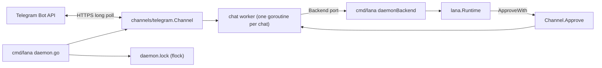
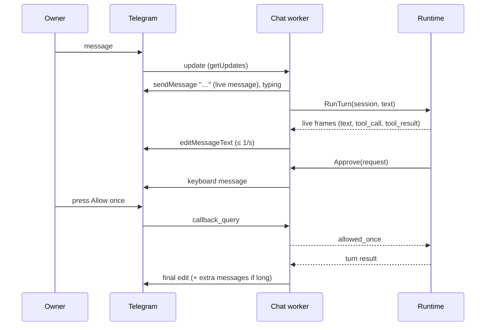

# Design: Daemon and Telegram channel

- **Issue**: —
- **Requirements**: [requirements.md](requirements.md)
- **Contract**: [api-contract.md](api-contract.md) — Required
- **Requirements revision**: 3
- **Contract revision**: 3
- **Requirements status**: Approved
- **Contract status**: Approved
- **Status**: Approved
- **Design revision**: 4 (revision 2: daemon backend cancels the runtime turn on shutdown; revision 3: `lana.ApproveChannels`; revision 4: pending chats, `enabled` key, status snapshot)

## Architecture references

- **ADR index**: [docs/adr](../../adr/README.md)
- **Diagram index**: [docs/diagram](../../diagram/README.md)
- **ADR**: [0003](../../adr/0003-multi-agent-with-channel-routing.md), [0004](../../adr/0004-permission-mode-per-agent.md), [0008](../../adr/0008-cli-channel-http-and-web-dashboard-interfaces.md), [0009](../../adr/0009-session-as-append-only-event-log.md)
- **Feature-local diagram**: [Components](#components), [One Telegram turn](#one-telegram-turn)
- **Durable diagram**: [0001. System Context and Roadmap](../../diagram/0001-system-context-and-roadmap.md) — the daemon is the first long-running process; no change to the diagram is needed for this spec

## Architecture decision scan

| ADR | Effect on this design |
|---|---|
| 0003 | Routes pick the agent per chat; one inbox per session is reused through `Runtime.Send` |
| 0004 | Approval keeps the same outcomes and 10-minute timeout; only the answerer changes |
| 0008 | Long polling, edits throttled to 1 second, inline keyboard. Go `net/http` instead of `reqwest` (ADR 0013) |
| 0009 | Chat sessions are ordinary sessions with channel `telegram`; nothing new is stored |
| 0010 | No `daemon` built-in profile yet; `lana daemon` uses the default effective config. A profile can be added with the HTTP API spec |

No new ADR: the choices are local and reversible.

## Visual Architecture Check

- New boundary: yes, Telegram Bot API (external system).
- New long-running process: yes, `lana daemon`.
- Multi-component flow with concurrency: yes. Feature-local diagrams below.

## Feature-local view

### Components

### One Telegram turn

## Repository fit

- The TUI already uses a `Backend` port implemented in `cmd/lana/chat.go` on top of `lana.Runtime`. Telegram follows the same pattern so `channels/telegram` imports only `core` and `internal/*` (import rule test).
- Live frames (`text_delta`, `tool_call`, `tool_result`) come from `Runtime.SubscribeLive`; the TUI pump in `channels/cli/tui/model.go` shows how to read them during `RunTurn`.
- `primaryArg` (tool argument summary) lives in the TUI package; it moves to `internal/toolfmt` so both channels share it.
- Spec #1 requires a session lock (`REQ-SESS`, `DQ-002`), and `store.TryLease` exists, but no caller takes the lease today. This spec adds `Runtime.LeaseSession` and uses it in both `lana chat` and the daemon.

## Proposed design

### Components

- **`internal/toolfmt` (new)** — `PrimaryArg(name, input)` moved from the TUI; the TUI calls it.
- **`internal/tgfmt` (new)** — `ToHTML(markdown) string` and `Split(html, limit) []string` per `API-TG-003`. Pure, table-tested.
- **`channels/telegram/pending.go` (new, rev 4)** — `pendingChats`: a mutex-guarded map keyed by chat ID. `dispatch` calls `record(chat, from, now)` for every update from a chat without a route. `list(now)` drops records older than 24 hours and returns copies, most recent first. Above 50 records the oldest `last_seen` is removed. The clock is `Channel.Now`, injectable, default `time.Now`.
- **`channels/telegram/status.go` (new, rev 4)** — the `Status` value of `API-TG-007`. `Channel.Status()` reads `bot`, the polling start, the last message time, and the pending list under `c.mu`. `StatusFor(cfg Config, tokenPresent bool)` returns `off` or `token_missing` for a channel that does not run.
- **`channels/telegram/config.go` (rev 4)** — `Config.Enabled` (default `true`). `ParseConfig` accepts `enabled` as a boolean. When `Enabled` is false, the "no `[[routes]]`" error does not apply.
- **`channels/telegram/api.go` (rev 4)** — `Chat` gains `title`, `first_name`, and `username`. The Bot API already sends these fields, so no request is added.
- **`channels/telegram/channel.go` (rev 4)** — `Run` sets the polling start after `Start` succeeds. `dispatch` sets the last message time for message updates and calls `pending.record` for chats without a route. The `info` log line stays.
- **`cmd/lana/daemon.go` (rev 4)** — checks `enabled` before the token and the routes. With the token missing and the web view on, it logs a warning, continues with `StatusFor(cfg, false)`, and gives the web view a status function. The type of that function is set in `T-010`.
- **`channels/telegram` (new)**:
  - `api.go` — minimal Bot API client over `net/http` with JSON bodies; typed errors `ErrUnauthorized`, `*RetryAfterError`, `*APIError`. Base URL from `api_base`.
  - `config.go` — parse and validate `[channels.telegram]` and telegram routes into `Config{TokenEnv, OwnerIDs, APIBase, Routes map[int64]string}`.
  - `channel.go` — `Channel.Run(ctx)`: `getMe`, `setMyCommands`, poll loop with backoff; dispatch each update to its chat worker through a buffered channel; advance the offset after dispatch. Ignore chats without a route (`info` log). Callback queries are dispatched to the same worker.
  - `chat.go` — chat worker: resolves the active agent and session through the port, handles commands, owns the live message (`liveMessage` with throttled editor and typing ticker), keeps per-chat in-memory usage for `/status`.
  - `approve.go` — `Channel.Approve(ctx, req)`: finds the chat by `req.SessionID`, sends the keyboard, waits on a reply channel, the 10-minute timer, or `ctx.Done()`.
  - `Backend` port: `ChatSession(ctx, chatID, routeAgent) (core.SessionInfo, error)`, `NewSession(ctx, chatID, agent)`, `SwitchAgent(ctx, chatID, agent)`, `RunTurn`, `Send`, `Cancel`, `SubscribeLive`, `Compact`, `Memory`, `AgentNames`, `AgentModel`, `Policy`, `Lease(ctx, sessionID) (release func(), error)`.
- **`lana.go`** — new methods:
  - `ChannelSession(ctx, channel, address, agent, workspace)` finds the most recent session with that channel, address, and agent, or creates one.
  - `ActiveAgent(ctx, channel, address)` returns the agent of the most recent session for that address, or "".
  - `LeaseSession(ctx, id)` wraps `store.TryLease`.
  - `CreateChannelSession(ctx, channel, address, agent, workspace)` for `/new`.
- **`cmd/lana/daemon.go` (new)** — `lana daemon`: flags and logging, `daemon.lock` with `flock` and PID, config checks with the contract's exit codes, token lookup through config secrets, `runtimeFor` with `ApproveWith(channel.Approve)`, `daemonBackend` adapter, `signal.NotifyContext` for SIGINT/SIGTERM, shutdown deadline 10 seconds.
- **`lana.ApproveChannels(channels...)` (new option)** — the `ApproveWith` answerer only handled sessions with channel `library` or `cli`; the daemon passes `ApproveChannels("telegram")` so Telegram sessions reach `Channel.Approve`. Found in the manual smoke test.
- **Shutdown of a running turn** — `Runtime.Run` keeps running when its ctx ends, so `daemonBackend.RunTurn` watches ctx and calls `Runtime.Cancel` for the session.
- **`cmd/lana/chat.go`** — takes `LeaseSession` on the chat session and on every session it switches to; a held lease gives `error: session <id> is in use by process <pid>`, exit 2 (spec #1 behavior).

### Contract mapping

| Contract operation | Implementation |
|---|---|
| `API-DMN-001` | `cmd/lana/daemon.go` |
| `API-TG-001` | `channels/telegram/config.go` |
| `API-TG-002` | `chat.go`, `lana.ChannelSession`, `ActiveAgent`, `CreateChannelSession`, `LeaseSession` |
| `API-TG-003` | `chat.go` (`liveMessage`), `internal/tgfmt`, `internal/toolfmt` |
| `API-TG-004` | `approve.go` |
| `API-TG-005` | `chat.go` commands |
| `API-TG-006` | `api.go`, `channel.go` |

### Persistence

- No schema change. Chat sessions are rows in `sessions` with channel `telegram` and address `<chat_id>`.
- The update offset is kept in memory; Telegram drops confirmed updates and keeps unconfirmed ones for 24 hours, so a restart sees at most the last unconfirmed batch again.
- Pending chat records and the status snapshot are in memory only. A restart empties them (rev 4).

### Failure handling

| Failure | Handling |
|---|---|
| `getUpdates` network/5xx | Backoff 1→30 s, reset on success |
| 429 | Sleep `retry_after`, retry the same call |
| 401 | Cancel the daemon context, exit 2 |
| HTML parse error | Resend the part without parse mode |
| `message is not modified` | Ignore |
| Lease held | Reply `✗ session is in use by another process` |
| Approval for a session not owned by a chat | `OutcomeUnavailable` (fail-closed) |
| Token missing, web view on | Warning, Telegram off, daemon runs (`REQ-DMN-006`, rev 4) |
| `enabled = false` | Telegram not started (`REQ-DMN-005`, rev 4) |
| Pending chats above 50 | Oldest `last_seen` removed (`REQ-TG-016`, rev 4) |

### Concurrency

- One poll goroutine. One worker goroutine per chat with a buffered queue (64); a full queue drops the update with a `warn` log.
- Each worker runs at most one turn; while it runs, new text goes to `Runtime.Send` (inbox) from the worker's update loop, so the worker never blocks on its own turn. The turn runs in a child goroutine that reports back on a channel.
- The live message editor is owned by the worker; frames and the 1-second ticker are merged in one `select`.
- Approvals block the runtime goroutine, not the worker, so the worker can process the button press.
- Shutdown: cancel the root context, wait for workers up to 10 seconds, release leases, remove the lock file.

### Security

- Allowlist by `chat_id`; owner checks by user ID for privileged actions in groups.
- The token appears only in request URLs; the HTTP client logs never include URLs. Errors are rewritten to drop the token.
- Callback data carries only random request IDs and agent names; requests are looked up server-side.

### Observability

- `info`: start line, ignored chats (`chat_id`, `user_id`, `username`), turn start/end per chat with session ID and duration.
- `warn`: send/edit failures, dropped updates.
- `debug`: every Bot API call name and status.

## Requirement traceability

| Requirement | Component |
|---|---|
| `REQ-DMN-*` | `cmd/lana/daemon.go` |
| `REQ-TG-001`, `REQ-TG-002` | `config.go`, `channel.go`, `chat.go` |
| `REQ-TG-003` through `REQ-TG-005` | `chat.go`, `lana.go` session methods |
| `REQ-TG-006` through `REQ-TG-010` | `chat.go`, `internal/tgfmt`, `internal/toolfmt` |
| `REQ-TG-011` | `approve.go` |
| `REQ-TG-012`, `REQ-TG-013` | `chat.go` |
| `REQ-TG-014`, `REQ-TG-015` | `api.go`, `channel.go` |
| `REQ-DMN-005`, `REQ-DMN-006` (rev 4) | `config.go`, `cmd/lana/daemon.go` |
| `REQ-TG-016` (rev 4) | `pending.go`, `channel.go` (`dispatch`) |
| `REQ-TG-017`, `REQ-TG-018`, `REQ-TG-019` (rev 4) | `channel.go` (`Run`, `Status`), `status.go`, `cmd/lana/daemon.go` |

## Acceptance verification map

| Acceptance criteria | Verification |
|---|---|
| `AC-DMN-001` through `AC-DMN-004` | `cmd/lana/daemon_test.go` with a fake Bot API (`httptest.Server`) and `MockLlm` |
| `AC-TG-001` through `AC-TG-006`, `AC-TG-015` through `AC-TG-021` | `channels/telegram` tests with a fake Bot API recording calls and a fake `Backend` |
| `AC-TG-007`, `AC-TG-009`, `AC-TG-010`, `AC-TG-011` | `channels/telegram` live message tests with a fake clock |
| `AC-TG-008` | `internal/tgfmt` table tests |
| `AC-TG-012` through `AC-TG-014` | approval tests with the fake Bot API and a short timeout |
| spec #1 lock | `cmd/lana` test: two runtimes, second `LeaseSession` fails |
| `AC-DMN-005` through `AC-DMN-007`, `AC-TG-027` (rev 4) | `channels/telegram` config tests; `cmd/lana/daemon_test.go` with no token and with `enabled = false` |
| `AC-TG-022`, `AC-TG-023` (rev 4) | `pending_test.go` with a fake clock and 51 chats |
| `AC-TG-024` through `AC-TG-026` (rev 4) | `telegram_test.go` status tests with the fake Bot API |

## Verification strategy

- Fake Bot API server in `channels/telegram/fakeapi_test.go`: queues updates, records calls, can return 401/429/5xx.
- `nix develop -c go test -count=1 ./...`, `go test -race` for `channels/telegram`, `golangci-lint`.
- Manual smoke test with a real bot: private chat, tool approval, `/agent`, `/cancel`, a group mention.

## Risks and tradeoffs

- Edits at 1 per second per chat stay under Telegram limits for one owner; many busy groups could hit 429, handled by `retry_after`.
- HTML conversion is a subset; unusual Markdown falls back to plain text rather than failing.
- In-memory offset may re-deliver the last batch after a crash; acceptable for chat.
- `lana chat` now refuses a session held by the daemon. This is spec #1 behavior that was missing.

## Blocking Design Questions

None.

## Change log

- Revision 4 (2026-10-30): pending chats kept in memory for 24 hours (`pending.go`); `enabled` key and token-missing rule in `config.go` and `cmd/lana/daemon.go`; status snapshot in `status.go`. Owner decision, spec #9 rev 2 decision 12. Requirements `REQ-DMN-005`, `REQ-DMN-006`, `REQ-TG-016` to `REQ-TG-019`; contract `API-TG-007`.
