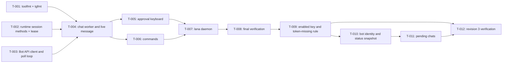

# Tasks: Daemon and Telegram channel

- **Issue**: —
- **Requirements**: [requirements.md](requirements.md)
- **Contract**: [api-contract.md](api-contract.md) — Required
- **Design**: [design.md](design.md)
- **Requirements revision**: 3
- **Contract revision**: 3
- **Design revision**: 4
- **Status**: In Progress (revision 2 slices `T-009` to `T-012`; `T-001` to `T-008` completed in revision 1)

## Execution rules

- Work in task order unless the graph allows parallel work.
- Each task keeps `go test ./...` green.
- Required verification is never optional.
- Mark a task complete only after verification evidence has been recorded.

## Coverage

| Acceptance criterion | Contract operation | Evidence owner | Issue/PR | Verification | Evidence |
|---|---|---|---|---|---|
| `AC-TG-008` | `API-TG-003` | `T-001` | — | `internal/tgfmt` tests | Pass |
| `AC-TG-004`, `AC-TG-006` | `API-TG-002` | `T-002` | — | `lana` session method tests | Pass |
| `AC-TG-019` through `AC-TG-021` | `API-TG-006` | `T-003` | — | `channels/telegram` api/poll tests | Pass |
| `AC-TG-001` through `AC-TG-003`, `AC-TG-005`, `AC-TG-007`, `AC-TG-009` through `AC-TG-011`, `AC-TG-015` | `API-TG-001` through `API-TG-003` | `T-004` | — | `channels/telegram` chat tests | Pass |
| `AC-TG-012` through `AC-TG-014` | `API-TG-004` | `T-005` | — | approval tests | Pass |
| `AC-TG-016` through `AC-TG-018` | `API-TG-005` | `T-006` | — | command tests | Pass |
| `AC-DMN-001` through `AC-DMN-004` | `API-DMN-001` | `T-007` | — | `cmd/lana/daemon_test.go` | Pass |
| `AC-DMN-005` through `AC-DMN-007`, `AC-TG-027` | `API-DMN-001`, `API-TG-001` | `T-009` | — | `channels/telegram` config tests, `cmd/lana/daemon_test.go` | Pass |
| `AC-TG-024` through `AC-TG-026` | `API-TG-006`, `API-TG-007` | `T-010` | — | `channels/telegram` status tests | Pass |
| `AC-TG-022`, `AC-TG-023` | `API-TG-007` | `T-011` | — | `channels/telegram/pending_test.go` | Pass |

## Task graph

## Tasks

- [x] `T-001` Move `primaryArg` to `internal/toolfmt` and add `internal/tgfmt` (Markdown to Telegram HTML, split)
  - Issue/PR: `—`
  - Depends on: `None`
  - Requirements: `REQ-TG-007`, `REQ-TG-008`, `REQ-TG-009`
  - Acceptance criteria: `AC-TG-008`
  - Contract operations: `API-TG-003`
  - Scope:
    - TUI uses `toolfmt.PrimaryArg`; existing TUI tests stay green.
    - `tgfmt.ToHTML`, `tgfmt.Split` with code-block reopen.
  - Verification:
    - `go test ./internal/... ./channels/cli/...`
  - Completion evidence:
    - Status: Completed
    - Command/test: `go test ./internal/tgfmt/ ./channels/cli/tui/` (TestToHTML, TestPlain, TestSplitParagraphs, TestSplitReopensCodeBlock, TestSplitHardCutAvoidsEntity; TUI TestPrimaryArg unchanged)
    - Result: pass
    - PR/commit: —
    - Deviation: `toolfmt.PrimaryArg` also summarizes `memory_read`/`memory_write`

- [x] `T-002` Add `Runtime.ChannelSession`, `ActiveAgent`, `CreateChannelSession`, `LeaseSession`; take the lease in `lana chat`
  - Issue/PR: `—`
  - Depends on: `None`
  - Requirements: `REQ-TG-003`, `REQ-TG-005`; spec #1 session lock
  - Acceptance criteria: `AC-TG-004`, `AC-TG-006`
  - Contract operations: `API-TG-002`
  - Scope:
    - Session lookup by channel, address, agent; workspace default `$LANA_HOME/workspaces/<agent>/`.
    - `lana chat` leases its session and sessions it switches to.
  - Verification:
    - Root package tests with SQLite store; `cmd/lana` lease test.
  - Completion evidence:
    - Status: Completed
    - Command/test: `go test .` (TestChannelSessions, 30 runs), `go test ./cmd/lana/` (TestLeaseSetRejectsSecondHolder)
    - Result: pass
    - PR/commit: —
    - Deviation: `lana chat` now leases its session (spec #1 `REQ-SESS` lock, previously not enforced)

- [x] `T-003` Implement the Bot API client, config parsing, and the poll loop
  - Issue/PR: `—`
  - Depends on: `None`
  - Requirements: `REQ-TG-001`, `REQ-TG-014`, `REQ-TG-015`
  - Acceptance criteria: `AC-TG-019` through `AC-TG-021`
  - Contract operations: `API-TG-001`, `API-TG-006`
  - Scope:
    - `api.go`, `config.go`, `channel.go` poll/dispatch, fake Bot API for tests.
  - Verification:
    - `go test ./channels/telegram/` including backoff, 429, 401, offset.
  - Completion evidence:
    - Status: Completed
    - Command/test: `go test -race ./channels/telegram/` (TestParseConfig, TestStartRegistersCommandsAndRejectsBadToken, TestPollBackoffOffsetAndUnauthorized)
    - Result: pass
    - PR/commit: —
    - Deviation: None

- [x] `T-004` Implement the chat worker, live message, groups, inbox, and non-text replies
  - Issue/PR: `—`
  - Depends on: `T-001`, `T-002`, `T-003`
  - Requirements: `REQ-TG-002` through `REQ-TG-010`, `REQ-TG-012`
  - Acceptance criteria: `AC-TG-001` through `AC-TG-003`, `AC-TG-005`, `AC-TG-007`, `AC-TG-009` through `AC-TG-011`, `AC-TG-015`
  - Contract operations: `API-TG-001` through `API-TG-003`
  - Scope:
    - Worker per chat, throttled editor with injectable clock, typing ticker, tool lines, end states, split.
  - Verification:
    - `go test -race ./channels/telegram/`
  - Completion evidence:
    - Status: Completed
    - Command/test: `go test -race -count=3 ./channels/telegram/` (TestPrivateChatTurn, TestStrangerIgnored, TestGroupMentionOnly, TestInboxDuringTurnAndCancel, TestLongAnswerSplit, TestErrorAndParseFallback, TestStreamingEditsAreThrottled, TestNonTextAndCommands)
    - Result: pass
    - PR/commit: —
    - Deviation: None

- [x] `T-005` Implement the approval keyboard
  - Issue/PR: `—`
  - Depends on: `T-004`
  - Requirements: `REQ-TG-011`
  - Acceptance criteria: `AC-TG-012` through `AC-TG-014`
  - Contract operations: `API-TG-004`
  - Scope:
    - `Channel.Approve`, callbacks, owner check, timeout, cancel on shutdown.
  - Verification:
    - Approval tests with the fake Bot API.
  - Completion evidence:
    - Status: Completed
    - Command/test: `go test -race ./channels/telegram/` (TestApprovalFlow, TestApproveUnknownSession)
    - Result: pass
    - PR/commit: —
    - Deviation: The approval label uses the tool line of the live message; `ApprovalRequest.Label` when the call is unknown. Manual test found approvals answered `unavailable`: the runtime only routed `library`/`cli` sessions to `ApproveWith`; fixed with `lana.ApproveChannels` (TestApproveChannels)

- [x] `T-006` Implement bot commands
  - Issue/PR: `—`
  - Depends on: `T-004`
  - Requirements: `REQ-TG-013`
  - Acceptance criteria: `AC-TG-016` through `AC-TG-018`
  - Contract operations: `API-TG-005`
  - Scope:
    - `/start`, `/help`, `/new`, `/agent` (with keyboard), `/memory`, `/compact`, `/cancel`, `/status`; owner-only in groups.
  - Verification:
    - Command tests with the fake Bot API.
  - Completion evidence:
    - Status: Completed
    - Command/test: `go test -race ./channels/telegram/` (TestNonTextAndCommands, TestStartRegistersCommandsAndRejectsBadToken)
    - Result: pass
    - PR/commit: —
    - Deviation: Agent buttons pressed by a non-owner in a group answer `only the owner can switch agents` (added to the contract)

- [x] `T-007` Implement `lana daemon`
  - Issue/PR: `—`
  - Depends on: `T-005`, `T-006`
  - Requirements: `REQ-DMN-001` through `REQ-DMN-004`
  - Acceptance criteria: `AC-DMN-001` through `AC-DMN-004`
  - Contract operations: `API-DMN-001`
  - Scope:
    - Lock file, config checks and exit codes, runtime with `ApproveWith`, backend adapter, signals, help text.
  - Verification:
    - `cmd/lana/daemon_test.go` with the fake Bot API and `MockLlm`.
  - Completion evidence:
    - Status: Completed
    - Command/test: `go test ./cmd/lana/` (TestDaemonConfigErrors, TestDaemonSingleInstance, TestDaemonAnswersAndStops, TestDaemonCancelsRunningTurn)
    - Result: pass
    - PR/commit: —
    - Deviation: `Runtime.Run` does not stop when its ctx ends, so the daemon backend calls `Runtime.Cancel` on shutdown

- [x] `T-008` Run final verification and a manual smoke test with a real bot
  - Issue/PR: `—`
  - Depends on: `T-007`
  - Requirements: all
  - Acceptance criteria: all
  - Contract operations: all
  - Scope:
    - Full suite, race, lint, release build; manual test with the owner's bot token.
  - Verification:
    - `nix develop -c go test -count=1 ./...`
  - Completion evidence:
    - Status: Completed
    - Command/test: `go test -count=1 ./...`, `go test -race` (channels, cmd, internal, root), `golangci-lint run ./...` (0 issues), `make release`; manual smoke with @lana_orc_bot from a private chat in a temp `LANA_HOME`: streamed answers, tool lines, `bash` approval with buttons, `/agent`, `/status`, `/memory`
    - Result: pass
    - PR/commit: —
    - Deviation: The manual test found approvals answered `unavailable` (fixed with `lana.ApproveChannels`) and repeated onboarding interviews (removed in spec #5 revision 2)

- [x] `T-009` Add the `enabled` key and the token-missing rule (revision 2)
  - Issue/PR: `—`
  - Depends on: `None`
  - Requirements: `REQ-DMN-005`, `REQ-DMN-006`, `REQ-TG-019`
  - Acceptance criteria: `AC-DMN-005`, `AC-DMN-006`, `AC-DMN-007`, `AC-TG-027`
  - Contract operations: `API-DMN-001`, `API-TG-001`
  - Scope:
    - `Config.Enabled` (default `true`); `ParseConfig` skips the route requirement when disabled.
    - `cmd/lana/daemon.go`: disabled channel is not started; token missing with the web view on logs a warning and keeps running; token missing with the web view off exits 2.
  - Target files: `channels/telegram/config.go`, `channels/telegram/telegram_test.go`, `cmd/lana/daemon.go`, `cmd/lana/daemon_test.go`.
  - Verification: `nix develop -c go test -count=1 ./channels/telegram/ ./cmd/lana/`
  - Completion evidence:
    - Status: Completed

- [x] `T-010` Bot identity and the status snapshot (revision 2)
  - Issue/PR: `—`
  - Depends on: `T-009`
  - Requirements: `REQ-TG-017`, `REQ-TG-018`
  - Acceptance criteria: `AC-TG-024`, `AC-TG-025`, `AC-TG-026`
  - Contract operations: `API-TG-006`, `API-TG-007`
  - Scope:
    - `Run` records the polling start; `Channel.Status()` and `StatusFor` in `status.go`.
    - The daemon passes a status function to the web view; its type is chosen here and used by spec #9 rev 2.
  - Target files: `channels/telegram/channel.go`, `channels/telegram/status.go` (new), `channels/telegram/telegram_test.go`, `cmd/lana/daemon.go`.
  - Verification: `nix develop -c go test -count=1 -race ./channels/telegram/`
  - Completion evidence:
    - Status: Completed

- [x] `T-011` Pending chats in memory for 24 hours (revision 2)
  - Issue/PR: `—`
  - Depends on: `T-010`
  - Requirements: `REQ-TG-016`
  - Acceptance criteria: `AC-TG-022`, `AC-TG-023`
  - Contract operations: `API-TG-007`
  - Scope:
    - `pendingChats` with retention 24 hours and a cap of 50; `dispatch` records chats without a route.
    - `Chat` decodes `title`, `first_name`, and `username`.
  - Target files: `channels/telegram/pending.go` (new), `channels/telegram/pending_test.go` (new), `channels/telegram/api.go`, `channels/telegram/channel.go`, `channels/telegram/fake_test.go`.
  - Verification: `nix develop -c go test -count=1 -race ./channels/telegram/`
  - Completion evidence:
    - Status: Completed

- [ ] `T-012` Revision 3 final verification and smoke test (revision 2)
  - Issue/PR: `—`
  - Depends on: `T-009`, `T-010`, `T-011`
  - Requirements: `REQ-DMN-005`, `REQ-DMN-006`, `REQ-TG-016` to `REQ-TG-019`
  - Acceptance criteria: all revision 3 criteria
  - Contract operations: `API-DMN-001`, `API-TG-001`, `API-TG-006`, `API-TG-007`
  - Scope:
    - Full suite and lint; manual check with the owner's bot: a message from an unrouted account appears as a pending chat in the status.
  - Verification:
    - `nix develop -c go test -count=1 ./...`
    - `nix develop -c golangci-lint run ./...`
  - Completion evidence:
    - Status: In progress

## Final verification

- [x] Every acceptance criterion has passing evidence.
- [x] No observable behavior exists without a requirement ID.
- [x] No behavior is outside scope.
- [x] ADRs and diagrams match the implementation.
- [x] `gofmt -l .` is empty, `golangci-lint run ./...`, `go test -race` (changed packages), and the release build pass.
- [x] Deviations are resolved in requirements or design, not only recorded here.

## Final verification (revision 3)

- [ ] Every revision 3 acceptance criterion (`AC-DMN-005` to `AC-DMN-007`, `AC-TG-022` to `AC-TG-027`) has passing evidence.
- [ ] `nix develop -c go test -count=1 ./...` and `golangci-lint` pass.

## Approval

- [x] Requirements and design are Approved and their revisions are recorded.
- [x] Contract is Approved.
- [x] Every acceptance criterion has exactly one evidence owner.
- [x] Every task has a limited scope, dependencies, and verification.
- [x] No task introduces new behavior.
- **Approved by**: Ridho ("oke sip lakukan", 2026-10-30) for revision 1; Ridho, lifted gate 2026-10-30 for the revision 2 slices (agent recommendations `Q-008` to `Q-011`)
- **Approved on**: 2026-10-30 (revision 1 and revision 2)
