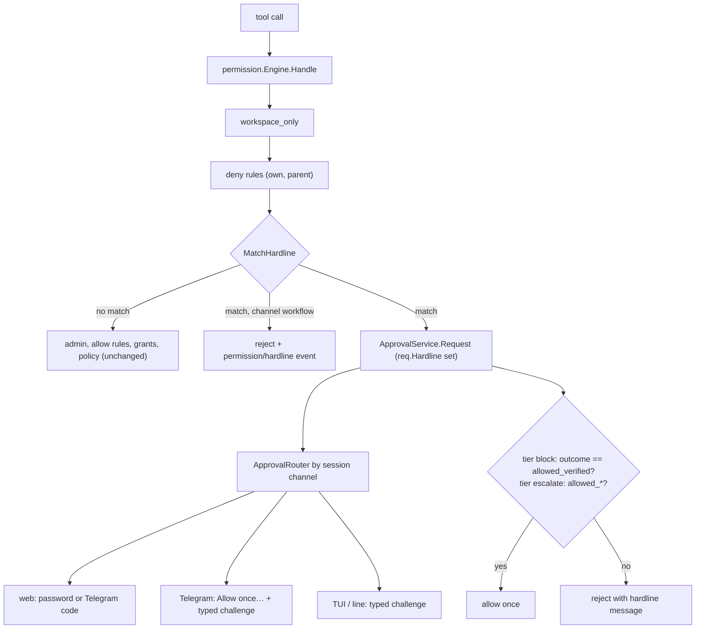

# Design: Hardline floor

- **Requirements**: [requirements.md](requirements.md) (revision 1, Approved)
- **Contract**: [api-contract.md](api-contract.md) (revision 1, Draft)
- **Status**: Draft
- **Design revision**: 1

## Feature-local view



## Repository fit

- The matcher is a new file in `tools/permission`, next to `auto.go`, and reuses `pattern.SplitCommand`,
  `roughSegments`, and `ResolvePath`.
- The evaluator gets one new step. Every policy path below it stays as it is.
- Step-up proof is carried by a new outcome, `allowed_verified`. Only a surface that really checked a
  password, a code, or a typed challenge returns it. A surface that knows nothing about hardline
  returns `allowed_once` at most, which a Block request rejects. Unknown or future surfaces therefore
  fail closed.
- Web reuses `verifyControlPassword` (login lockout), `newResetCode`, `controlCodeStore`, and
  `telegramOwnerMessenger` from spec 57. Telegram reuses the armed-text capture pattern of
  `captureQuestionText` (`channels/telegram/ask.go`).

## Proposed design

### 1. Matcher — `tools/permission/hardline.go`

```go
// HardlineMatch lives in core so approval surfaces can read it.
type HardlineMatch struct {
    Rule   string // "HL-B-001"
    Tier   string // core.HardlineBlock ("block") or core.HardlineEscalate ("escalate")
    Reason string
}

// MatchHardline returns the first matching rule, Block rules before Escalate
// rules, or nil. home is the owner's home directory (os.UserHomeDir in
// production, a temp dir in tests).
func MatchHardline(tool string, input json.RawMessage, workspace, home string) *core.HardlineMatch
```

- Tools: `bash` (field `command`), `write_file`/`edit_file`/`read_file` (field `path`). Every other
  tool returns nil.
- Path resolution (REQ-HLF-004), in one helper `resolveHL(p, cwd, home)`:
  1. Expand `~`, `~/`, `$HOME`, and `${HOME}` with `home`.
  2. Make the path absolute against `cwd`. For bash, `cwd` is the workspace, updated by a leading
     `cd <dir>` segment of the same command.
  3. `filepath.Clean`.
  4. If the path or its longest existing parent exists, apply `filepath.EvalSymlinks` to that part.
  5. Compare with `strings.EqualFold` on cleaned paths, and use prefix checks on `dir + "/"`.
- Bash analysis:
  1. Split with `pattern.SplitCommand`. Not analyzable means use `roughSegments`.
  2. For a segment `bash|sh|zsh -c <string>` or `eval <string>`, analyze the string once more with the
     same function (depth limit 1).
  3. Strip leading `VAR=value` assignments. Use `filepath.Base` of the first field as the command name.
  4. Redirect targets (`>`, `>>`, `&>`, `2>`) count as write targets for HL-B-002 and HL-B-004.
  5. Pipelines are checked as a whole for HL-E-001, reusing `pipeToShell` extended with
     `python|node|perl`.
  6. Raw-text fallback (REQ-HLF-005): if the command was not analyzable and its raw text contains a
     Block command name (`rm`, `mkfs`, `newfs`, `dd`, `diskutil`) or a protected path (after `~`/`$HOME`
     expansion), return Block with the rule of that keyword. Use `HL-B-001` for `rm` and `HL-B-004` for
     a protected path.
- Rule tables are plain Go values. There are no config hooks (REQ-HLF-006).

### 2. Core types — `core/approval.go`, `core/event.go`

- `ApprovalRequest.Hardline *HardlineMatch`
- `OutcomeAllowedVerified ApprovalOutcome = "allowed_verified"`, added to `validOutcome` and to
  `lana.go validApprovalOutcome`
- `ApprovalAsked.Hardline *HardlineMatch` with JSON tag `hardline,omitempty` (API-HLF-001)
- `KindPermissionHardline = "permission/hardline"` and the `PermissionHardline` payload (API-HLF-003)

### 3. Evaluator — `tools/permission/evaluator.go`

Insert after the parent-deny loop, before the `RiskAdmin` block:

```go
if m := MatchHardline(in.Call.Name, in.Call.Input, workspace, e.home()); m != nil {
    return e.hardline(ctx, in, info, agentName, m), nil
}
```

`e.hardline`:

1. Log `permission: hardline` with session, agent, tool, rule, tier.
2. If `info.Channel == "workflow"` or `e.Approval == nil`, append `permission/hardline` and reject.
3. Call `requestApproval` with `Hardline: m`. `requestApproval` gets a `*core.HardlineMatch` parameter.
4. For Block, only `allowed_verified` allows. For Escalate, `allowed_once`, `allowed_session`, and
   `allowed_verified` allow.
5. Allow with `core.OutcomeAllowedOnce`. On rejection, return the REQ-HLF-010 message:
   `blocked by hardline rule <ID> (<reason>). Do not retry or work around it; ask the owner to run it themselves or to approve it.`
6. Log the outcome.

`Engine.home` is a new optional field, `Home func() string`, that defaults to `os.UserHomeDir`, so tests
can point it at a temp dir.

### 4. Approval service — `tools/permission/approval.go`

- Copy `req.Hardline` into `ApprovalAsked`.
- When `req.Hardline != nil` and the outcome is `allowed_session`, record and return `allowed_once`.
  `Grants` therefore never sees a hardline grant (AC-HLF-015, AC-HLF-017).

### 5. Web — `web/approvals.go`, `web/notify.go`, `web/ui/src/views/approval.tsx`

- `approvalEvent.Hardline` holds `{rule, tier, reason, step_up}` (API-HLF-004). `step_up` comes from
  `s.remoteConfig().ConfirmWith`.
- The broker keeps the request's `Hardline` with the pending entry.
- `handleAnswerApproval` follows API-HLF-005. The password is checked with `verifyControlPassword`. The
  code is checked with a dedicated `approvalCodes` store (`newControlCodeStore()`), keyed by
  `sha256(requestID)`. On success, call `answer(id, allowed_verified)`.
- New route `POST /v1/approvals/{id}/code` (API-HLF-006). It mirrors `handleControlTelegram` with an
  approval-specific message.
- `handleLocalApproval` answers 409 `step_up_required` for Block (API-HLF-007).
- UI:
  - For `hardline.tier == "block"`, the card shows the rule ID and reason in a danger style, a password
    field, and, when `step_up == "password_or_telegram"`, a "Send Telegram code" button with a code
    field.
  - The card hides "Allow for session" for every hardline request.
  - On 401 or 429, the card shows the error inline and keeps the card open.

### 6. Telegram — `channels/telegram/approve.go`, `chat.go`

- For a hardline request, the bubble text shows the tool, the full argument (not shortened), the rule
  ID, and the reason.
- Escalate keyboard: "Allow once" and "Reject".
- Block keyboard: "Allow once…" and "Reject". "Allow once…" generates a random 4-digit challenge, edits
  the bubble to `Reply with <challenge> to run it`, and arms text capture on the approval.
- The next owner text in that chat is consumed by `captureApprovalText`, checked before
  `captureQuestionText`. If it equals the challenge, the reply is `allowed_verified`. Any other text
  is `rejected`. Either way, the text is not forwarded to the agent.
- The approval timeout is unchanged.

### 7. CLI — `channels/cli/tui/model.go`, `cmd/lana/main.go lineAnswerer`

- TUI, Block request: after "Allow once", show a 4-digit challenge and an input. A matching entry
  returns `allowed_verified`. A wrong entry returns `rejected`.
- TUI, any hardline request: "Allow for session" is hidden.
- `lineAnswerer`: for a Block request, print the challenge and read one line. A match returns
  `allowed_verified`; anything else returns `rejected`. For a hardline request, `a` (session) is
  treated as `y` (once).

### 8. Rollout replay — `cmd/lana-eval hardline-replay`

`lana-eval hardline-replay --db ~/.lana/lana.db` reads every `tool/call` event of `bash`, `write_file`,
`edit_file`, and `read_file`, runs `MatchHardline` with the session's workspace, and prints one line per
match: time, agent, rule, and the shortened argument. Then it prints totals per rule. It is read-only;
the DB is opened with `mode=ro`.

## Failure behavior

- A matcher panic must not allow the call. `e.hardline` recovers the panic and rejects with the reason
  `hardline check failed`.
- A home-directory lookup error falls back to `$HOME`, then to no home. Home-based rules then do not
  match, but `/` and the system directories still do.

## Test plan

- `tools/permission/hardline_test.go`: table tests for every rule (AC-HLF-003..005, 007..011). Symlink
  cases use `t.TempDir()` as home.
- `tools/permission/evaluator_test.go`: trust with an allow rule (AC-HLF-001), session grant
  (AC-HLF-002), Escalate under trust (AC-HLF-006), every policy (AC-HLF-012), no grant after a hardline
  approval (AC-HLF-015, 017), workflow rejection with event (AC-HLF-018), message, log, and event
  (AC-HLF-019).
- `web/approvals_test.go`: missing, wrong, and correct password or code; lockout; and that a 401 keeps
  the request open (AC-HLF-013). `web/notify_test.go`: AC-HLF-016.
- `channels/telegram/telegram_test.go`: wrong and correct challenge (AC-HLF-014).
