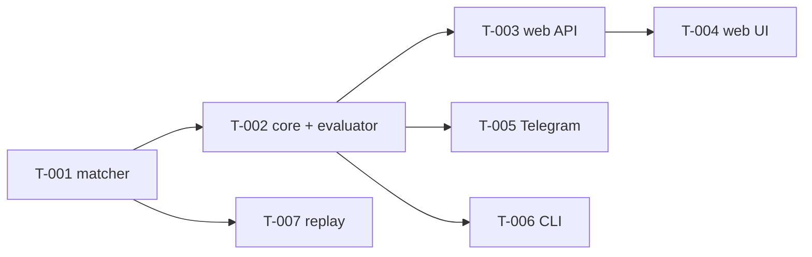

# Tasks: Hardline floor

- **Requirements**: [requirements.md](requirements.md) (revision 1)
- **Contract**: [api-contract.md](api-contract.md) (revision 1)
- **Design**: [design.md](design.md) (revision 1)
- **Status**: Draft

## Execution rules

- Implement only the requirements and acceptance criteria assigned to the task.
- Stop if requirements, design, or contract conflict with each other.
- Mark a task complete only after its verification evidence is recorded.

## Task graph

## Coverage

| Acceptance criterion | Evidence owner | Verification |
|---|---|---|
| AC-HLF-003, 004, 005, 007, 008, 009, 010, 011 | T-001 | `go test ./tools/permission/ -run Hardline` |
| AC-HLF-001, 002, 006, 012, 015, 017, 018, 019 | T-002 | `go test ./tools/permission/ ./core/` |
| AC-HLF-013, 016 | T-003 | `go test ./web/ -run Approval` |
| AC-HLF-013 (UI) | T-004 | `npm test` in `web/ui` + manual check |
| AC-HLF-014 | T-005 | `go test ./channels/telegram/` |
| AC-HLF-015 (CLI) | T-006 | `go test ./channels/cli/... ./cmd/lana/` |
| Rollout | T-007 | `lana-eval hardline-replay` report |

## Tasks

- [x] `T-001` Implement the hardline matcher with table tests
  - Requirements: REQ-HLF-002, 003, 004, 005, 006
  - Scope: new `tools/permission/hardline.go`, `tools/permission/hardline_test.go`; `HardlineMatch` and
    tier constants in `core/approval.go`. No wiring into the evaluator.
  - Verification: `nix develop -c go test ./tools/permission/ ./core/`
  - Evidence: 2026-11-21 — 2 implementer runs (Command Code) plus a one-line orchestrator fix (bare `*`
    target). 93 hardline subtests pass; build, vet, gofmt clean. An extra probe of 53 bypass and
    false-positive cases (quotes, globs, wrappers, `bash -c` variants, inline interpreter code) matches
    expectations. Not committed.

- [x] `T-002` Wire the matcher into the evaluator and approval service
  - Depends on: T-001
  - Requirements: REQ-HLF-001, 006, 008, 009, 010
  - Scope: `core/approval.go` (`ApprovalRequest.Hardline`, `OutcomeAllowedVerified`), `core/event.go`
    (`ApprovalAsked.Hardline`, `permission/hardline`), `lana.go` (`validApprovalOutcome`),
    `tools/permission/evaluator.go`, `tools/permission/approval.go`, and their tests
  - Verification: `nix develop -c go test ./tools/permission/ ./core/ .`
  - Evidence: 2026-11-21, commit ca4de25 — 1 implementer run plus an orchestrator fix: under the never
    policy a hardline match now rejects directly, because a session's own allow rules (AC-PERM-007)
    would otherwise run it. `store/store.go` learned the new event kind. All listed packages pass.

- [x] `T-003` Add step-up to the web approval API
  - Depends on: T-002
  - Requirements: REQ-HLF-007; API-HLF-004..007
  - Scope: `web/approvals.go`, `web/notify.go`, new code route, and tests
  - Verification: `nix develop -c go test ./web/`
  - Evidence: 2026-11-21 — 1 implementer run. `go test ./web/ ./cmd/lana/` pass.
  - Deviation: the macOS banner text is built in `internal/notify/events.go` (`ApprovalAsked`), so the
    "Open Lana to confirm." suffix is follow-up `T-008`. The 409 `step_up_required` answer is in place,
    so the banner cannot allow a Block call.

- [ ] `T-008` Say "Open Lana to confirm." on a Block-tier macOS banner
  - Depends on: T-003
  - Requirements: REQ-HLF-007 (notification row)
  - Scope: `internal/notify/events.go` (`ApprovalAsked` gets the tier) and its callers; the macOS app
    may hide "Allow once" for a Block banner
  - Evidence: Pending

- [x] `T-004` Show the step-up approval card in the web UI
  - Depends on: T-003
  - Requirements: REQ-HLF-007
  - Scope: `web/ui/src/views/approval.tsx` and its types
  - Verification: UI build and tests, and a manual check with a fake Block request
  - Evidence: 2026-11-21, commits a217edc + 73cc694 (dist) — 1 implementer run; typecheck, lint, 751 vitest tests, and build pass. Manual browser check still pending.

- [x] `T-005` Add the typed challenge to Telegram approvals
  - Depends on: T-002
  - Requirements: REQ-HLF-007
  - Scope: `channels/telegram/approve.go`, `channels/telegram/chat.go`, and tests
  - Verification: `nix develop -c go test ./channels/telegram/`
  - Evidence: 2026-11-21, commit 285e2a2 — 1 implementer run; `go test ./channels/telegram/` passes.

- [x] `T-006` Add the typed challenge to the TUI and line answerer
  - Depends on: T-002
  - Requirements: REQ-HLF-007, 008
  - Scope: `channels/cli/tui/model.go`, `cmd/lana/main.go` (`lineAnswerer`), and tests
  - Verification: `nix develop -c go test ./channels/cli/... ./cmd/lana/`
  - Evidence: 2026-11-21, commit d559e62 — 1 implementer run; `go test ./channels/cli/... ./cmd/lana/` pass.

- [x] `T-007` Add `lana-eval hardline-replay` and run it on the owner's DB
  - Depends on: T-001
  - Requirements: Rollout
  - Scope: `cmd/lana-eval`
  - Verification: the report on `~/.lana/lana.db`, reviewed before release
  - Evidence: 2026-11-21, commit 47e8422. Replay of 521 recorded calls: no Block-tier match. 15 HL-E-001 matches were all `curl … | python3 -c` JSON parsing, so HL-E-001 was narrowed to interpreters that read their program from stdin (second implementer run); the replay then reports 0 matches.

## Final verification

- [x] Every acceptance criterion has passing evidence (AC-HLF-013 UI part: automated tests; manual check pending).
- [x] `nix develop -c go build ./...` and `nix develop -c go test ./...` pass.
- [x] The replay report is reviewed and its false positives are fixed.
