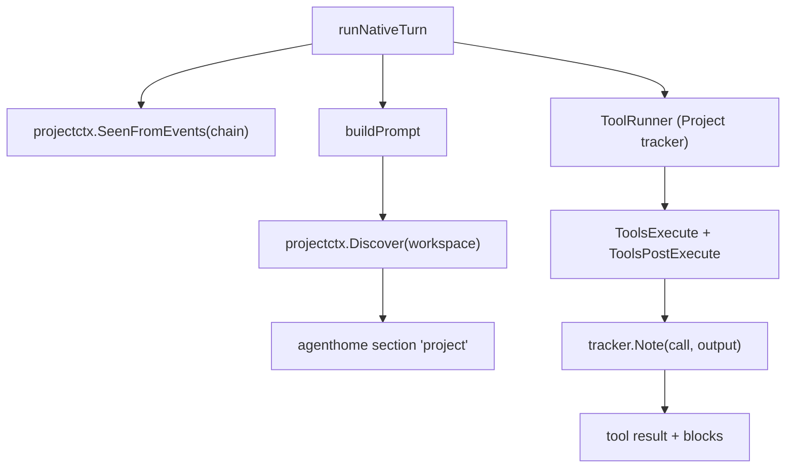

# Design: Project context files

- **Requirements**: [requirements.md](requirements.md) (revision 1, Approved)
- **Contract**: [api-contract.md](api-contract.md) (revision 1)
- **Status**: Draft
- **Design revision**: 1

## Feature-local view



## Repository fit

- A new leaf package, `internal/projectctx`, holds discovery, rendering, caps, and the seen set. It
  imports only the standard library and `internal/pattern` (for `SplitCommand`), so `agent` and
  `internal/agenthome` can both use it.
- `internal/agenthome` gets one new section, built like the others, so REQ-LTC-002 diffs it for free.
- `core.ToolCtx` gets one optional field. The tool layer (`tools/`) is unchanged.

## Proposed design

### 1. Config — `core/config.go`, `config/validate.go`, `config/load.go`

- `AgentConfig.ContextFiles *[]string` with TOML tag `context_files`. A pointer separates absent (nil)
  from empty.
- `func (a AgentConfig) ContextFileNames() []string` returns the default list for nil, and a copy
  otherwise.
- Add `context_files` to `agentKeys`. Validate per API-PCX-001.

### 2. Package `internal/projectctx`

```go
type File struct { Path string; Text string; Truncated bool; Size int }

// Chain returns start and its parents up to, but not including, home (or "/"
// when start is not under home), top-down.
func Chain(start, home string) []string

// Discover returns the context files of the chain of start, top-down, at most
// one per directory (the first name of names that is a regular file).
func Discover(start, home string, names []string) []File

// Render wraps files as <project-context> blocks under the injection cap.
// It applies REQ-PCX-005 and returns "" for no files.
func Render(files []File) string

// Tracker is the per-turn seen set.
type Tracker struct { /* names, home, workspace, seen map[string]bool (cleaned, lowercased paths) */ }
func NewTracker(names []string, home, workspace string, seen []string) *Tracker
func (t *Tracker) MarkSeen(paths ...string)

// Note returns the blocks to append after a successful call, or "".
// Only read_file, write_file, edit_file, glob, grep (field "path", default
// workspace) and bash (leading `cd <dir>` via pattern.SplitCommand) count.
func (t *Tracker) Note(tool string, input json.RawMessage) string

// SeenFromEvents rebuilds the seen set from a session chain: the project
// section of the head system message after the latest compaction/summary,
// and every <project-context path="…"> marker in later tool results.
func SeenFromEvents(events []core.SessionEvent) []string
```

- Path handling: expand `~`, make the path absolute against the workspace, `filepath.Clean`. For a
  path that names a file, start from its directory. A path that does not exist (a `write_file` that
  created a new directory tree) still walks its existing parents.
- Caps: 16 KiB per file (cut on a UTF-8 boundary), 32 KiB per injection. The markers and the
  truncation note follow REQ-PCX-005.
- `Tracker` is safe for concurrent use. Tools run in parallel (`executeParallel`), so it uses a
  mutex and the check-and-mark of one file is atomic. Two parallel calls never both show the same
  file.
- Using `core.SessionEvent` keeps `projectctx` depending on `core`, which is a leaf already used
  everywhere.

### 3. Prompt — `internal/agenthome/prompt.go`, `agent/turn.go`

- `PromptInput.Project string`, the rendered blocks. `SectionProject = "project"` goes after
  `SectionSkills` and before `SectionToolNotes`. Its text is the heading of the contract followed by
  the blocks. It is empty when there are no files.
- `buildPrompt` calls `projectctx.Discover(res.workspace, home, names)` unless the names list is
  empty, renders the files, and returns their paths in `promptBuild` so the tracker can mark them
  seen.

### 4. Tool results — `core/tool.go`, `agent/toolrunner.go`, `agent/turn.go`

`agent.ToolRunner` is shared by every session (`rn.reg.pipeline`), so the per-turn tracker travels on the
per-turn `core.ToolCtx` instead of on the runner.

- `core.ToolCtx.ProjectNote func(tool string, input json.RawMessage) string`. It is nil when the feature is
  off and is not serialized.
- In `executeOne`, after `ToolsPostExecute` and before `spillOutput`: if `post.Status` is success and
  `tc.ProjectNote != nil`, append `"\n\n" + note` to `post.Output` when the note is not empty.
  `read_file` output is never spilled, so the note stays visible. For other tools, the spill preview
  keeps the tail, where the note sits.
- `runNativeTurn` builds the tracker once per turn: names from the agent config, `home` from
  `os.UserHomeDir`, the workspace from `resolved.workspace`, and seen from
  `projectctx.SeenFromEvents(chain)` plus the files of this turn's prompt section. It sets
  `toolCtx.ProjectNote = tracker.Note`. The Claude Code runtime path (`agent/external.go`) leaves it nil.

### 5. Seen set and compaction

`SeenFromEvents` scans the chain backwards to the latest `compaction/summary` event, or to the start,
and collects marker paths only from events after it. The head prompt written after a compaction holds
a fresh `project` section, so its files count as seen. This matches REQ-PCX-004 without a new event
kind.

## Failure behavior

- Discovery errors are logged at debug level and skipped (REQ-PCX-006).
- A home lookup failure disables the chain stop at home. The chain then stops at `/`, which stays
  excluded.

## Test plan

- `internal/projectctx`: chain bounds, first-name-wins, caps and truncation note, `Note` for each tool
  (including a failed path), bash `cd`, concurrency (two goroutines touching the same repository show
  the file once, with `-race`), and `SeenFromEvents` with and without a compaction.
- `internal/agenthome`: the section is placed and its text is pinned.
- `agent`: an end-to-end turn test with a fake provider. A `read_file` into a temp repository gets the
  note; a second call does not; after a compaction event the note comes back (AC-PCX-006, 007, 010).
- `config`: validation (AC-PCX-003).
