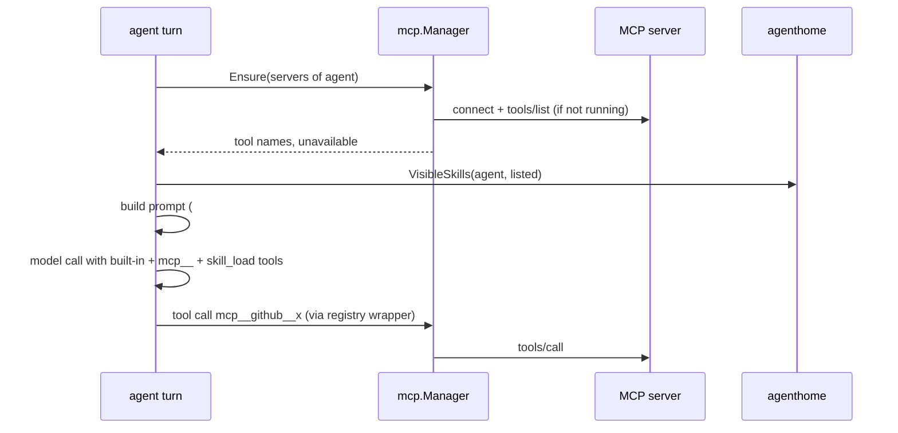

# Design: MCP client and Skills

- **Issue**: —
- **Requirements**: [requirements.md](requirements.md)
- **Contract**: [api-contract.md](api-contract.md) — Required
- **Requirements revision**: 1
- **Contract revision**: 1
- **Requirements status**: Approved
- **Contract status**: Approved
- **Status**: Approved
- **Design revision**: 2 (revision 2: glob matching of tool names in permission patterns; cancelled calls keep the server running)

## Architecture references

- **ADR index**: [docs/adr](../../adr/README.md)
- **Diagram index**: [docs/diagram](../../diagram/README.md)
- **ADR**: [0002](../../adr/0002-core-from-modules-services-and-hooks.md), [0004](../../adr/0004-permission-mode-per-agent.md), [0006](../../adr/0006-extend-via-mcp-client-and-skills.md)
- **Feature-local diagram**: [Turn with MCP and skills](#turn-with-mcp-and-skills)
- **Durable diagram**: — (no change)

## Architecture decision scan

| ADR | Effect on this design |
|---|---|
| 0002 | MCP is a new module providing service `mcp`; the agent module uses it when present |
| 0004 | MCP tools and `skill_write` go through `tools.pre_execute` with their risk |
| 0006 | Implemented as decided; the Go SDK `github.com/modelcontextprotocol/go-sdk` v1.8.0 replaces `rmcp` (ADR 0013). Agent skills in the agent home extend the skill locations (owner decision `Q-005`) |

No new ADR.

## Feature-local view

### Turn with MCP and skills

## Repository fit

- Modules register with `core.RegisterModule` and are listed in `config/profile.go` base TOML; services are looked up through `Builder.Lookup`.
- Tools live in `core.ToolRegistry`; the turn passes `resolved.tools` to `Specs` and the tool runner. MCP tools are registered into the same registry when first listed, so the pipeline needs no change.
- `internal/agenthome` already owns per-agent files and prompt assembly; skills fit there. It may only import `core` and `internal/*`.
- Root-level implementation packages (`store`, `tools`) may import third-party modules; the new `mcp` package is one of them.

## Proposed design

### Components

- **`core`** — `ServiceMCP`; `MCPManager` interface: `Ensure(ctx, servers []string) (tools []string, unavailable map[string]string)` and `Status(servers []string) []MCPServerStatus{Name, State, Tools, Reason}`. `ToolCtx.Skills []string` (the agent's listed global skills).
- **`mcp` package (new)** — `Module` (id `mcp`, requires `tools`, provides `mcp`, `Stop` closes all). `Manager` with one `server` per `[mcp.*]`: state, `*mcp.ClientSession`, tool list, `lastUsed`, in-flight counter, mutex. `Ensure` connects with a 30-second timeout (`CommandTransport` with env and dir, or `StreamableClientTransport` with a header-adding `http.RoundTripper`), lists tools, registers `toolWrapper`s once per name. A reaper goroutine every 30 seconds closes servers idle for 10 minutes with no call in flight. `toolWrapper.Call` looks up the server, increments in-flight, calls `CallTool` with a 120-second timeout, and converts content per `API-MCP-003`.
- **`internal/agenthome/skills.go` (new)** — `ParseSkill(dir)`, `ListSkills(home)` (global and every agent's), `VisibleSkills(home, agent, listed)`, `WriteSkill(home, agent, name, description, body)`. `PromptInput` gains `Skills []Skill` and `UnavailableMCP map[string]string`.
- **`tools/skills.go` (new)** — `skill_load` (read) and `skill_write` (write) using `tc.Home`, `tc.AgentName`, `tc.Skills`.
- **`agent`** — at turn start: call `MCPManager.Ensure` for `cfg.MCP` (if the service exists), compute visible skills, add MCP tool names and `skill_load` (when skills exist) to the turn's tool list, and pass skills and unavailable servers to `agenthome.Build`. The agent module's boot check of `tools` is unchanged; MCP names are not listed there.
- **`lana.go`** — blank import of `mcp`; `Runtime.MCPStatus(agent)` and `Runtime.Skills(agent)` for slash commands.
- **`config/profile.go`** — `mcp` module row in the base profile.
- **CLI** — `cmd/lana/mcp.go` (`lana mcp list|tools`, using `mcp.NewManager` directly) and `cmd/lana/skill.go` (`lana skill list|new|show`); `lana config check` warns about invalid skills.
- **TUI and Telegram** — `/mcp` and `/skills` through new backend methods; command tables updated; Telegram `Commands` gains two entries.
- **Templates** — `skill_write` added.

### Contract mapping

| Contract operation | Implementation |
|---|---|
| `API-MCP-001`, `API-MCP-002`, `API-MCP-003` | `mcp` package, `agent` turn |
| `API-SKL-001` | `internal/agenthome/skills.go` |
| `API-SKL-002` | `agenthome.Build`, `agent` turn |
| `API-SKL-003`, `API-SKL-004` | `tools/skills.go` |
| `API-CLI-001`, `API-CLI-002` | `cmd/lana/mcp.go`, `cmd/lana/skill.go`, `cmd/lana/main.go` |
| `API-CMD-001` | TUI, Telegram, `lana.go` |

### Persistence

None beyond skill files. MCP tool calls and results are normal `tool/call` and `tool/result` events.

### Failure handling

| Failure | Handling |
|---|---|
| Connect or list fails | `unavailable` with reason; turn continues; next turn retries |
| Call fails or session closed | Status `error`; server marked `stopped` so the next turn reconnects |
| Server hangs | 120-second call timeout; turn cancel cancels the call context |
| Invalid skill | Skipped; warning via CLI and config check |

### Concurrency

- `Manager` holds one mutex per server for connect/close; calls run concurrently on the shared `ClientSession`.
- The reaper closes a server only when `inflight == 0` and idle ≥ 10 minutes, under the server mutex.
- `Ensure` from two turns at once connects once (the second waits on the server mutex).

### Security

- Paths for skills derive from `tc.Home` and `tc.AgentName`; names are validated with the contract regex.
- MCP output is returned as tool output only.
- Secrets in `env` and `headers` are already interpolated `core.Secret` values; they are revealed only when building the process env or request headers and never logged.

### Observability

- `info`: server connected (name, tool count, duration), server stopped (idle), server unavailable (reason).
- `debug`: each MCP call (server, tool, duration, status), server stderr lines.

## Requirement traceability

| Requirement | Component |
|---|---|
| `REQ-MCP-001` through `REQ-MCP-006` | `mcp` package, `agent` turn, config validation |
| `REQ-SKL-001` through `REQ-SKL-003` | `internal/agenthome/skills.go`, `agenthome.Build` |
| `REQ-SKL-004`, `REQ-SKL-005` | `tools/skills.go` |
| `REQ-CLI-001`, `REQ-CLI-002` | `cmd/lana` |
| `REQ-CMD-001` | TUI, Telegram, `lana.go` |

## Acceptance verification map

| Acceptance criteria | Verification |
|---|---|
| `AC-MCP-001` through `AC-MCP-012` | `mcp` package tests with an in-process MCP server (SDK `NewInMemoryTransports`) and a stdio test server built from a Go test helper (`os.Args` re-exec); `agent` turn test with a fake `MCPManager`; config test for `AC-MCP-003` |
| `AC-SKL-001` through `AC-SKL-007` | `internal/agenthome` and `tools` tests; permission test for `skill_write` under `never` |
| `AC-CLI-001` through `AC-CLI-003` | `cmd/lana` tests with the re-exec stdio server |
| `AC-CMD-001` | TUI program test and Telegram command test with fakes |

## Verification strategy

- Unit and integration tests above; `go test -race` for `mcp`.
- Manual smoke test: a real MCP server through `npx` or a Go binary (for example `@modelcontextprotocol/server-filesystem` or `github-mcp-server`) with the dev Telegram bot.

## Risks and tradeoffs

- Listing tools at turn start adds latency on the first turn after a stop (process start). Accepted; idle stop keeps RAM low.
- Large MCP servers expose many tools and grow the prompt; owners limit them with `deny` rules or by not listing the server.
- `readOnlyHint` comes from the server and could be wrong; owners can add `deny` rules.

## Blocking Design Questions

None.
