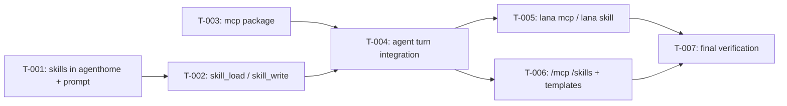

# Tasks: MCP client and Skills

- **Issue**: —
- **Requirements**: [requirements.md](requirements.md)
- **Contract**: [api-contract.md](api-contract.md) — Required
- **Design**: [design.md](design.md)
- **Requirements revision**: 1
- **Contract revision**: 1
- **Design revision**: 1
- **Status**: In Progress

## Execution rules

- Work in task order unless the graph allows parallel work.
- Each task keeps `go test ./...` green.
- Required verification is never optional.
- Mark a task complete only after verification evidence has been recorded.

## Coverage

| Acceptance criterion | Contract operation | Evidence owner | Issue/PR | Verification | Evidence |
|---|---|---|---|---|---|
| `AC-SKL-001`, `AC-SKL-002` | `API-SKL-001` | `T-001` | — | `internal/agenthome` tests | Pass |
| `AC-SKL-003` | `API-SKL-002` | `T-001` | — | `agenthome.Build` test | Pass |
| `AC-SKL-004` through `AC-SKL-007` | `API-SKL-003`, `API-SKL-004` | `T-002` | — | `tools` and permission tests | Pass |
| `AC-MCP-004`, `AC-MCP-005`, `AC-MCP-007`, `AC-MCP-008`, `AC-MCP-010` through `AC-MCP-012` | `API-MCP-001` through `API-MCP-003` | `T-003` | — | `mcp` package tests | Pass |
| `AC-MCP-001` through `AC-MCP-003`, `AC-MCP-006`, `AC-MCP-009` | `API-MCP-001` through `API-MCP-003` | `T-004` | — | `agent` turn and config tests | Pass |
| `AC-CLI-001` through `AC-CLI-003` | `API-CLI-001`, `API-CLI-002` | `T-005` | — | `cmd/lana` tests | Pass |
| `AC-CMD-001` | `API-CMD-001` | `T-006` | — | TUI and Telegram tests | Pass |

## Task graph

## Tasks

- [x] `T-001` Add skills to `internal/agenthome` and the `# Skills` prompt section
  - Issue/PR: `—`
  - Depends on: `None`
  - Requirements: `REQ-SKL-001` through `REQ-SKL-003`
  - Acceptance criteria: `AC-SKL-001` through `AC-SKL-003`
  - Contract operations: `API-SKL-001`, `API-SKL-002`
  - Scope:
    - `ParseSkill`, `ListSkills`, `VisibleSkills`, `WriteSkill`; `PromptInput.Skills`, `PromptInput.UnavailableMCP`.
  - Verification:
    - `go test ./internal/agenthome/`
  - Completion evidence:
    - Status: Completed
    - Command/test: `go test ./internal/agenthome/` (skills_test.go: ParseSkill, ReadSkills, VisibleSkills with shadowing, WriteSkill, Build with skills and unavailable MCP)
    - Result: pass
    - PR/commit: —
    - Deviation: Implemented by dsh

- [x] `T-002` Implement `skill_load` and `skill_write`
  - Issue/PR: `—`
  - Depends on: `T-001`
  - Requirements: `REQ-SKL-004`, `REQ-SKL-005`
  - Acceptance criteria: `AC-SKL-004` through `AC-SKL-007`
  - Contract operations: `API-SKL-003`, `API-SKL-004`
  - Scope:
    - `tools/skills.go`, registration, `core.ToolCtx.Skills`.
  - Verification:
    - `go test ./tools/...`
  - Completion evidence:
    - Status: Completed
    - Command/test: `go test ./tools/...` (TestSkillTools, TestSkillUnavailableWithoutHome, TestSkillWriteNeverPolicy)
    - Result: pass
    - PR/commit: —
    - Deviation: Implemented by dsh

- [x] `T-003` Implement the `mcp` package (manager, transports, lifecycle, tool wrapper, module)
  - Issue/PR: `—`
  - Depends on: `None`
  - Requirements: `REQ-MCP-002` through `REQ-MCP-006`
  - Acceptance criteria: `AC-MCP-004`, `AC-MCP-005`, `AC-MCP-007`, `AC-MCP-008`, `AC-MCP-010` through `AC-MCP-012`
  - Contract operations: `API-MCP-001` through `API-MCP-003`
  - Scope:
    - `core.ServiceMCP`, `core.MCPManager`; stdio and HTTP transports; idle reaper with injectable clock; content conversion; base profile row.
  - Verification:
    - `go test -race ./mcp/` with in-memory and stdio test servers.
  - Completion evidence:
    - Status: Completed
    - Command/test: `go test -race ./mcp/` (in-memory and stdio servers: Ensure, risk, results, timeout, unavailable, idle reap, concurrent connect, env and cwd)
    - Result: pass
    - PR/commit: —
    - Deviation: Implemented by dsh; `go.mod` go directive 1.24 → 1.25 required by go-sdk v1.8.0

- [x] `T-004` Integrate MCP tools and skills into the agent turn
  - Issue/PR: `—`
  - Depends on: `T-002`, `T-003`
  - Requirements: `REQ-MCP-001`, `REQ-MCP-003`, `REQ-MCP-004`, `REQ-SKL-003`
  - Acceptance criteria: `AC-MCP-001` through `AC-MCP-003`, `AC-MCP-006`, `AC-MCP-009`
  - Contract operations: `API-MCP-001` through `API-MCP-003`, `API-SKL-002`
  - Scope:
    - `Ensure` at turn start, tool list, `skill_load` auto-add, prompt inputs; `Runtime.MCPStatus`, `Runtime.Skills`.
  - Verification:
    - `go test ./agent/ ./config/ .`
  - Completion evidence:
    - Status: Completed
    - Command/test: `go test ./agent/ ./config/ ./tools/permission/ .` (agent/mcp_test.go, TestMCPStatus/Skills, mcp__github__* allow rule, unknown mcp server validation); `go test -race ./agent/ ./mcp/`
    - Result: pass
    - PR/commit: —
    - Deviation: `internal/pattern` now matches globs in the tool part of a pattern so `mcp__github__*` works (the contract promised it; matching was literal before). A cancelled turn no longer marks an MCP server stopped (review finding on T-003)

- [x] `T-005` Implement `lana mcp` and `lana skill`, and skill warnings in `lana config check`
  - Issue/PR: `—`
  - Depends on: `T-004`
  - Requirements: `REQ-CLI-001`, `REQ-CLI-002`
  - Acceptance criteria: `AC-CLI-001` through `AC-CLI-003`
  - Contract operations: `API-CLI-001`, `API-CLI-002`
  - Scope:
    - `cmd/lana/mcp.go`, `cmd/lana/skill.go`, help text.
  - Verification:
    - `go test ./cmd/lana/`
  - Completion evidence:
    - Status: Completed
    - Command/test: `go test ./cmd/lana/` (mcp list, mcp tools against a re-exec stdio server, command not found, unknown server, skill new/list/show, config check warning); manual run of `lana skill new|list`, `lana mcp list|tools x`
    - Result: pass
    - PR/commit: —
    - Deviation: Implemented by dsh

- [x] `T-006` Add `/mcp` and `/skills` to the TUI and Telegram, and `skill_write` to the templates
  - Issue/PR: `—`
  - Depends on: `T-004`
  - Requirements: `REQ-CMD-001`
  - Acceptance criteria: `AC-CMD-001`
  - Contract operations: `API-CMD-001`
  - Scope:
    - Backend methods, command tables, Telegram `Commands`, templates.
  - Verification:
    - `go test ./channels/... ./internal/agenthome/`
  - Completion evidence:
    - Status: Completed
    - Command/test: `go test ./channels/... ./cmd/... ./internal/...`, `go test -race ./channels/telegram/` (TUI /mcp and /skills, Telegram 9 commands and replies)
    - Result: pass
    - PR/commit: —
    - Deviation: Spec #6 contract API-TG-005 updated with /mcp and /skills

- [ ] `T-007` Run final verification and a manual smoke test with a real MCP server
  - Issue/PR: `—`
  - Depends on: `T-005`, `T-006`
  - Requirements: all
  - Acceptance criteria: all
  - Contract operations: all
  - Scope:
    - Full suite, race, lint, release build; manual test through Telegram with a real MCP server and a skill.
  - Verification:
    - `nix develop -c go test -count=1 ./...`
  - Completion evidence:
    - Status: Pending
    - Command/test: —
    - Result: —
    - PR/commit: —
    - Deviation: None

## Final verification

- [ ] Every acceptance criterion has passing evidence.
- [ ] No observable behavior exists without a requirement ID.
- [ ] No behavior is outside scope.
- [ ] ADRs and diagrams match the implementation.
- [ ] `gofmt -l .` is empty, `golangci-lint run ./...`, `go test -race ./...`, and the release build pass.
- [ ] Deviations are resolved in requirements or design, not only recorded here.

## Approval

- [x] Requirements and design are Approved and their revisions are recorded.
- [x] Contract is Approved.
- [x] Every acceptance criterion has exactly one evidence owner.
- [x] Every task has a limited scope, dependencies, and verification.
- [x] No task introduces new behavior.
- **Approved by**: Ridho ("oke accept implement", 2026-10-30)
- **Approved on**: 2026-10-30
