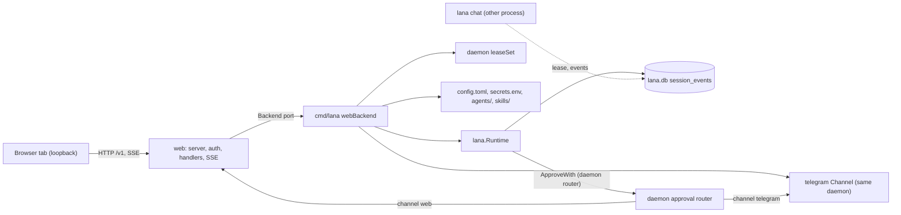
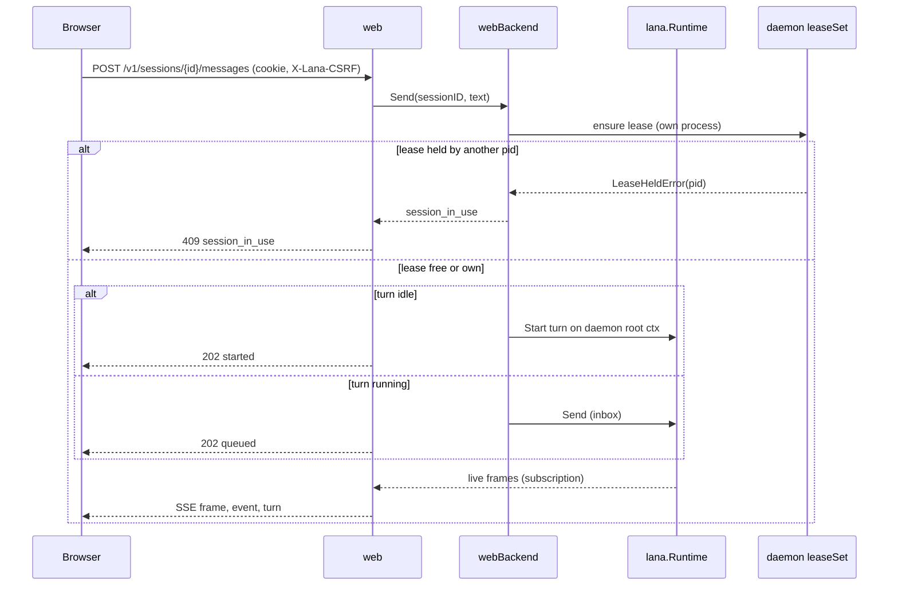
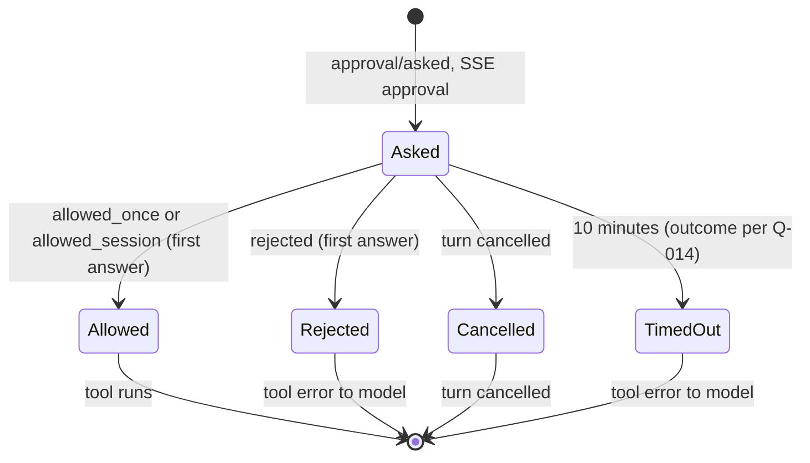
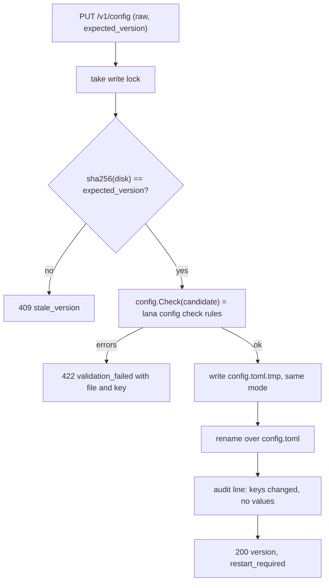

# Design: Web view: settings and chat sessions

- **Issue**: `—`
- **Requirements**: [requirements.md](requirements.md)
- **Contract**: [api-contract.md](api-contract.md) — Required
- **Requirements revision**: 2
- **Contract revision**: 2
- **Requirements status**: Approved
- **Contract status**: Approved
- **Status**: Approved
- **Design revision**: 2 (2026-10-30, owner brief: align with the dashboard mockup; see "Rev 2" sections)

Every open question was answered on 2026-10-30 (the owner accepted every agent recommendation). Rev 2 questions `Q-016` to `Q-028` are answered with the agent recommendation (owner lifted the gate, 2026-10-30).

## Architecture references

- **ADR index**: [docs/adr](../../adr/README.md)
- **Diagram index**: [docs/diagram](../../diagram/README.md)
- **Specs**: [#5 rev 4](../5-agent-home/design.md) (shared `USER.md`), [#6 rev 3](../6-daemon-telegram/design.md) (waiting chats, `enabled`, `getMe`), [#10](../10-agent-teams/design.md) and [#11](../11-ask-user-question/design.md) (linked, not defined here)
- **ADR**: [0004](../../adr/0004-permission-mode-per-agent.md), [0008](../../adr/0008-cli-channel-http-and-web-dashboard-interfaces.md), [0009](../../adr/0009-session-as-append-only-event-log.md), [0010](../../adr/0010-profile-and-config-patch.md), [0014](../../adr/0014-integration-as-agentic-tool.md), [0015](../../adr/0015-embeddable-runtime-for-services.md). [0016](../../adr/0016-owner-auth-for-browser.md) owner auth for the browser
- **Feature-local diagram**: [Components](#components), [Send a message](#send-a-message), [Approval](#approval), [Save config](#save-config)
- **Durable diagram**: [0001. System Context and Roadmap](../../diagram/0001-system-context-and-roadmap.md) — the web view is the `Doors` entry point with REST and SSE; no change to the diagram in this spec

## UI reference

The dashboard follows the mockup in `design/`. The mockup is the source for layout, screen list, and UI copy. This
spec is the source for behavior. A difference is listed under "Known differences" below.

| What | Where | Use |
|---|---|---|
| Design source (editable) | `design/lana-design-system.figcraft` (FigCraft document) | Open in the FigCraft app to change a screen. Not read by the build |
| Screen renders | `design/export/screens/<slug>.png` | Visual check for each screen |
| Layout notes | `design/export/screens/<slug>.layout.txt` | Frame tree per screen: direction (`row`/`col`), gap, padding, size (`f` fixed, `h` hug, `f` fill), and token colors |
| Components | `design/export/components/components.layout.txt` | Button, input, badge, row, and dialog variants with their props |
| Design tokens | `design/export/tokens.css` | Colors, type, spacing, radius, and the Light and Dark themes |
| Icons | `design/export/icons/*.svg` (27 files) | Sidebar, nav, chevrons, lock, plus, search, and others |

The UI slices (`T-024` onward in `tasks.md`) copy the assets before they change the pages:

- Copy `design/export/icons/*.svg` to `web/assets/icons/`.
- Copy `design/export/tokens.css` to `web/assets/tokens.css`.

The pages load `tokens.css` first. The theme switch sets a `data-theme` attribute (`light`, `dark`, or absent for System) on the root element. The tokens file defines the values for each. The icon files are loaded as URLs or inlined by the page code; they are not changed by hand.

The layout notes name tokens such as `--bg-primary`, `--text-primary`, `--border-secondary`. Use the token names as they appear in `tokens.css`. Do not copy hex values into the pages.

### Screen inventory

Each row is one route, the screen file that shows it, and the API operations the page calls. "No screen" means the mockup has no file for that view; the page follows the nearest screen and this spec.

| Route | Screen file(s) in `design/export/screens/` | API operations |
|---|---|---|
| `#/setup/unlock` | `01-unlock-dashboard` | `POST /v1/auth/login` (`API-WEB-002`), `GET /v1/auth/session` |
| `#/setup/provider` | `02-choose-provider` | `GET /v1/setup` (`API-WEB-018`) |
| `#/setup/connect` | `03-connect-model`, `03b-connect-model-error` | `POST /v1/providers/test` (`API-WEB-019`) |
| `#/setup/agent` | `04-set-up-agent` | none until the save |
| `#/setup/persona` | `04b-persona-and-profile` | `POST /v1/setup` (`API-WEB-021`) |
| `#/setup/ready` | `05-ready` | `GET /v1/daemon` (`API-WEB-022`), `GET /v1/setup` (`API-WEB-018`) |
| `#/home` | `dashboard-home` | none (empty state) |
| `#/sessions` | No screen for the list alone. Use `sessions-chat` for the list pane; the chat pane shows "Pick a session" | `GET /v1/sessions` (`API-WEB-003`) |
| `#/sessions` filter popover | `sessions-filter` | `GET /v1/sessions` with `q`, `status`, `agent`, `channel` |
| `#/sessions` sidebar collapsed | `sessions-chat-sidebar-collapsed` | as above |
| `#/sessions/new` | `sessions-new-session`, `sessions-new-session-agent-picker` | `GET /v1/agents` (`API-WEB-012`), `POST /v1/sessions` (`API-WEB-005`), `POST /v1/sessions/{id}/messages` (`API-WEB-007`) |
| `#/sessions/{id}` | `sessions-chat` | `GET /v1/sessions/{id}` and `/events` (`API-WEB-004`), `GET /v1/sessions/{id}/stream` (`API-WEB-008`), `POST /messages` (`API-WEB-007`), `POST /cancel` (`API-WEB-009`), `POST /compact` and `/fork` (`API-WEB-010`), `PATCH` (`API-WEB-006`) |
| Approval card in `#/sessions/{id}` | No separate screen. The card follows `REQ-WEB-039` | `POST /v1/approvals/{request_id}` (`API-WEB-011`) |
| `#/agents` | `agents-list` | `GET /v1/agents` (`API-WEB-012`), `POST /v1/agents` (`API-WEB-025`) |
| `#/agents/{name}/general` | `agents-detail-general` | `GET /v1/agents`, `GET /v1/providers` (`API-WEB-020`), `PUT /v1/agents/{name}` (`API-WEB-025`) |
| `#/agents/{name}/persona` | `agents-detail-persona` | `GET` and `PUT /v1/agents/{name}/files/{file}` (`API-WEB-016`) |
| `#/agents/{name}/tools` | `agents-detail-tools` | `GET /v1/tools?agent=` (`API-WEB-026`), `PUT /v1/agents/{name}` (`disabled_tools`) |
| `#/agents/{name}/skills` | `agents-detail-skills`, `agents-detail-skills-add` (dialog) | `GET /v1/skills` (`API-WEB-017`), `PUT /v1/agents/{name}` (`skills`) |
| `#/agents/{name}/mcp` | `agents-detail-mcp` | `GET /v1/mcp` (`API-WEB-027`), `PUT /v1/agents/{name}` (`mcp`) |
| `#/agents/{name}/rules` | No screen. Tab in the same tab bar as `agents-detail-general` | `PUT /v1/agents/{name}` (`rules`) |
| `#/agents/{name}/workspace` | No screen. Tab in the same tab bar | `PUT /v1/agents/{name}` (`workspace`) |
| `#/skills` | `skills-list` | `GET /v1/skills` (`API-WEB-017`), `DELETE /v1/skills/{scope}/{name}` |
| `#/skills/{scope}/{name}` | `skills-editor` | `GET` and `PUT /v1/skills/{scope}/{name}` (`API-WEB-017`), `GET /v1/agents` |
| `#/skills/new` | `skills-editor` (empty form) | `PUT /v1/skills/{scope}/{name}` (`API-WEB-017`) |
| Add agent dialog (skill editor) | `skills-editor-add-agents` | `PUT /v1/agents/{name}` (`skills`) |
| `#/mcp` | `mcp-list`, and `mcp-add-server` (dialog) | `GET /v1/mcp` (`API-WEB-027`), `PUT /v1/mcp/{name}`, `POST /v1/mcp/test` |
| `#/mcp/{name}` | `mcp-detail` | `GET /v1/mcp`, `PUT` and `DELETE /v1/mcp/{name}`, `POST /v1/mcp/{name}/restart` |
| `#/channels` | `channels-list` | `GET /v1/channels` (`API-WEB-028`) |
| `#/channels/telegram` | `channels-telegram` | `GET /v1/channels`, `PUT /v1/channels/telegram`, `POST /v1/channels/telegram/check`, `PUT` and `DELETE /v1/channels/telegram/routes/{chat_id}`, `GET /v1/agents` |
| "+ Add chat" dialog | `channels-telegram-add-chat` | `GET /v1/channels/telegram/waiting`, `PUT /v1/channels/telegram/routes/{chat_id}` |
| `#/settings/general` | `settings-general` | `GET /v1/daemon` (`API-WEB-022`), `PUT /v1/web` (`API-WEB-029`), `POST /v1/daemon/restart` (`API-WEB-023`), `GET` and `POST /v1/auth/sessions` (`API-WEB-024`) |
| `#/settings/providers` | `settings-providers` | `GET /v1/providers`, `PUT` and `DELETE /v1/providers/{name}` (`API-WEB-020`), `POST /v1/providers/test` (`API-WEB-019`) |
| `#/settings/secrets` | `settings-secrets` | `GET /v1/secrets`, `PUT` and `DELETE /v1/secrets/{NAME}` (`API-WEB-015`) |
| `#/settings/config` | `settings-config-file` | `GET /v1/config`, `PUT /v1/config` (`API-WEB-013`, `API-WEB-014`), `POST /v1/daemon/restart` |
| `#/settings/audit` | No screen | `GET /v1/audit` (`API-WEB-030`) |
| Team rows, team picker entries, team message blocks | `agents-list` (team rows), `sessions-team-chat`, `team-message-states` | Owned by spec #10. Not built in this spec |
| Question card, multi-select | `sessions-question`, `sessions-question-multi-select` | Owned by spec #11. Not built in this spec |

### Known differences between the mockup and this spec

| # | Mockup | This spec | Why |
|---|---|---|---|
| 1 | Agents › General: "Changes apply to new turns…" | "Config changes apply after a daemon restart. Agent file changes apply at the next turn." | Config is loaded at start (`Q-008`). The brief asks for the honest wording |
| 2 | `05-ready` memory hint: "You can review and edit it in Settings › Agents." | "…in Agents." | `Agents` is a top-level item, not a settings tab |
| 3 | No screen for Settings › Audit log | Page per `REQ-WEB-056`, same list style as Sessions | Brief decision 13 |
| 4 | No screen for the Rules and Workspace tabs | Same tab bar and a simple form | Brief decision 8 names the tabs |
| 5 | MCP status "Needs sign-in" | Shown as a label; not produced in v1 | No client state reports an authentication failure (G-22) |
| 6 | Sessions channel facet: Web, CLI, Telegram | Same. Library sessions have no chip | `Q-023` |
| 7 | Telegram card "Connected" with "N chats" | A Telegram config needs at least one route (G-21). Zero chats shows "Token found, add a chat" | Existing config rule (`channels/telegram/config.go`) |
| 8 | ADR 0008 lists cron and approvals pages (see ADR) | Not in the mockup; not built | Owner brief IA. Cron is spec #8 (not written) |
| 9 | Sidebar 280 px with 40 px nav items; session list 360 px with three-line rows and pill badges | Sidebar 240 px with 32 px nav items and 20 px icons; session list 280 px with 72 px rows (meta line "agent · channel", title, one-line preview) | Owner testing feedback, 2026-10-30 (`REQ-WEB-030`) |
| 10 | Type scale: nav 16 px, body 14–16 px, page titles up to 30 px | Compact scale: body and nav 14 px, labels and tables 13 px, meta 12 px, page titles 20 px; paddings about 15–20% smaller | Owner testing feedback, 2026-10-30: the mockup scale felt too large on a laptop screen |
| 11 | Composer with a fixed tall text area | Text area starts at 2 lines and grows to 8; chat column 760 px | Owner testing feedback, 2026-10-30 |
| 12 | Assistant text shown as plain text | Markdown rendered (`REQ-WEB-057`) | Owner testing feedback, 2026-10-30 |


## Architecture decision scan

| Topic | Existing authority | Decision location | Action |
|---|---|---|---|
| Public interface | ADR 0008 (web pages, port), ADR 0014 (`/v1` REST and SSE, `[[api.tokens]]`) | requirements and contract | reuse the paths; new ADR 0016 for auth (`Q-002`, `Q-003`) |
| Persistence | ADR 0009 (event log), ADR 0005 (one SQLite) | design (no new table) | reuse; config and secrets stay as files |
| State and lifecycle | ADR 0004 (approval outcomes), ADR 0009 (turn boundary for fork) | requirements state matrix | reuse |
| Concurrency | Spec #1 `REQ-SESS-002` (lease), spec #6 (one lease set per daemon) | design | reuse the daemon's lease set; add one write lock for files |
| Dependency direction | ADR 0015 (library packages do not import `web/`), diagram 0001 (`Web --> Core`) | design | new `web` package imports `core` and `internal/*` only; the daemon adapter lives in `cmd/lana` (port pattern as in `channels/telegram`) |
| Frontend | ADR 0008 (Preact + `htm`, no build step, `embed`) | `Q-004` | reuse ADR 0008 unless the owner changes it |

## Visual Architecture Check

| Trigger | Present? | Required view |
|---|---:|---|
| Module or crate boundary | Yes | boundary (`web` package and its port) |
| Interaction with an actor or external system | Yes | sequence (browser, daemon, runtime) |
| Multi-component flow | Yes | sequence (send message with streaming) |
| Lifecycle or state transition | Yes | approval state in `Approval` diagram |
| Entity relation | No | Not required — no new entity; `session_events` and `sessions` are unchanged |
| Concurrency, retry, or failure flow | Yes | flowchart (save config with version check) |
| Dependency direction or runtime topology | Yes | components flowchart |

## Feature-local view

### Components



- `web` never imports `lana` directly. It sees the runtime through its `Backend` port (see Proposed design), the same way
  `channels/telegram` does (spec #6 `Repository fit`).
- The daemon adapter `webBackend` in `cmd/lana/web.go` implements the port on top of `lana.Runtime`, `leaseSet`, and file helpers.

### Send a message



### Approval



### Save config



## Repository fit

- The `web` package follows the `channels/telegram` port pattern: a `Backend` interface in `web` and an adapter in
  `cmd/lana`. Library packages stay free of `web/` (ADR 0015 and `internal/archtest/arch_test.go`).
- The daemon already owns the runtime, the lease set, the approval closure, and the root context (`cmd/lana/daemon.go`).
  The web view joins those objects; it does not create a second runtime.
- Message text, tool lines, and approval labels reuse `internal/toolfmt.PrimaryArg` (spec #6 `T-001`).
- Config validation reuses `config` rules. A new function `config.Check(ctx, home, candidate)` runs the same
  validators as `Load` on the candidate text (additive; no behavior change for `lana config check`).
- Agent files and skills reuse `internal/agenthome` (`Paths`, `ReadEntries`, `Apply`, `Update`, `WriteFile`,
  `ParseSkill`, `VisibleSkills`, `WriteSkill`).
- The web assets live in `web/assets/` and are embedded with `embed.FS` (ADR 0008). Vendored Preact and `htm` files
  are pinned by version in a comment at the top of each vendored file, if `Q-004` accepts ADR 0008. No Node.js is needed.

## Gaps in the current code

These are facts found while reading the code for this draft. Each one shapes a component below or a question.

| # | Gap | Where | Effect on this spec |
|---|---|---|---|
| G-1 | The daemon exits with code 2 when no `[channels.telegram]` exists | `cmd/lana/daemon.go` (`no channel configured`) | `REQ-WEB-004` needs a revision of spec #6 (`Q-005`) |
| G-2 | Approvals have one responder (`ApproveWith`). The daemon passes `ApproveChannels("telegram")`. Each call replaces the whole channel set | `lana.go` (`ApproveWith`, `ApproveChannels`) | The daemon routes by session channel: `telegram` to the Telegram channel, `web` to the web broker. Pass `ApproveChannels("telegram", "web")`. No core change |
| G-3 | `TryLease` refuses a session the same PID already holds (`heldPID == pid`) | `store/store.go` `TryLease` | The web view must use the daemon's `leaseSet`, which caches held leases, not call `LeaseSession` directly |
| G-4 | Runtime config is read once at start (`rt.result.Config`) | `lana.go` `New`, `AgentModel`, `AgentNames` | No hot reload. `REQ-WEB-023`, `Q-008` |
| G-5 | Live frames are published by the in-process registry hub only | `agent/registry.go` `SubscribeLive` | Cross-process sessions use polling (`REQ-WEB-012`, `Q-007`) |
| G-6 | `Runtime.ListSessions` is limited to `cli` and the current directory; `store.List` supports an empty channel but is not exposed | `lana.go` `ListSessions`, `store/store.go` `List` | New facade method `ListAllSessions(ctx, filter)` (additive) |
| G-7 | No facade method says whether a turn runs in this process | `lana.go` | New facade method `TurnActive(sessionID) bool` (additive); it reads the registry runners |
| G-8 | `Runtime.Run` cancels the turn when its `ctx` ends | `lana.go` `Run` | The web handler must start turns on the daemon root context, never on the request context (`REQ-WEB-011`, `AC-WEB-032`) |
| G-9 | Secrets are read once at start (`runtimeFor`, `secrets.env`) and the mock provider is used when a key is missing | `cmd/lana/main.go` `runtimeFor` | Secret changes take effect at restart (`REQ-WEB-024`) |
| G-10 | No config writer. `lana config edit` only opens `$EDITOR`. `secrets.env` is written inline by `lana init` | `cmd/lana/main.go` (`cmdConfig edit`, `cmdInit`) | New atomic writer and secrets line editor in `web` (or `internal/`) |
| G-11 | Approval timeout outcome differs: ADR 0004 says `unavailable`; the Telegram channel uses `rejected` | `channels/telegram/approve.go` | `Q-014` |
| G-12 | ADR 0008 says `lana init` creates a dashboard token; `lana init` creates no token today | `cmd/lana/main.go` `cmdInit` | `Q-002`, new ADR 0016 |
| G-13 | ADR 0014 uses `[[api.tokens]]` bearer tokens; ADR 0008 uses a login token with a hash. The two auth models conflict | ADRs 0008, 0014 | `Q-003`, ADR 0016 |
| G-14 | `init` writes `config.toml` with mode `0644`, but MCP `env` and `headers` may hold literal values | `cmd/lana/main.go` (`initConfig`), `core/config.go` | Masking in `API-WEB-013`; the owner may move values to `secrets.env` (`Q-009`) |
| G-15 | The secrets parser strips one pair of quotes and has no escape syntax | `config/secrets.go` | Writer rejects newlines and quotes inside values; quotes values with spaces or `#` (`API-WEB-015`) |
| G-16 | `web/assets/` already holds rev 1 code (`app.js`, `api.js`, `format.js`, `ui.js`, `views/login.js`, `sessions.js`, `session.js`, `settings.js`). It is not committed (`git status` shows `web/` as untracked) | `web/assets/` | Rev 2 pages replace the rev 1 views. The UI slices rewrite them in place; no data migration |
| G-17 | No setup status endpoint and no wizard. `lana init` writes `config.toml` and `secrets.env` once; the browser has no first-run path | `cmd/lana/main.go` (`cmdInit`), `cmd/lana/setup.go` (logging helper, not onboarding) | New `API-WEB-018` and `API-WEB-021` (`REQ-WEB-032`, `REQ-WEB-034`). The name `setup` in `cmd/lana/setup.go` is a logging helper and does not clash with `/v1/setup` |
| G-18 | The daemon takes `flock` on `$LANA_HOME/daemon.lock` (`lockDaemon`). Go opens files with close-on-exec, so an `exec` drops the lock | `cmd/lana/daemon.go` (`lockDaemon`) | Restart in place keeps that one descriptor open across `exec` (`design.md`, Restart in place; `Q-019`) |
| G-19 | Browser sessions are an in-memory map in `web/auth.go`; they are lost on stop | `web/auth.go` | `web-sessions.json` (`REQ-WEB-036`, `Q-020`) |
| G-20 | `[channels.telegram]` has no `enabled` key. `channels/telegram/config.go` rejects unknown keys | `channels/telegram/config.go` | New key, default `true` (spec #6 rev 3) |
| G-21 | `ParseConfig` requires at least one `[[routes]]` entry with channel `telegram`, else it fails (`no [[routes]] entry for channel "telegram"`) | `channels/telegram/config.go` | A Telegram table cannot be valid with zero chats. The Channels page shows "add a chat" (mockup difference 7). Owner to confirm (report) |
| G-22 | MCP: the client states are `running`, `stopped`, `unavailable` (`core/mcp.go`). No per-server restart. No "needs sign-in" state | `core/mcp.go`, `mcp.go` (root) | Restart is a new additive method. "Needs sign-in" is reserved, not produced in v1 |
| G-23 | `agentKeys` in `config/validate.go` does not list `description` or `disabled_tools`. Such keys are a validation error today | `config/validate.go` | New keys (`REQ-WEB-046`); the list grows |
| G-24 | `secrets.env` has no timestamps | `config/secrets.go`, `internal/webfiles/secrets.go` | `secrets.meta.json` (`Q-022`) |
| G-25 | Store session status is `idle` or `running` only (`store/store.go`). Approval, question, and failure states are not stored as status | `store/store.go`, `core/session.go` | Status and preview are derived when the list is read (`API-WEB-003`) |
| G-26 | Settings audit lines go to the daemon stderr only | `web/` save paths | `logs/audit.jsonl` (`Q-021`) |
| G-27 | `USER.md` is read per agent: `agenthome.Paths.User` is `<agent dir>/USER.md` | `internal/agenthome/agenthome.go` | Shared file at `$LANA_HOME/USER.md` (spec #5 rev 4). `agenthome.SharedUser` is the helper |
| G-28 | Telegram `getMe` exists (`Client.GetMe`, called at start) | `channels/telegram/api.go` | The check endpoint reuses it; no new Telegram API call |
| G-29 | No tool catalog lists groups, risk, or "asks first" for an agent | `tools/`, `agent/registry.go` | New read method (additive) for `API-WEB-026` |
| G-30 | Provider config keys: `kind`, `base_url`, `api_key_env`, `headers`, `timeout` (`core/config.go`). The form uses the first four | `core/config.go` | `API-WEB-020` fields; `timeout` stays raw |

## Proposed design

### Components

- **`web` (new package)** — the HTTP server, auth, origin and host checks, handlers, SSE, and the dashboard assets.
  - `web/server.go`: `Server` with `Config{Addr, Enabled}`, `Start(ctx) error`, `Shutdown(ctx)`. Validates the loopback address (`REQ-WEB-003`). Sets security headers on every response.
  - `web/auth.go`: owner token file `web.json` (create, hash, compare in constant time); browser session map with 12-hour idle expiry; CSRF value per browser session; middleware for cookie, `Host`, `Origin`, and `X-Lana-CSRF`.
  - `web/sessions.go`: handlers for `API-WEB-003` to `API-WEB-006`, `API-WEB-010`, and `API-WEB-012`.
  - `web/turns.go`: `POST messages` and `POST cancel` (`API-WEB-007`, `API-WEB-009`). Calls the `Backend`.
  - `web/sse.go`: `GET stream` (`API-WEB-008`). Merges the live subscription with the log poller. Heartbeat every 15 seconds. Emits `shutdown` on server stop.
  - `web/approvals.go`: the approval broker. One entry per open request with a reply channel and a 10-minute timer. Answers from the browser (`API-WEB-011`) and the daemon approval router. Keeps request IDs unguessable (32 random bytes, base64url).
  - `web/config.go`, `web/secrets.go`, `web/agentfiles.go`, `web/skills.go`: handlers for `API-WEB-013` to `API-WEB-017`. Each save takes the write lock and checks the version.
  - `web/assets/`: `index.html`, `app.js`, `app.css`, and `vendor/` (`Q-004`). Embedded with `//go:embed`.
- **`web.Backend` (port, in `web`)** — the methods the handlers need:
  - `Sessions(ctx, filter)`, `Session(ctx, id)`, `Events(ctx, id, fromSeq)`, `CreateSession(ctx, agent, model)`
  - `Send(ctx, id, text)`, `Cancel(ctx, id)`, `Compact(ctx, id)`, `Fork(ctx, id)`, `SetAgent`, `SetModel`, `SetPolicy`
  - `Subscribe(ctx, id)` (live frames), `TurnActive(id)`, `Holder(ctx, id)` (self, other with PID, or none)
  - `Agents()`, `MCPStatus(agent)`, `Config()` (effective read model and loaded hash), `Skills(scope)`, `AgentFile(agent, kind)`
  - Writes: `SaveConfig`, `SetSecret`, `DeleteSecret`, `SaveAgentFile`, `SaveSkill` (these operate on files and are implemented by small helpers in `internal/`)
- **`cmd/lana/web.go` (new)** — `webBackend` implements `web.Backend` on top of `*lana.Runtime`, the daemon's `leaseSet`, the root context, and the file helpers. It is the only place that knows both sides.
- **`cmd/lana/daemon.go` (changed)** — starts `web.Server` when `[web]` is enabled; passes `ApproveChannels("telegram", "web")`; routes approval requests by session channel (G-2); runs the Telegram channel only when configured (G-1, `Q-005`); on shutdown stops the web server first, then the channel, then the runtime.
- **`lana.go` / `lana_channel.go` (additive)** — `ListAllSessions(ctx, filter)` (G-6) and `TurnActive(sessionID)` (G-7). No existing behavior changes.
- **`config` (additive)** — `Check(ctx, home string, candidate []byte) (Result, error)` runs the same validators as `Load` on the candidate `config.toml`. `Load` is unchanged.
- **`internal/webfiles` (new, private)** — atomic write (temporary file in the same directory, `fsync`, rename, keep mode), and the `secrets.env` line editor (keeps comments and other lines; validates names and values as in `API-WEB-015`).

- **Rev 2 additions to `web` (in `web/`, no new imports of `lana`)**:
  - `web/setup.go`: `GET /v1/setup` (`API-WEB-018`) and the setup save (`API-WEB-021`). The save calls the backend and then asks the daemon to restart in place.
  - `web/providers.go`: provider list and form endpoints (`API-WEB-020`), and the connection test (`API-WEB-019`). The test calls `Backend.TestProvider`.
  - `web/daemon.go`: daemon status and restart (`API-WEB-022`, `API-WEB-023`). Calls `Backend.DaemonInfo` and `Backend.Restart`.
  - `web/browsersessions.go`: browser session records, persistence, and revoke-others (`API-WEB-024`). Used by `web/auth.go`.
  - `web/agents.go`: agent create, edit, duplicate (`API-WEB-025`). Uses the section writer.
  - `web/tools.go`: tool catalog (`API-WEB-026`).
  - `web/mcp.go`: MCP list, form, test, restart (`API-WEB-027`).
  - `web/channels.go`: channel cards, Telegram form, check, waiting chats, routes (`API-WEB-028`).
  - `web/server.go`: web address save (`API-WEB-029`).
  - `web/audit.go`: audit list (`API-WEB-030`).
  - `web/assets/`: rev 2 pages (see "UI reference").
- **Rev 2 additions to `internal/webfiles` (private)**: `tomlsection.go` (section rewrite, `REQ-WEB-043`), `secretsmeta.go` (`secrets.meta.json`), `audit.go` (`logs/audit.jsonl`), `sessionsfile.go` (`web-sessions.json`). All use the atomic write helper.
- **Rev 2 additions to `cmd/lana`**:
  - `cmd/lana/web.go`: `webBackend` gains the methods listed in "Backend port, rev 2".
  - `cmd/lana/restart.go` (new): restart in place (`design.md`, Restart in place), and the `LANA_RESTART_LOCK_FD` handling used by `cmd/lana/daemon.go`.
  - `cmd/lana/daemon.go`: starts with `web-sessions.json` loaded; accepts the restart lock descriptor; passes the Telegram channel `enabled` flag (`[channels.telegram] enabled`, spec #6 rev 3).
- **Rev 2 additions to the root package (additive, `lana.go`)**: `ToolCatalog(agent)` (G-29), `RestartMCP(name)` and `TestMCP(def)` (G-22), and a `Sessions` filter that accepts `q`, `status`, and `agent` (G-25). No existing behavior changes.
- **Rev 2 additions to `config`**: `Check` already exists; add the keys `description` and `disabled_tools` to `agentKeys` (G-23), and `enabled` to the Telegram key list in `channels/telegram/config.go` (G-20).

### Backend port, rev 2

The `web.Backend` port gains these methods. The daemon adapter in `cmd/lana/web.go` implements them.

| Method | Used by | Notes |
|---|---|---|
| `SetupState() (SetupStatus, error)` | `API-WEB-018` | Reads `config.toml` and counts tables |
| `TestProvider(ctx, ProviderTest) (TestResult, error)` | `API-WEB-019`, `API-WEB-020`, `API-WEB-021` | Same provider adapter as the runtime. One request, one output token, 15 s |
| `SaveSetup(ctx, SetupInput) error` | `API-WEB-021` | Runs the steps of "Setup save" below |
| `DaemonInfo() DaemonInfo` | `API-WEB-022` | PID, `started_at`, addr, home, versions, running turns, browser count |
| `Restart(ctx) error` | `API-WEB-023` | Schedules restart in place; returns after preflight |
| `BrowserSessions()`, `RevokeOtherBrowsers(current)` | `API-WEB-024` | Reads `web-sessions.json` through `web` |
| `ToolCatalog(agent) ([]ToolGroup, error)` | `API-WEB-026` | Additive runtime method (G-29) |
| `MCPServers() []MCPServerRow`, `MCPTest(ctx, def) MCPTestResult`, `MCPRestart(ctx, name) MCPState` | `API-WEB-027` | `MCPRestart` is additive (G-22) |
| `TelegramStatus() TelegramStatus`, `TelegramCheck(ctx) (TelegramCheckResult, error)`, `TelegramWaiting() []WaitingChat` | `API-WEB-028` | Uses `Client.GetMe` and the in-memory waiting map |
| `AuditList(before, limit) ([]AuditEntry, *int64, error)` | `API-WEB-030` | Reads `logs/audit.jsonl` |

The port does not import `lana` or `channels/telegram`. The adapter in `cmd/lana` does.

### Contract mapping, rev 2

| Contract operation | Component | Input | Result | Requirements |
|---|---|---|---|---|
| `API-WEB-018` | `web/setup.go` → `SetupState` | — | needed, reasons | `REQ-WEB-032` |
| `API-WEB-019` | `web/providers.go` → `TestProvider` | kind, URL, model, key | ok, latency or status | `REQ-WEB-033` |
| `API-WEB-020` | `web/providers.go` → section writer | name, fields, version | provider list, 200, 409, 422 | `REQ-WEB-042`, `REQ-WEB-043` |
| `API-WEB-021` | `web/setup.go` → `SaveSetup`, `Restart` | setup input, version | 202 | `REQ-WEB-034` |
| `API-WEB-022` | `web/daemon.go` → `DaemonInfo` | — | daemon info | `REQ-WEB-035`, `REQ-WEB-054` |
| `API-WEB-023` | `web/daemon.go` → `Restart` | confirm | 202 | `REQ-WEB-035` |
| `API-WEB-024` | `web/browsersessions.go` | — or revoke | records, count | `REQ-WEB-036` |
| `API-WEB-025` | `web/agents.go` → section writer, `agenthome` | agent fields | 200, 201 | `REQ-WEB-045` to `REQ-WEB-047` |
| `API-WEB-026` | `web/tools.go` → `ToolCatalog` | agent | groups | `REQ-WEB-047` |
| `API-WEB-027` | `web/mcp.go` → `MCPServers`, `MCPTest`, `MCPRestart` | definition, name | list, test, state | `REQ-WEB-050`, `REQ-WEB-051` |
| `API-WEB-028` | `web/channels.go` → `TelegramStatus`, `TelegramCheck`, `TelegramWaiting` | fields, chat ID | cards, check, chats | `REQ-WEB-052`, `REQ-WEB-053` |
| `API-WEB-029` | `web/server.go` → section writer | addr, version | 200, 422 | `REQ-WEB-054` |
| `API-WEB-030` | `web/audit.go` → `AuditList` | before, limit | entries | `REQ-WEB-056` |

### Contract mapping, rev 1

| Contract operation | Component | Input | Result | Requirements |
|---|---|---|---|---|
| `API-WEB-001` | `web/server.go`, `cmd/lana/daemon.go`, config `[web]` | `[web]` table | listener or error | `REQ-WEB-001`, `REQ-WEB-003`, `REQ-WEB-004` |
| `API-WEB-002` | `web/auth.go` | token, cookie, headers | cookie, CSRF value, or 401/403 | `REQ-WEB-005` to `REQ-WEB-007` |
| `API-WEB-003` | `web/sessions.go` → `Backend.Sessions` | filter, paging | list | `REQ-WEB-008` |
| `API-WEB-004` | `web/sessions.go` → `Backend.Session`, `Events` | ID, `from_seq` | session, events | `REQ-WEB-009`, `REQ-WEB-012` |
| `API-WEB-005` | `web/sessions.go` → `CreateSession` | agent, model | session | `REQ-WEB-010` |
| `API-WEB-006` | `web/sessions.go` → `SetAgent`, `SetModel`, `SetPolicy` | fields | session | `REQ-WEB-017`, `REQ-WEB-018` |
| `API-WEB-007` | `web/turns.go` → `Send` | text | 202 | `REQ-WEB-011`, `REQ-WEB-018`, `REQ-WEB-019` |
| `API-WEB-008` | `web/sse.go` → `Subscribe`, `Events` | ID, `from_seq` | SSE stream | `REQ-WEB-011`, `REQ-WEB-012`, `REQ-WEB-029` |
| `API-WEB-009` | `web/turns.go` → `Cancel` | ID | 202 or 200 | `REQ-WEB-016` |
| `API-WEB-010` | `web/sessions.go` → `Compact`, `Fork` | ID | summary or session | `REQ-WEB-017` |
| `API-WEB-011` | `web/approvals.go` | request ID, outcome | 200 or 409 | `REQ-WEB-014`, `REQ-WEB-015` |
| `API-WEB-012` | `web/sessions.go` → `Agents` | — | agents | `REQ-WEB-010` |
| `API-WEB-013` | `web/config.go` → `Config` | — | read model, raw masked | `REQ-WEB-020` |
| `API-WEB-014` | `web/config.go` → `config.Check`, `webfiles.AtomicWrite` | raw, version | 200, 409, 422 | `REQ-WEB-021` to `REQ-WEB-023`, `REQ-WEB-027` |
| `API-WEB-015` | `web/secrets.go` → `webfiles.Secrets` | name, value, version | state | `REQ-WEB-024`, `REQ-WEB-027` |
| `API-WEB-016` | `web/agentfiles.go` → `agenthome` | agent, file, content | file | `REQ-WEB-025` |
| `API-WEB-017` | `web/skills.go` → `agenthome.ParseSkill`, `WriteSkill` | scope, name, content | skill | `REQ-WEB-026` |

### Session identity and the live path

- A session shown in the list is always an existing log session. `web` never creates a session except through
  `API-WEB-005`.
- For a session that `TurnActive` reports as running in this process, `Subscribe` yields live frames and the SSE stream
  sends `frame`, `event`, and `turn` lines.
- For any other session, the SSE handler polls `Events(fromSeq)` every second and sends `event` lines only (`Q-007`).
- `status` events report `holder: self` when the daemon's lease set holds the session, `other` with the PID from
  `core.LeaseHeldError`, or `none`.

### Status and preview for the list (rev 2)

- `status` is derived when the list is read; the store keeps only `idle` and `running` (G-25):
  1. `waiting_approval` when the session has an open approval request.
  2. `waiting_input` when a question from spec #11 is open.
  3. `running` when a turn runs in any process (`TurnActive` for this process, `Store` turn state for others).
  4. `failed` when the last turn ended with stop reason `error`.
  5. `idle` otherwise.
- `preview` uses the first applicable line: the pending approval text (`Waiting for your approval: <tool> <primary argument>`, with `toolfmt.PrimaryArg`), the running tool text (`Running: <tool> <argument>`), the last `assistant/message` text, or the error text. It is cut at 120 characters.
- `q` matches `title` and `preview` (case-insensitive). The facets count the sessions that match `q` and no other filter (`Q-023`).
- The list keeps the 50-per-page rule. The store has no `before` cursor (rev 1 deviation T-003); the in-memory filter stays for rev 2.

### Turns on the daemon context

- Turns started by `POST messages` run with the daemon root context. The request context is used only for the HTTP
  call. This keeps the turn alive when the browser closes (`AC-WEB-032`, G-8).
- A message to a running turn goes to `Runtime.Send` (inbox), as Telegram does (spec #6 `API-TG-002`).
- `POST cancel` calls `Runtime.Cancel` (the same call the daemon uses on shutdown).

### Approval routing

- The daemon's approval closure looks up the session channel (`Runtime.SessionInfo`) and routes:
  `telegram` to `channel.Approve`, `web` to `web.Approvals.Ask`. Any other channel returns `unavailable`.
- `web.Approvals.Ask(ctx, req)` registers the request, publishes an `approval` SSE event to the session's open streams,
  waits for the first browser answer, the 10-minute timer, or `ctx.Done()` (`REQ-WEB-015`, `REQ-WEB-016`).
- Timeout outcome is the value chosen in `Q-014`. `Q-014`: the outcome is `unavailable`; it is one constant.
- The request ID is random. An answer for an unknown or closed request returns `409 approval_closed` (or `404` when the
  ID never existed).

### Config save

- The daemon keeps `loaded_sha256` (SHA-256 of `config.toml` at start). `GET /v1/config` returns the current hash as
  `version`. `restart_required` is `version != loaded_sha256`.
- Save steps: take the write lock; compare `expected_version` with the file hash; run `config.Check` on the candidate;
  write `config.toml.tmp` with the same mode and `fsync`; rename; log the audit line with changed keys (the old and new
  texts are parsed, so only key paths are logged).
- Masked values: when the candidate has `"***"` at a key path under `mcp.*.env` or `mcp.*.headers`, the stored value at
  that path is kept. A new key with `"***"` is refused with `422 validation_failed`.
- Raw editor: the page shows the masked text. The owner's edits to other lines are saved as typed.

### Secrets

- `GET /v1/secrets` lists the names in `secrets.env` and the names found in `[providers.*].api_key_env`,
  `[channels.telegram].token_env`, and MCP `${VAR}` references (only names are read from config).
- The `secrets.env` line editor finds the line `NAME=`, replaces or appends it, or removes it. Values are quoted with
  double quotes when they contain spaces, `#`, or quotes; a value with a newline is refused (G-15).
- Writes keep mode `0600`. The file is created with `0600` if missing.

### Agent files and skills

- `API-WEB-016` maps `agent`, `user`, `memory` to `AGENT.md`, `USER.md`, `MEMORY.md` through `agenthome.Paths`.
  `user` and `memory` are checked against `agenthome.UserLimit` and `MemoryLimit` (`over_limit`). The file is written
  atomically with mode `0600`.
- `API-WEB-017` validates frontmatter with `agenthome.ParseSkill` on the candidate directory before writing.

### Persistence

- No new table. Session data stays in `session_events` and `sessions` (ADR 0009). Approvals live in memory and are lost
  when the daemon stops, as in rev 1.
- Browser session records are on disk since rev 2 (`web-sessions.json`, `REQ-WEB-036`).
- Files: `$LANA_HOME/web.json` (token hash, mode `0600`, `Q-002`), `$LANA_HOME/web-sessions.json` (browser records, mode `0600`, rev 2), `$LANA_HOME/secrets.meta.json` (names and times, mode `0600`, rev 2), `$LANA_HOME/logs/audit.jsonl` (one line per save, mode `0600`, rev 2), `config.toml`, `secrets.env`, `$LANA_HOME/USER.md` (shared, spec #5 rev 4), agent files, skills.

### Setup save

The steps of `API-WEB-021`, in order. Each step stops the save when it fails.

1. Take the write lock. Refuse with `setup_not_needed` when `SetupState` reports no reason. Check `expected_version`.
2. Run `TestProvider` with the key (`REQ-WEB-033`). Refuse with `connection_failed` on failure.
3. Build the candidate `config.toml`: add `version = 1` when the file is missing; add `[providers.<name>]` and `[agents.<name>]` through the section writer. Run `config.Check` on the candidate. Refuse with `validation_failed` on errors.
4. Write `config.toml` atomically (mode `0644` for a new file, as `lana init` writes it; otherwise the current mode).
5. Write the key line to `secrets.env` (mode `0600`) and the time to `secrets.meta.json`.
6. Create the agent home from the template (spec #5): `AGENT.md` from the persona text; `USER.md` at `$LANA_HOME/USER.md` only when it is missing.
7. Append audit line `setup.save` (key paths and names only).
8. Return `202` and schedule the restart in place.

A failure after step 4 leaves the earlier files written. The API returns `500` and names the step. The owner fixes the rest on the Settings pages, or runs the wizard again after deleting the new table by hand. A rollback is not in v1 (Risks).

### Restart in place

`POST /v1/daemon/restart` (`API-WEB-023`) replaces the process image and keeps the PID. The steps:

1. **Preflight** (before anything stops). The handler checks that the platform supports `exec` (macOS and Linux), that the daemon lock file descriptor is open, and that `os.Executable()` resolves. A failed check returns `500 restart_failed` and the daemon keeps running.
2. **Respond**. The handler returns `202` with `running_turns`. A goroutine waits about 300 ms so the response is written.
3. **Shutdown**. The same path as SIGTERM (`REQ-DMN-004`, `runDaemon` in `cmd/lana/daemon.go`): running turns end with stop reason `cancelled`; every SSE stream gets `event: shutdown`; the listener closes; the store closes. The shutdown waits up to 10 seconds (`shutdownGrace`).
4. **Keep the lock**. `lockDaemon` takes `flock` on `$LANA_HOME/daemon.lock`. The open file description keeps the lock across `exec` only if the descriptor stays open. Go opens files with close-on-exec, so the restart clears `FD_CLOEXEC` on that one descriptor (`fcntl F_SETFD`, value `0`) and passes its number in the environment as `LANA_RESTART_LOCK_FD`. Every other descriptor is closed before the `exec`.
5. **Exec**. `syscall.Exec(os.Executable(), os.Args, env)` with `LANA_RESTART_LOCK_FD` set. The arguments and the rest of the environment are unchanged.
6. **New image**. `runDaemon` reads `LANA_RESTART_LOCK_FD`. When it is set, it wraps that descriptor as the lock and skips `lockDaemon`. It unsets the variable so that child processes do not inherit it. It sets `started_at` to the new start time and loads `web-sessions.json` (`REQ-WEB-036`).

If `exec` fails after step 3, the process exits with code 1 and writes the error to stderr. The owner starts `lana daemon` again from a terminal. The lock is released by the exit.

The browser calls `GET /v1/daemon` until `started_at` changes, then reconnects its SSE streams. The browser session cookie stays valid, because browser records are on disk (`REQ-WEB-036`).

Notes:

- The binary that runs after the restart is whatever `os.Executable()` points to at that moment. A rebuilt binary is picked up. This is the "same binary" of the brief.
- A `lana` process started by hand while the restart runs sees the lock held and exits with code 1 (`daemon already running`).
- Hot reload is still out of scope (`Q-008`). Config is read again only because the process starts again.


```mermaid
sequenceDiagram
  participant B as Browser
  participant W as web (daemon)
  participant R as Runtime
  participant F as daemon.lock (fd)
  B->>W: POST /v1/daemon/restart (confirm, cookie, CSRF)
  W->>W: preflight (exec path, lock fd, platform)
  W-->>B: 202 running_turns n
  W->>R: cancel running turns (cancelled)
  W-->>B: SSE event shutdown
  W->>W: stop listener, close store
  W->>F: clear FD_CLOEXEC, keep lock
  W->>W: syscall.Exec(same binary, same args, LANA_RESTART_LOCK_FD)
  Note over W: same PID; new image takes the lock from the fd
  B->>W: GET /v1/daemon (polls until started_at changes)
  B->>W: SSE reconnect
```

### Browser session records

- File `$LANA_HOME/web-sessions.json`, mode `0600`, written atomically (`internal/webfiles`). Shape: `{"version": 1, "sessions": [{"id_hash", "csrf_hash", "created_at", "last_used_at", "user_agent"}]}`. `id_hash` is the SHA-256 of the cookie value (hex). `csrf_hash` is the SHA-256 of the CSRF value (hex). Times are Unix milliseconds.
- The cookie value is 32 random bytes, base64url. The CSRF value is 32 random bytes, base64url, returned by `GET /v1/auth/session` and never stored in plain text.
- A request looks up the record by the SHA-256 of the cookie. The CSRF check compares the SHA-256 of `X-Lana-CSRF` with `csrf_hash` in constant time.
- Writes happen on login, logout, revoke-others, and on expiry pruning. `last_used_at` is updated at most once a minute to avoid a write per request.
- Idle limit 12 hours, measured from `last_used_at`. Expired records are dropped at load and at the next write.
- Load at start: a missing file means no records. A file that cannot be parsed stops the daemon with exit 2 and names the file (`Q-020`). This matches `web.json`.
- The current browser is never revoked by revoke-others. Its record is identified by the cookie.

### Section rewrite (form saves)

The writer lives in `internal/webfiles/tomlsection.go`. It works on bytes, not on a re-encoded document, so every byte outside the section stays the same.

- Find table headers: lines whose first non-space character is `[`, matching `[name]` or `[[name]]` with an optional trailing comment. Header detection ignores lines inside multi-line strings (`"""` and `'''`) and inside multi-line arrays, so a value line such as `["a", "b"],` or a `[` inside a string is not a header.
- A table span runs from its header line up to, not including, the next header line or the end of file.
- Save of `[agents.coder]`: replace its span with the new table text. Create it at the end of the file (after a blank line) when it does not exist. Keep comment lines above the next header as part of the span above them only when they are inside the span; a comment line directly above the next header belongs to that next table.
- Save of one `[[routes]]` entry: the entry is found by its `match = { chat_id = <n> }` line. It is replaced as one span. A new entry is appended at the end of the `[[routes]]` group.
- Before the atomic write, the candidate text is parsed and passed through `config.Check` (`REQ-WEB-021`). Changed key paths are computed by comparing the parsed old and new documents. Only key paths go to the audit line.
- A test on the bytes: every byte before and after the span is unchanged (`AC-WEB-046`).

### Secret update times and the audit file

- `$LANA_HOME/secrets.meta.json` (mode `0600`): `{"version": 1, "updated_ms": {"OPENAI_API_KEY": <ms>}}`. Written on set and remove, under the write lock. Holds names and times only (`Q-022`).
- `$LANA_HOME/logs/audit.jsonl` (mode `0600`, directory `0700`): one JSON object per line: `{"time", "kind", "target", "changed_keys"}`. Appended under the write lock with `O_APPEND`. Never holds a value (`Q-021`). No rotation in v1.
- Every save path that the audit list in `API-WEB-030` names writes one line. The stderr `info` line of `REQ-WEB-027` is still written.

### Telegram waiting chats and status

- The Telegram channel keeps an in-memory map from chat ID to `{name, type, last_message_at}`. It records a chat when the chat writes to the bot and has no `[[routes]]` entry. An entry older than 24 hours is dropped on read. A chat is removed when a route is saved for it. The map is not persisted (`Q-027`, spec #6 rev 3).
- `GET /v1/channels/telegram/waiting` reads the map through the daemon backend (`cmd/lana/web.go`).
- The bot username comes from `Client.GetMe` (`channels/telegram/api.go`). The check (`POST /v1/channels/telegram/check`) calls it again with the current token. `enabled = false` makes the Telegram channel not start; the card shows Off.

### MCP restart and status

- Restart calls a new runtime method that stops and starts one client from the loaded definition (`core/mcp.go` has the client states `running`, `stopped`, and `unavailable`, and no restart today: G-22). The method is additive.
- The test (`POST /v1/mcp/test`) starts a temporary client from the definition in the request, lists tools, and stops it. The client is never added to the runtime.


### Failure handling

| Failure | Internal error | Observable result |
|---|---|---|
| Non-loopback address | `ErrNotLoopback` | exit 2 |
| Port in use | `listen: address already in use` | exit 1 |
| `web.json` unreadable or invalid | `ErrTokenFile` | exit 2 naming the file |
| Lease held by other PID | `core.LeaseHeldError` | 409 `session_in_use` with PID |
| Turn already running on compact or fork | runtime busy error | 409 `invalid_state` |
| Config candidate invalid | `config.Errors` | 422 with each `file`, `key`, `message` |
| Stale version | version mismatch | 409 `stale_version` |
| Atomic write fails | `os` error | 500, temporary file removed, original unchanged |
| Approval answered twice | closed request | 409 `approval_closed` |
| Client disconnect during SSE | context done | stream closed; turn unaffected |
| Store read fails while polling | `error` | logged at `warn`; the stream keeps polling on the next tick (no extra SSE event) |
| Shutdown | `context.Canceled` | `shutdown` event, streams closed, turns cancelled, exit 0 |
| Provider test fails | `ProviderError` with status | `200` with `ok: false` (test); `422 connection_failed` on save |
| Setup not needed | `SetupState` reasons empty | 409 `setup_not_needed` |
| Restart preflight fails | `exec` path or lock fd missing | 500 `restart_failed`; daemon keeps running |
| `exec` fails after shutdown started | `syscall.Exec` error | Process exits 1 with stderr message |
| `web-sessions.json` unreadable | `ErrSessionFile` | exit 2 naming the file (`Q-020`) |
| Section rewrite candidate invalid | `config.Errors` | 422 with each `file`, `key`, `message`; nothing written |
| Secret meta file unreadable | `error` | Logged at `warn`; names show "—"; the secret itself is unaffected |
| Audit file cannot be appended | `error` | The save still succeeds (config written); logged at `error`. A missing audit line is a known limit |
| Telegram check, token missing | `token_missing` | `200` with `ok: false`, message `Token missing` |
| MCP test start fails | client error | `200` with `ok: false` and the error text |
| MCP restart for a server not in config | not found | 404 `not_found` |

### Concurrency

- One write lock (`sync.Mutex`) in `web` for every file save under `$LANA_HOME`. Saves are rare; a single lock is enough. Rev 2 adds the browser session records, the secret meta file, and the audit file to the same lock.
- The restart holds the lock while it runs the preflight and the file closes. It does not hold it during the `exec`.
- Browser session lookups use a read lock on the in-memory copy of `web-sessions.json`; writes update the copy and then the file under the write lock.
- Restart cancels running turns through the same path as shutdown. A turn started during the restart is cancelled too.
- One goroutine per SSE stream plus one poller per session shared by all streams of that session.
- Approval broker uses one mutex and one channel per request; the timer goroutine and the answer race through a
  `sync.Once`-style close.
- Turns run in goroutines started on the daemon context; the daemon waits for them within the 10-second shutdown grace
  (spec #6 `REQ-DMN-004`).
- `leaseSet` is already mutex-protected; web and Telegram use the same instance (G-3).

### Security

- Rev 2 adds: browser records hold hashes only (`REQ-WEB-036`); the restart needs the cookie, the CSRF header, and the confirmation; the connection test sends the inline key only in the request to the provider and never writes it; `secrets.meta.json` and `audit.jsonl` hold names and times only.
- The section writer never reads or writes outside `config.toml`.

- Loopback bind; `Host` and `Origin` checks; cookie `HttpOnly`, `SameSite=Strict`; CSRF header on state-changing calls.
- Token: 32 random bytes; stored as SHA-256 in `web.json`; compared in constant time; never logged.
- Responses: `Cache-Control: no-store` for `/v1`; `Content-Security-Policy: default-src 'self'; frame-ancestors 'none'`;
  `X-Content-Type-Options: nosniff`; `Referrer-Policy: no-referrer`.
- No inline script, no `eval`, no third-party URL in the assets (`REQ-WEB-002`).
- Secrets are never in a response or the audit log. `Secret` values are passed to the writer as bytes, never to a
  formatted string.
- Audit: changed key paths and secret names only.
- Logging: the daemon logs request method, path, status, and duration at `debug`. Bodies, cookies, and the `X-Lana-CSRF`
  value are never logged.
- Store-level redaction: this design adds none. Tool output and user text are stored as the runtime stores them today.
  Writing tool output that contains secrets is an existing risk shared with the CLI and Telegram (ADR 0004 does not
  sandbox tools). Listed in Risks.

### Observability

- Rev 2 adds: `info` for each restart (PID and turn count, no turn text); `info` for each audit line; `warn` when the Telegram token check fails.

- `info`: `web: listening on ...`, login success and failure counts (no token), every save audit line, approval outcomes
  with request ID.
- `warn`: SSE poll errors; approval timeout.
- `debug`: request log lines without bodies.
- Unchanged: runtime logs.

## Requirement traceability

| Requirement | Contract operation | Design component | Verification level |
|---|---|---|---|
| `REQ-WEB-001`, `REQ-WEB-003`, `REQ-WEB-004` | `API-WEB-001` | `web/server.go`, `cmd/lana/daemon.go` | integration (`cmd/lana`) |
| `REQ-WEB-002` | — (assets) | `web/assets`, `embed.FS` | unit (header and asset scan) and runtime |
| `REQ-WEB-005` to `REQ-WEB-007` | `API-WEB-002` | `web/auth.go` | unit |
| `REQ-WEB-008`, `REQ-WEB-009`, `REQ-WEB-010` | `API-WEB-003` to `API-WEB-005`, `API-WEB-012` | `web/sessions.go`, `ListAllSessions` | integration |
| `REQ-WEB-011`, `REQ-WEB-013` | `API-WEB-007`, `API-WEB-008` | `web/turns.go`, `web/sse.go` | integration with `MockLlm` |
| `REQ-WEB-012` | `API-WEB-004`, `API-WEB-008` | `web/sse.go`, `TurnActive` | integration with two processes |
| `REQ-WEB-014`, `REQ-WEB-015` | `API-WEB-011` | `web/approvals.go`, daemon router | integration with a fake clock |
| `REQ-WEB-016`, `REQ-WEB-017` | `API-WEB-006`, `API-WEB-009`, `API-WEB-010` | `web/sessions.go`, `web/turns.go` | integration |
| `REQ-WEB-018`, `REQ-WEB-019` | `API-WEB-006`, `API-WEB-007` | `leaseSet` (shared) | integration (`cmd/lana` lease test) |
| `REQ-WEB-020` to `REQ-WEB-023` | `API-WEB-013`, `API-WEB-014` | `web/config.go`, `config.Check`, `internal/webfiles` | unit (table tests) and integration |
| `REQ-WEB-024` | `API-WEB-015` | `web/secrets.go`, `internal/webfiles` | unit (line editor table tests) |
| `REQ-WEB-025` | `API-WEB-016` | `web/agentfiles.go`, `agenthome` | unit and integration (next turn) |
| `REQ-WEB-026` | `API-WEB-017` | `web/skills.go`, `agenthome` | unit |
| `REQ-WEB-027` | `API-WEB-014`, `API-WEB-015` | audit in save path | unit (log capture) |
| `REQ-WEB-028` | — (UI) | `web/assets` | manual (keyboard and VoiceOver) |
| `REQ-WEB-029` | `API-WEB-008` | `web/server.go`, `cmd/lana/daemon.go` | integration (SIGTERM test) |
| `REQ-WEB-030`, `REQ-WEB-031` | — (UI) | `web/assets/app.js`, `tokens.css` | browser check; asset test |
| `REQ-WEB-032`, `REQ-WEB-034` | `API-WEB-018`, `API-WEB-021` | `web/setup.go`, `cmd/lana/web.go` | integration |
| `REQ-WEB-033` | `API-WEB-019` | `web/providers.go` | integration with fake provider |
| `REQ-WEB-035`, `REQ-WEB-054` | `API-WEB-022`, `API-WEB-023` | `web/daemon.go`, `cmd/lana/restart.go` | integration with child process |
| `REQ-WEB-036` | `API-WEB-002`, `API-WEB-024` | `web/browsersessions.go` | unit and integration |
| `REQ-WEB-037`, `REQ-WEB-038`, `REQ-WEB-039`, `REQ-WEB-040`, `REQ-WEB-041` | `API-WEB-003`, `API-WEB-004`, `API-WEB-005`, `API-WEB-007`, `API-WEB-009`, `API-WEB-011` | `web/sessions.go`, `web/render.go`, UI | unit; manual |
| `REQ-WEB-042`, `REQ-WEB-043`, `REQ-WEB-044` | `API-WEB-013`, `API-WEB-014`, `API-WEB-020`, `API-WEB-025`, `API-WEB-028`, `API-WEB-029` | `internal/webfiles/tomlsection.go`, `config.Check` | unit (bytes) |
| `REQ-WEB-045` to `REQ-WEB-047` | `API-WEB-012`, `API-WEB-016`, `API-WEB-025`, `API-WEB-026` | `web/agents.go`, `web/tools.go`, `agenthome` | integration; turn test |
| `REQ-WEB-048`, `REQ-WEB-049` | `API-WEB-017` | `web/skills.go`, `agenthome` | unit |
| `REQ-WEB-050`, `REQ-WEB-051` | `API-WEB-027` | `web/mcp.go`, `core/mcp.go` restart | integration with fake client |
| `REQ-WEB-052`, `REQ-WEB-053` | `API-WEB-028` | `web/channels.go`, `channels/telegram` | integration with fake Bot API |
| `REQ-WEB-055` | `API-WEB-015` | `web/secrets.go`, `internal/webfiles/secretsmeta.go` | unit |
| `REQ-WEB-056` | `API-WEB-030` | `web/audit.go`, `internal/webfiles/audit.go` | unit |

## Acceptance verification map

| Acceptance criterion | Verification method | Planned evidence |
|---|---|---|
| `AC-WEB-001`, `AC-WEB-002` | integration | `cmd/lana/web_test.go` start line and no listener |
| `AC-WEB-003` | unit and runtime | header test on `GET /`; offline browser check |
| `AC-WEB-004` | integration | `cmd/lana/web_test.go` non-loopback exit 2 |
| `AC-WEB-005` | integration | `cmd/lana/web_test.go` no telegram config, fake Bot API counts zero calls |
| `AC-WEB-006` | unit | `web/auth_test.go` login table |
| `AC-WEB-007` | unit | `web/auth_test.go` scan of log buffer, config, responses |
| `AC-WEB-008` | unit | `web/auth_test.go` Origin, Host, CSRF table |
| `AC-WEB-009` | integration | `web/sessions_test.go` with a store that has three channels |
| `AC-WEB-010` | integration | `web/sessions_test.go` history equals `ChainEvents` |
| `AC-WEB-011` | integration | `web/sessions_test.go` create session, model set |
| `AC-WEB-012` | integration | `web/sse_test.go` with `MockLlm` |
| `AC-WEB-013` | integration | `web/turns_test.go` inbox during turn |
| `AC-WEB-014` | integration | `cmd/lana/web_lease_test.go` second process running `lana chat` |
| `AC-WEB-015` | unit | `web/render_test.go` tool line and status words |
| `AC-WEB-016` | integration | `web/approvals_test.go` two answers |
| `AC-WEB-017` | unit | `web/approvals_test.go` fake clock timeout |
| `AC-WEB-018` | integration | `web/turns_test.go` cancel with pending approval |
| `AC-WEB-019` | integration | `web/sessions_test.go` compact, fork, policy events |
| `AC-WEB-020` | integration | `cmd/lana/web_lease_test.go` held lease, 409 with PID |
| `AC-WEB-021` | integration | `cmd/lana/web_test.go` Telegram session used by web |
| `AC-WEB-022` | unit | `web/config_test.go` masking in both views |
| `AC-WEB-023` | unit | `web/config_test.go` invalid candidate, mode check |
| `AC-WEB-024` | unit | `web/config_test.go` stale version |
| `AC-WEB-025` | integration | `cmd/lana/web_test.go` config save does not change running model |
| `AC-WEB-026` | unit | `internal/webfiles/secrets_test.go` line editor and mode |
| `AC-WEB-027` | unit and integration | `web/agentfiles_test.go` over limit; next-turn prompt test |
| `AC-WEB-028` | unit | `web/skills_test.go` frontmatter validation |
| `AC-WEB-029` | unit | `web/config_test.go` log capture, no values |
| `AC-WEB-030` | manual | keyboard-only walk-through and VoiceOver run, recorded in `tasks.md` |
| `AC-WEB-031` | integration | `cmd/lana/web_test.go` SIGTERM with open stream and turn |
| `AC-WEB-032` | integration | `web/turns_test.go` context of HTTP request cancelled, turn continues |
| `AC-WEB-033` | unit and manual | `web/assets_test.go` route table; browser check of each route |
| `AC-WEB-034` | manual | browser: theme and sidebar after reload (`localStorage`) |
| `AC-WEB-035` | integration | `web/setup_test.go` needed reasons with missing and present config |
| `AC-WEB-036` | integration | `web/providers_test.go` fake provider server (401 and 200) |
| `AC-WEB-037` | integration | `cmd/lana/web_setup_test.go` temporary `LANA_HOME`, PID check |
| `AC-WEB-038` | integration | `cmd/lana/restart_test.go` child process; same PID; lock held |
| `AC-WEB-039` | integration and unit | `web/browsersessions_test.go` file scan; restart test |
| `AC-WEB-040` | unit | `web/sessions_test.go` filters, facets, preview |
| `AC-WEB-041` | unit | `web/render_test.go` activity summary and steps |
| `AC-WEB-042` | unit and manual | `web/approvals_test.go` outcome mapping; keyboard check |
| `AC-WEB-043` | integration and manual | `web/turns_test.go` cancel; stop button check |
| `AC-WEB-044` | manual | keyboard walk-through of the new session view |
| `AC-WEB-045` | unit | `internal/webfiles/tomlsection_test.go` byte check outside the table |
| `AC-WEB-046` | unit | `internal/webfiles/tomlsection_test.go` comments, invalid candidate, stale version |
| `AC-WEB-047` | manual and unit | banner text in `web/config_test.go`; browser check |
| `AC-WEB-048` | integration | `web/agents_test.go` create, duplicate, name rule |
| `AC-WEB-049` | unit | `config/check_test.go` new keys; `cmd/lana/web_nextturn_test.go` |
| `AC-WEB-050` | integration | `web/agents_test.go` tools and skills lists; `cmd/lana/web_nextturn_test.go` persona |
| `AC-WEB-051` | unit | `web/skills_test.go` paging, counts, delete, runtime skip |
| `AC-WEB-052` | unit | `web/skills_test.go` limits and agent add |
| `AC-WEB-053` | integration | `web/mcp_test.go` restart with fake client |
| `AC-WEB-054` | integration | `web/mcp_test.go` test ok and error |
| `AC-WEB-055` | integration | `web/channels_test.go` fake Bot API `getMe`; disconnect |
| `AC-WEB-056` | unit | `channels/telegram/waiting_test.go` 24 h and restart |
| `AC-WEB-057` | unit | `web/server_test.go` address validation |
| `AC-WEB-058` | unit | `internal/webfiles/secretsmeta_test.go`, `web/secrets_test.go` |
| `AC-WEB-059` | unit | `internal/webfiles/audit_test.go`, `web/audit_test.go` |

## Verification strategy

- **Unit**: `web` (auth, origin and host, versioned saves, masking, render helpers), `internal/webfiles` (atomic write
  mode, secrets line editor), `config.Check` (same results as `Load` on the same text).
- **Integration**: `cmd/lana` tests with `httptest` and `MockLlm`, the fake Telegram Bot API from spec #6, two
  `lana.Runtime` instances on one SQLite file (lease test), and a child process running `lana chat` for `AC-WEB-014`.
- **Runtime**: start `lana daemon` in a temporary `LANA_HOME`; open the dashboard in a browser; run one turn with the
  mock provider; approve one `bash` call; change one setting and see `restart required`; send SIGTERM with an open
  stream. Keyboard-only and VoiceOver checks are recorded in `tasks.md`.
- **Rev 2 UI slices**: `nix develop -c go test -count=1 ./web/ -run 'Assets'` (embedded files, route table, no external URL, CSP header), then the screen check of each page against its file in "Screen inventory".
- Commands: `nix develop -c go test -count=1 ./...`, `nix develop -c go test -race ./web/ ./cmd/lana/`,
  `nix develop -c golangci-lint run ./...`, `make release` (binary size check, 40 MB target).
- No JavaScript unit tests in v1. The page logic is small; the runtime check covers it. A later spec can add a
  browser test runner if the UI grows.

## Risks and tradeoffs

- **Sessions used by the web view stay leased until the daemon stops** (same as Telegram today; `leaseSet` releases only
  at shutdown). `lana chat` cannot open such a session until the daemon restarts. This is consistent with spec #6 but
  becomes visible with the browser. Possible follow-up: release leases after idle time (not in this spec).
- **Polling for cross-process sessions** adds up to one second of latency and no token stream (`Q-007`).
- **Restart after config or secret change** is a manual step (`Q-008`). Owners who edit often will want hot reload; the
  Telegram backend holds the runtime, so reload needs a rebuild of both (later spec).
- **Raw TOML editing** is error-prone; validation catches syntax and reference errors but not wrong values of valid keys.
- **Tool output with secrets** is stored in the log and shown in the browser, as it is in the CLI and Telegram today.
  This spec does not add redaction (ADR 0004 has no sandbox).
- **Single-token login**: one token opens every setting. Rotation means deleting `web.json` and restarting the daemon
  (`Q-002`).
- **Frontend without a build step** keeps the binary and Nix shell small, but the UI code has no type checks and no
  unit tests in v1 (`Q-004`).
- **Two ADRs disagree** on the auth model (G-13). ADR 0016 resolves it: cookie login for the browser; bearer tokens stay for a later API spec.

- **Restart in place** depends on `exec` keeping the lock descriptor. macOS and Linux are the supported platforms. Windows hides the control (`Q-019`). The lock path is tested on both platforms before the release.
- **Setup is not transactional.** A failure after the config write leaves earlier files in place (see "Setup save"). A rollback is not in v1.
- **A Telegram table needs one route** (G-21). Until the owner decides otherwise, the Channels page asks for one chat before Telegram can be enabled, and the mockup's "Connected with 0 chats" is not shown.
- **Waiting chats are memory only** (`Q-027`). They are lost on restart. A chat that writes once while the daemon is down is not listed.
- **The audit file grows** by one line per save and has no rotation (`Q-021`).
- **The section writer depends on header detection.** Fixtures cover multi-line strings and arrays (`AC-WEB-046`). A bad candidate is caught by `config.Check` before the write.
- **Browser records hold hashes.** A copy of `web-sessions.json` cannot sign in, but a stolen cookie can, as before.
- **Preact views without a build step** grow with each page. Rev 1 already has the same risk (`Q-004`). Each UI slice adds one view file and no new library.
- **"Needs sign-in" MCP status** is shown as a label that the daemon never sets in v1 (G-22).

## Blocking Design Questions

None in this spec. `Q-001` to `Q-028`, `CQ-001`, and `CQ-002` are answered. ADR 0016 is updated for rev 2.
One owner check is open and is not blocking: G-21 (a Telegram table needs at least one route). The owner can change it in a later revision.

## Approval

- [x] Requirements are Approved and their revision is recorded (rev 2).
- [x] Contract is Approved or `Not required`.
- [x] Architecture decision scan and Visual Architecture Check are complete.
- [x] Required ADRs are Accepted (ADR 0016 is not yet written).
- [x] Every requirement maps to one design component.
- [x] Every acceptance criterion has a verification method.
- [x] Blocking Design Questions is `None`.
- **Approved by**: Ridho, lifted gate 2026-10-30 (rev 2)
- **Approved on**: 2026-10-30 (rev 1 and rev 2)
