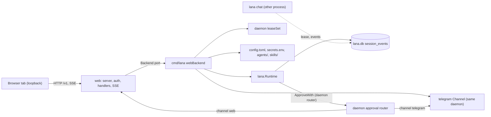
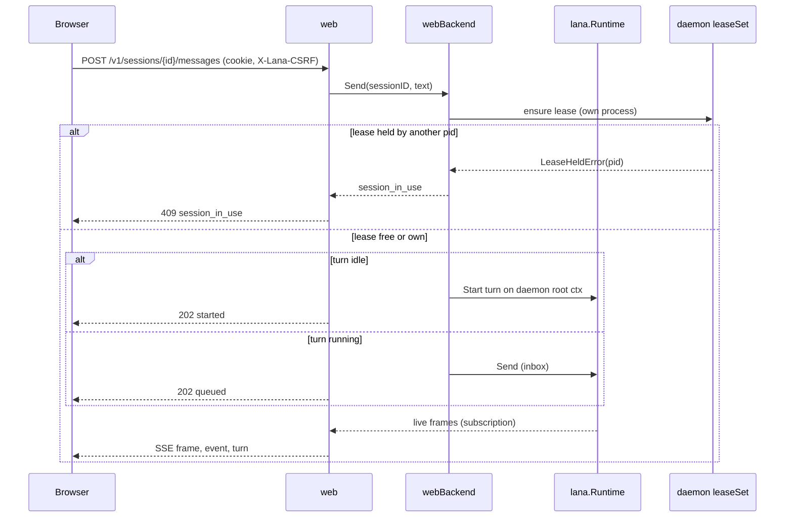
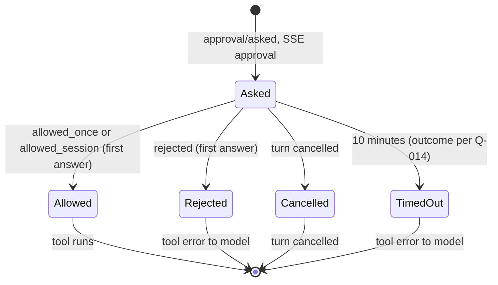
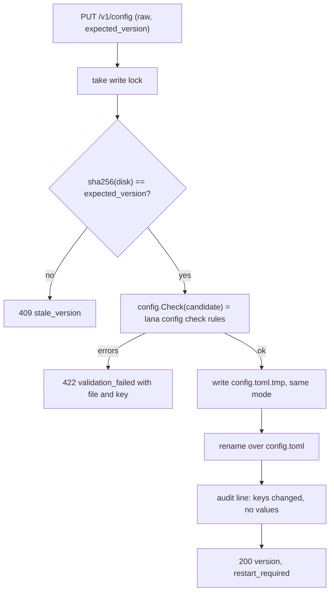

# Design: Web view: settings and chat sessions

- **Issue**: `—`
- **Requirements**: [requirements.md](requirements.md)
- **Contract**: [api-contract.md](api-contract.md) — Required
- **Requirements revision**: 1
- **Contract revision**: 1
- **Requirements status**: Draft
- **Contract status**: Draft
- **Status**: Draft
- **Design revision**: 1

Do not write a design against requirements or a contract that are not yet approved. This draft shows the intended
design so the owner can review the open questions. Components marked `(pending Q-0NN)` change when the answer changes.

## Architecture references

- **ADR index**: [docs/adr](../../adr/README.md)
- **Diagram index**: [docs/diagram](../../diagram/README.md)
- **ADR**: [0004](../../adr/0004-permission-mode-per-agent.md), [0008](../../adr/0008-cli-channel-http-and-web-dashboard-interfaces.md), [0009](../../adr/0009-session-as-append-only-event-log.md), [0010](../../adr/0010-profile-and-config-patch.md), [0014](../../adr/0014-integration-as-agentic-tool.md), [0015](../../adr/0015-embeddable-runtime-for-services.md). New ADR required: `0016` owner auth for the browser and HTTP surface (not written by this draft)
- **Feature-local diagram**: [Components](#components), [Send a message](#send-a-message), [Approval](#approval), [Save config](#save-config)
- **Durable diagram**: [0001. System Context and Roadmap](../../diagram/0001-system-context-and-roadmap.md) — the web view is the `Doors` entry point with REST and SSE; no change to the diagram in this spec

## Architecture decision scan

| Topic | Existing authority | Decision location | Action |
|---|---|---|---|
| Public interface | ADR 0008 (web pages, port), ADR 0014 (`/v1` REST and SSE, `[[api.tokens]]`) | requirements and contract | reuse the paths; new ADR 0016 for auth (`Q-002`, `Q-003`) |
| Persistence | ADR 0009 (event log), ADR 0005 (one SQLite) | design (no new table) | reuse; config and secrets stay as files |
| State and lifecycle | ADR 0004 (approval outcomes), ADR 0009 (turn boundary for fork) | requirements state matrix | reuse |
| Concurrency | Spec #1 `REQ-SESS-002` (lease), spec #6 (one lease set per daemon) | design | reuse the daemon's lease set; add one write lock for files |
| Dependency direction | ADR 0015 (library packages do not import `web/`), diagram 0001 (`Web --> Core`) | design | new `web` package imports `core` and `internal/*` only; the daemon adapter lives in `cmd/lana` (port pattern as in `channels/telegram`) |
| Frontend | ADR 0008 (Preact + `htm`, no build step, `embed`) | `Q-004` | reuse ADR 0008 unless the owner changes it |

## Visual Architecture Check

| Trigger | Present? | Required view |
|---|---:|---|
| Module or crate boundary | Yes | boundary (`web` package and its port) |
| Interaction with an actor or external system | Yes | sequence (browser, daemon, runtime) |
| Multi-component flow | Yes | sequence (send message with streaming) |
| Lifecycle or state transition | Yes | approval state in `Approval` diagram |
| Entity relation | No | Not required — no new entity; `session_events` and `sessions` are unchanged |
| Concurrency, retry, or failure flow | Yes | flowchart (save config with version check) |
| Dependency direction or runtime topology | Yes | components flowchart |

## Feature-local view

### Components

- `web` never imports `lana` directly. It sees the runtime through its `Backend` port (see Proposed design), the same way
  `channels/telegram` does (spec #6 `Repository fit`).
- The daemon adapter `webBackend` in `cmd/lana/web.go` implements the port on top of `lana.Runtime`, `leaseSet`, and file helpers.

### Send a message

### Approval

### Save config

## Repository fit

- The `web` package follows the `channels/telegram` port pattern: a `Backend` interface in `web` and an adapter in
  `cmd/lana`. Library packages stay free of `web/` (ADR 0015 and `internal/archtest/arch_test.go`).
- The daemon already owns the runtime, the lease set, the approval closure, and the root context (`cmd/lana/daemon.go`).
  The web view joins those objects; it does not create a second runtime.
- Message text, tool lines, and approval labels reuse `internal/toolfmt.PrimaryArg` (spec #6 `T-001`).
- Config validation reuses `config` rules. A new function `config.Check(ctx, home, candidate)` runs the same
  validators as `Load` on the candidate text (additive; no behavior change for `lana config check`).
- Agent files and skills reuse `internal/agenthome` (`Paths`, `ReadEntries`, `Apply`, `Update`, `WriteFile`,
  `ParseSkill`, `VisibleSkills`, `WriteSkill`).
- The web assets live in `web/assets/` and are embedded with `embed.FS` (ADR 0008). Vendored Preact and `htm` files
  are pinned by version in a comment at the top of each vendored file, if `Q-004` accepts ADR 0008. No Node.js is needed.

## Gaps in the current code

These are facts found while reading the code for this draft. Each one shapes a component below or a question.

| # | Gap | Where | Effect on this spec |
|---|---|---|---|
| G-1 | The daemon exits with code 2 when no `[channels.telegram]` exists | `cmd/lana/daemon.go` (`no channel configured`) | `REQ-WEB-004` needs a revision of spec #6 (`Q-005`) |
| G-2 | Approvals have one responder (`ApproveWith`). The daemon passes `ApproveChannels("telegram")`. Each call replaces the whole channel set | `lana.go` (`ApproveWith`, `ApproveChannels`) | The daemon routes by session channel: `telegram` to the Telegram channel, `web` to the web broker. Pass `ApproveChannels("telegram", "web")`. No core change |
| G-3 | `TryLease` refuses a session the same PID already holds (`heldPID == pid`) | `store/store.go` `TryLease` | The web view must use the daemon's `leaseSet`, which caches held leases, not call `LeaseSession` directly |
| G-4 | Runtime config is read once at start (`rt.result.Config`) | `lana.go` `New`, `AgentModel`, `AgentNames` | No hot reload. `REQ-WEB-023`, `Q-008` |
| G-5 | Live frames are published by the in-process registry hub only | `agent/registry.go` `SubscribeLive` | Cross-process sessions use polling (`REQ-WEB-012`, `Q-007`) |
| G-6 | `Runtime.ListSessions` is limited to `cli` and the current directory; `store.List` supports an empty channel but is not exposed | `lana.go` `ListSessions`, `store/store.go` `List` | New facade method `ListAllSessions(ctx, filter)` (additive) |
| G-7 | No facade method says whether a turn runs in this process | `lana.go` | New facade method `TurnActive(sessionID) bool` (additive); it reads the registry runners |
| G-8 | `Runtime.Run` cancels the turn when its `ctx` ends | `lana.go` `Run` | The web handler must start turns on the daemon root context, never on the request context (`REQ-WEB-011`, `AC-WEB-032`) |
| G-9 | Secrets are read once at start (`runtimeFor`, `secrets.env`) and the mock provider is used when a key is missing | `cmd/lana/main.go` `runtimeFor` | Secret changes take effect at restart (`REQ-WEB-024`) |
| G-10 | No config writer. `lana config edit` only opens `$EDITOR`. `secrets.env` is written inline by `lana init` | `cmd/lana/main.go` (`cmdConfig edit`, `cmdInit`) | New atomic writer and secrets line editor in `web` (or `internal/`) |
| G-11 | Approval timeout outcome differs: ADR 0004 says `unavailable`; the Telegram channel uses `rejected` | `channels/telegram/approve.go` | `Q-014` |
| G-12 | ADR 0008 says `lana init` creates a dashboard token; `lana init` creates no token today | `cmd/lana/main.go` `cmdInit` | `Q-002`, new ADR 0016 |
| G-13 | ADR 0014 uses `[[api.tokens]]` bearer tokens; ADR 0008 uses a login token with a hash. The two auth models conflict | ADRs 0008, 0014 | `Q-003`, ADR 0016 |
| G-14 | `init` writes `config.toml` with mode `0644`, but MCP `env` and `headers` may hold literal values | `cmd/lana/main.go` (`initConfig`), `core/config.go` | Masking in `API-WEB-013`; the owner may move values to `secrets.env` (`Q-009`) |
| G-15 | The secrets parser strips one pair of quotes and has no escape syntax | `config/secrets.go` | Writer rejects newlines and quotes inside values; quotes values with spaces or `#` (`API-WEB-015`) |

## Proposed design

### Components

- **`web` (new package)** — the HTTP server, auth, origin and host checks, handlers, SSE, and the dashboard assets.
  - `web/server.go`: `Server` with `Config{Addr, Enabled}`, `Start(ctx) error`, `Shutdown(ctx)`. Validates the loopback address (`REQ-WEB-003`). Sets security headers on every response.
  - `web/auth.go`: owner token file `web.json` (create, hash, compare in constant time); browser session map with 12-hour idle expiry; CSRF value per browser session; middleware for cookie, `Host`, `Origin`, and `X-Lana-CSRF`.
  - `web/sessions.go`: handlers for `API-WEB-003` to `API-WEB-006`, `API-WEB-010`, and `API-WEB-012`.
  - `web/turns.go`: `POST messages` and `POST cancel` (`API-WEB-007`, `API-WEB-009`). Calls the `Backend`.
  - `web/sse.go`: `GET stream` (`API-WEB-008`). Merges the live subscription with the log poller. Heartbeat every 15 seconds. Emits `shutdown` on server stop.
  - `web/approvals.go`: the approval broker. One entry per open request with a reply channel and a 10-minute timer. Answers from the browser (`API-WEB-011`) and the daemon approval router. Keeps request IDs unguessable (32 random bytes, base64url).
  - `web/config.go`, `web/secrets.go`, `web/agentfiles.go`, `web/skills.go`: handlers for `API-WEB-013` to `API-WEB-017`. Each save takes the write lock and checks the version.
  - `web/assets/`: `index.html`, `app.js`, `app.css`, and `vendor/` (`Q-004`). Embedded with `//go:embed`.
- **`web.Backend` (port, in `web`)** — the methods the handlers need:
  - `Sessions(ctx, filter)`, `Session(ctx, id)`, `Events(ctx, id, fromSeq)`, `CreateSession(ctx, agent, model)`
  - `Send(ctx, id, text)`, `Cancel(ctx, id)`, `Compact(ctx, id)`, `Fork(ctx, id)`, `SetAgent`, `SetModel`, `SetPolicy`
  - `Subscribe(ctx, id)` (live frames), `TurnActive(id)`, `Holder(ctx, id)` (self, other with PID, or none)
  - `Agents()`, `MCPStatus(agent)`, `Config()` (effective read model and loaded hash), `Skills(scope)`, `AgentFile(agent, kind)`
  - Writes: `SaveConfig`, `SetSecret`, `DeleteSecret`, `SaveAgentFile`, `SaveSkill` (these operate on files and are implemented by small helpers in `internal/`)
- **`cmd/lana/web.go` (new)** — `webBackend` implements `web.Backend` on top of `*lana.Runtime`, the daemon's `leaseSet`, the root context, and the file helpers. It is the only place that knows both sides.
- **`cmd/lana/daemon.go` (changed)** — starts `web.Server` when `[web]` is enabled; passes `ApproveChannels("telegram", "web")`; routes approval requests by session channel (G-2); runs the Telegram channel only when configured (G-1, `Q-005`); on shutdown stops the web server first, then the channel, then the runtime.
- **`lana.go` / `lana_channel.go` (additive)** — `ListAllSessions(ctx, filter)` (G-6) and `TurnActive(sessionID)` (G-7). No existing behavior changes.
- **`config` (additive)** — `Check(ctx, home string, candidate []byte) (Result, error)` runs the same validators as `Load` on the candidate `config.toml`. `Load` is unchanged.
- **`internal/webfiles` (new, private)** — atomic write (temporary file in the same directory, `fsync`, rename, keep mode), and the `secrets.env` line editor (keeps comments and other lines; validates names and values as in `API-WEB-015`).

### Contract mapping

| Contract operation | Component | Input | Result | Requirements |
|---|---|---|---|---|
| `API-WEB-001` | `web/server.go`, `cmd/lana/daemon.go`, config `[web]` | `[web]` table | listener or error | `REQ-WEB-001`, `REQ-WEB-003`, `REQ-WEB-004` |
| `API-WEB-002` | `web/auth.go` | token, cookie, headers | cookie, CSRF value, or 401/403 | `REQ-WEB-005` to `REQ-WEB-007` |
| `API-WEB-003` | `web/sessions.go` → `Backend.Sessions` | filter, paging | list | `REQ-WEB-008` |
| `API-WEB-004` | `web/sessions.go` → `Backend.Session`, `Events` | ID, `from_seq` | session, events | `REQ-WEB-009`, `REQ-WEB-012` |
| `API-WEB-005` | `web/sessions.go` → `CreateSession` | agent, model | session | `REQ-WEB-010` |
| `API-WEB-006` | `web/sessions.go` → `SetAgent`, `SetModel`, `SetPolicy` | fields | session | `REQ-WEB-017`, `REQ-WEB-018` |
| `API-WEB-007` | `web/turns.go` → `Send` | text | 202 | `REQ-WEB-011`, `REQ-WEB-018`, `REQ-WEB-019` |
| `API-WEB-008` | `web/sse.go` → `Subscribe`, `Events` | ID, `from_seq` | SSE stream | `REQ-WEB-011`, `REQ-WEB-012`, `REQ-WEB-029` |
| `API-WEB-009` | `web/turns.go` → `Cancel` | ID | 202 or 200 | `REQ-WEB-016` |
| `API-WEB-010` | `web/sessions.go` → `Compact`, `Fork` | ID | summary or session | `REQ-WEB-017` |
| `API-WEB-011` | `web/approvals.go` | request ID, outcome | 200 or 409 | `REQ-WEB-014`, `REQ-WEB-015` |
| `API-WEB-012` | `web/sessions.go` → `Agents` | — | agents | `REQ-WEB-010` |
| `API-WEB-013` | `web/config.go` → `Config` | — | read model, raw masked | `REQ-WEB-020` |
| `API-WEB-014` | `web/config.go` → `config.Check`, `webfiles.AtomicWrite` | raw, version | 200, 409, 422 | `REQ-WEB-021` to `REQ-WEB-023`, `REQ-WEB-027` |
| `API-WEB-015` | `web/secrets.go` → `webfiles.Secrets` | name, value, version | state | `REQ-WEB-024`, `REQ-WEB-027` |
| `API-WEB-016` | `web/agentfiles.go` → `agenthome` | agent, file, content | file | `REQ-WEB-025` |
| `API-WEB-017` | `web/skills.go` → `agenthome.ParseSkill`, `WriteSkill` | scope, name, content | skill | `REQ-WEB-026` |

### Session identity and the live path

- A session shown in the list is always an existing log session. `web` never creates a session except through
  `API-WEB-005`.
- For a session that `TurnActive` reports as running in this process, `Subscribe` yields live frames and the SSE stream
  sends `frame`, `event`, and `turn` lines.
- For any other session, the SSE handler polls `Events(fromSeq)` every second and sends `event` lines only (`Q-007`).
- `status` events report `holder: self` when the daemon's lease set holds the session, `other` with the PID from
  `core.LeaseHeldError`, or `none`.

### Turns on the daemon context

- Turns started by `POST messages` run with the daemon root context. The request context is used only for the HTTP
  call. This keeps the turn alive when the browser closes (`AC-WEB-032`, G-8).
- A message to a running turn goes to `Runtime.Send` (inbox), as Telegram does (spec #6 `API-TG-002`).
- `POST cancel` calls `Runtime.Cancel` (the same call the daemon uses on shutdown).

### Approval routing

- The daemon's approval closure looks up the session channel (`Runtime.SessionInfo`) and routes:
  `telegram` to `channel.Approve`, `web` to `web.Approvals.Ask`. Any other channel returns `unavailable`.
- `web.Approvals.Ask(ctx, req)` registers the request, publishes an `approval` SSE event to the session's open streams,
  waits for the first browser answer, the 10-minute timer, or `ctx.Done()` (`REQ-WEB-015`, `REQ-WEB-016`).
- Timeout outcome is the value chosen in `Q-014`. Until it is answered, the code uses a single constant so the change is
  one line.
- The request ID is random. An answer for an unknown or closed request returns `409 approval_closed` (or `404` when the
  ID never existed).

### Config save

- The daemon keeps `loaded_sha256` (SHA-256 of `config.toml` at start). `GET /v1/config` returns the current hash as
  `version`. `restart_required` is `version != loaded_sha256`.
- Save steps: take the write lock; compare `expected_version` with the file hash; run `config.Check` on the candidate;
  write `config.toml.tmp` with the same mode and `fsync`; rename; log the audit line with changed keys (the old and new
  texts are parsed, so only key paths are logged).
- Masked values: when the candidate has `"***"` at a key path under `mcp.*.env` or `mcp.*.headers`, the stored value at
  that path is kept. A new key with `"***"` is refused with `422 validation_failed`.
- Raw editor: the page shows the masked text. The owner's edits to other lines are saved as typed.

### Secrets

- `GET /v1/secrets` lists the names in `secrets.env` and the names found in `[providers.*].api_key_env`,
  `[channels.telegram].token_env`, and MCP `${VAR}` references (only names are read from config).
- The `secrets.env` line editor finds the line `NAME=`, replaces or appends it, or removes it. Values are quoted with
  double quotes when they contain spaces, `#`, or quotes; a value with a newline is refused (G-15).
- Writes keep mode `0600`. The file is created with `0600` if missing.

### Agent files and skills

- `API-WEB-016` maps `agent`, `user`, `memory` to `AGENT.md`, `USER.md`, `MEMORY.md` through `agenthome.Paths`.
  `user` and `memory` are checked against `agenthome.UserLimit` and `MemoryLimit` (`over_limit`). The file is written
  atomically with mode `0600`.
- `API-WEB-017` validates frontmatter with `agenthome.ParseSkill` on the candidate directory before writing.

### Persistence

- No new table. Session data stays in `session_events` and `sessions` (ADR 0009). Browser sessions and approvals live in
  memory and are lost when the daemon stops.
- Files: `$LANA_HOME/web.json` (token hash, mode `0600`, `Q-002`), `config.toml`, `secrets.env`, agent files, skills.

### Failure handling

| Failure | Internal error | Observable result |
|---|---|---|
| Non-loopback address | `ErrNotLoopback` | exit 2 |
| Port in use | `listen: address already in use` | exit 1 |
| `web.json` unreadable or invalid | `ErrTokenFile` | exit 2 naming the file |
| Lease held by other PID | `core.LeaseHeldError` | 409 `session_in_use` with PID |
| Turn already running on compact or fork | runtime busy error | 409 `invalid_state` |
| Config candidate invalid | `config.Errors` | 422 with each `file`, `key`, `message` |
| Stale version | version mismatch | 409 `stale_version` |
| Atomic write fails | `os` error | 500, temporary file removed, original unchanged |
| Approval answered twice | closed request | 409 `approval_closed` |
| Client disconnect during SSE | context done | stream closed; turn unaffected |
| Store read fails while polling | `error` | logged at `warn`; the stream keeps polling on the next tick (no extra SSE event) |
| Shutdown | `context.Canceled` | `shutdown` event, streams closed, turns cancelled, exit 0 |

### Concurrency

- One write lock (`sync.Mutex`) in `web` for every file save under `$LANA_HOME`. Saves are rare; a single lock is enough.
- One goroutine per SSE stream plus one poller per session shared by all streams of that session.
- Approval broker uses one mutex and one channel per request; the timer goroutine and the answer race through a
  `sync.Once`-style close.
- Turns run in goroutines started on the daemon context; the daemon waits for them within the 10-second shutdown grace
  (spec #6 `REQ-DMN-004`).
- `leaseSet` is already mutex-protected; web and Telegram use the same instance (G-3).

### Security

- Loopback bind; `Host` and `Origin` checks; cookie `HttpOnly`, `SameSite=Strict`; CSRF header on state-changing calls.
- Token: 32 random bytes; stored as SHA-256 in `web.json`; compared in constant time; never logged.
- Responses: `Cache-Control: no-store` for `/v1`; `Content-Security-Policy: default-src 'self'; frame-ancestors 'none'`;
  `X-Content-Type-Options: nosniff`; `Referrer-Policy: no-referrer`.
- No inline script, no `eval`, no third-party URL in the assets (`REQ-WEB-002`).
- Secrets are never in a response or the audit log. `Secret` values are passed to the writer as bytes, never to a
  formatted string.
- Audit: changed key paths and secret names only.
- Logging: the daemon logs request method, path, status, and duration at `debug`. Bodies, cookies, and the `X-Lana-CSRF`
  value are never logged.
- Store-level redaction: this design adds none. Tool output and user text are stored as the runtime stores them today.
  Writing tool output that contains secrets is an existing risk shared with the CLI and Telegram (ADR 0004 does not
  sandbox tools). Listed in Risks.

### Observability

- `info`: `web: listening on ...`, login success and failure counts (no token), every save audit line, approval outcomes
  with request ID.
- `warn`: SSE poll errors; approval timeout.
- `debug`: request log lines without bodies.
- Unchanged: runtime logs.

## Requirement traceability

| Requirement | Contract operation | Design component | Verification level |
|---|---|---|---|
| `REQ-WEB-001`, `REQ-WEB-003`, `REQ-WEB-004` | `API-WEB-001` | `web/server.go`, `cmd/lana/daemon.go` | integration (`cmd/lana`) |
| `REQ-WEB-002` | — (assets) | `web/assets`, `embed.FS` | unit (header and asset scan) and runtime |
| `REQ-WEB-005` to `REQ-WEB-007` | `API-WEB-002` | `web/auth.go` | unit |
| `REQ-WEB-008`, `REQ-WEB-009`, `REQ-WEB-010` | `API-WEB-003` to `API-WEB-005`, `API-WEB-012` | `web/sessions.go`, `ListAllSessions` | integration |
| `REQ-WEB-011`, `REQ-WEB-013` | `API-WEB-007`, `API-WEB-008` | `web/turns.go`, `web/sse.go` | integration with `MockLlm` |
| `REQ-WEB-012` | `API-WEB-004`, `API-WEB-008` | `web/sse.go`, `TurnActive` | integration with two processes |
| `REQ-WEB-014`, `REQ-WEB-015` | `API-WEB-011` | `web/approvals.go`, daemon router | integration with a fake clock |
| `REQ-WEB-016`, `REQ-WEB-017` | `API-WEB-006`, `API-WEB-009`, `API-WEB-010` | `web/sessions.go`, `web/turns.go` | integration |
| `REQ-WEB-018`, `REQ-WEB-019` | `API-WEB-006`, `API-WEB-007` | `leaseSet` (shared) | integration (`cmd/lana` lease test) |
| `REQ-WEB-020` to `REQ-WEB-023` | `API-WEB-013`, `API-WEB-014` | `web/config.go`, `config.Check`, `internal/webfiles` | unit (table tests) and integration |
| `REQ-WEB-024` | `API-WEB-015` | `web/secrets.go`, `internal/webfiles` | unit (line editor table tests) |
| `REQ-WEB-025` | `API-WEB-016` | `web/agentfiles.go`, `agenthome` | unit and integration (next turn) |
| `REQ-WEB-026` | `API-WEB-017` | `web/skills.go`, `agenthome` | unit |
| `REQ-WEB-027` | `API-WEB-014`, `API-WEB-015` | audit in save path | unit (log capture) |
| `REQ-WEB-028` | — (UI) | `web/assets` | manual (keyboard and VoiceOver) |
| `REQ-WEB-029` | `API-WEB-008` | `web/server.go`, `cmd/lana/daemon.go` | integration (SIGTERM test) |

## Acceptance verification map

| Acceptance criterion | Verification method | Planned evidence |
|---|---|---|
| `AC-WEB-001`, `AC-WEB-002` | integration | `cmd/lana/web_test.go` start line and no listener |
| `AC-WEB-003` | unit and runtime | header test on `GET /`; offline browser check |
| `AC-WEB-004` | integration | `cmd/lana/web_test.go` non-loopback exit 2 |
| `AC-WEB-005` | integration | `cmd/lana/web_test.go` no telegram config, fake Bot API counts zero calls |
| `AC-WEB-006` | unit | `web/auth_test.go` login table |
| `AC-WEB-007` | unit | `web/auth_test.go` scan of log buffer, config, responses |
| `AC-WEB-008` | unit | `web/auth_test.go` Origin, Host, CSRF table |
| `AC-WEB-009` | integration | `web/sessions_test.go` with a store that has three channels |
| `AC-WEB-010` | integration | `web/sessions_test.go` history equals `ChainEvents` |
| `AC-WEB-011` | integration | `web/sessions_test.go` create session, model set |
| `AC-WEB-012` | integration | `web/sse_test.go` with `MockLlm` |
| `AC-WEB-013` | integration | `web/turns_test.go` inbox during turn |
| `AC-WEB-014` | integration | `cmd/lana/web_lease_test.go` second process running `lana chat` |
| `AC-WEB-015` | unit | `web/render_test.go` tool line and status words |
| `AC-WEB-016` | integration | `web/approvals_test.go` two answers |
| `AC-WEB-017` | unit | `web/approvals_test.go` fake clock timeout |
| `AC-WEB-018` | integration | `web/turns_test.go` cancel with pending approval |
| `AC-WEB-019` | integration | `web/sessions_test.go` compact, fork, policy events |
| `AC-WEB-020` | integration | `cmd/lana/web_lease_test.go` held lease, 409 with PID |
| `AC-WEB-021` | integration | `cmd/lana/web_test.go` Telegram session used by web |
| `AC-WEB-022` | unit | `web/config_test.go` masking in both views |
| `AC-WEB-023` | unit | `web/config_test.go` invalid candidate, mode check |
| `AC-WEB-024` | unit | `web/config_test.go` stale version |
| `AC-WEB-025` | integration | `cmd/lana/web_test.go` config save does not change running model |
| `AC-WEB-026` | unit | `internal/webfiles/secrets_test.go` line editor and mode |
| `AC-WEB-027` | unit and integration | `web/agentfiles_test.go` over limit; next-turn prompt test |
| `AC-WEB-028` | unit | `web/skills_test.go` frontmatter validation |
| `AC-WEB-029` | unit | `web/config_test.go` log capture, no values |
| `AC-WEB-030` | manual | keyboard-only walk-through and VoiceOver run, recorded in `tasks.md` |
| `AC-WEB-031` | integration | `cmd/lana/web_test.go` SIGTERM with open stream and turn |
| `AC-WEB-032` | integration | `web/turns_test.go` context of HTTP request cancelled, turn continues |

## Verification strategy

- **Unit**: `web` (auth, origin and host, versioned saves, masking, render helpers), `internal/webfiles` (atomic write
  mode, secrets line editor), `config.Check` (same results as `Load` on the same text).
- **Integration**: `cmd/lana` tests with `httptest` and `MockLlm`, the fake Telegram Bot API from spec #6, two
  `lana.Runtime` instances on one SQLite file (lease test), and a child process running `lana chat` for `AC-WEB-014`.
- **Runtime**: start `lana daemon` in a temporary `LANA_HOME`; open the dashboard in a browser; run one turn with the
  mock provider; approve one `bash` call; change one setting and see `restart required`; send SIGTERM with an open
  stream. Keyboard-only and VoiceOver checks are recorded in `tasks.md`.
- Commands: `nix develop -c go test -count=1 ./...`, `nix develop -c go test -race ./web/ ./cmd/lana/`,
  `nix develop -c golangci-lint run ./...`, `make release` (binary size check, 40 MB target).
- No JavaScript unit tests in v1. The page logic is small; the runtime check covers it. A later spec can add a
  browser test runner if the UI grows.

## Risks and tradeoffs

- **Sessions used by the web view stay leased until the daemon stops** (same as Telegram today; `leaseSet` releases only
  at shutdown). `lana chat` cannot open such a session until the daemon restarts. This is consistent with spec #6 but
  becomes visible with the browser. Possible follow-up: release leases after idle time (not in this spec).
- **Polling for cross-process sessions** adds up to one second of latency and no token stream (`Q-007`).
- **Restart after config or secret change** is a manual step (`Q-008`). Owners who edit often will want hot reload; the
  Telegram backend holds the runtime, so reload needs a rebuild of both (later spec).
- **Raw TOML editing** is error-prone; validation catches syntax and reference errors but not wrong values of valid keys.
- **Tool output with secrets** is stored in the log and shown in the browser, as it is in the CLI and Telegram today.
  This spec does not add redaction (ADR 0004 has no sandbox).
- **Single-token login**: one token opens every setting. Rotation means deleting `web.json` and restarting the daemon
  (`Q-002`).
- **Frontend without a build step** keeps the binary and Nix shell small, but the UI code has no type checks and no
  unit tests in v1 (`Q-004`).
- **Two ADRs disagree** on the auth model (G-13). Until ADR 0016 is accepted, the auth design is provisional.

## Blocking Design Questions

None of its own. Every design choice that depends on a product decision is listed in `requirements.md` (`Q-001` to
`Q-015`) or `api-contract.md` (`CQ-001`, `CQ-002`). This design cannot be approved until those are answered, and until
ADR 0016 is written and accepted.

## Approval

- [ ] Requirements are Approved and their revision is recorded.
- [ ] Contract is Approved or `Not required`.
- [ ] Architecture decision scan and Visual Architecture Check are complete.
- [ ] Required ADRs are Accepted (ADR 0016 is not yet written).
- [ ] Every requirement maps to one design component.
- [ ] Every acceptance criterion has a verification method.
- [ ] Blocking Design Questions is `None`.
- **Approved by**: —
- **Approved on**: —
