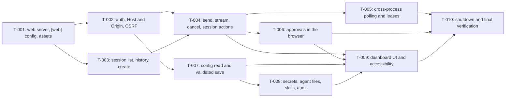

# Tasks: Web view: settings and chat sessions

- **Issue**: `—`
- **Requirements**: [requirements.md](requirements.md)
- **Contract**: [api-contract.md](api-contract.md) — Required
- **Design**: [design.md](design.md)
- **Requirements revision**: 1
- **Contract revision**: 1
- **Design revision**: 1
- **Status**: Draft

Do not create a task plan before requirements, contract, and design are approved. This plan is a draft for review. Tasks
must not start while `Q-001` to `Q-015` and `CQ-001` to `CQ-002` are open.

## Execution rules

- Implement only the requirements and acceptance criteria assigned to the task.
- Stop if requirements, design, ADR, diagrams, or contract conflict with each other.
- Do not answer product or architecture questions only in code.
- Every acceptance criterion has exactly one evidence owner.
- Required verification is never optional.
- Mark a task complete only after verification evidence has been recorded.
- Code is written through the `dsh-coder` workflow in this repository (see the project `CLAUDE.md`). The main session
  plans, reviews the diff, and verifies.
- Go tooling runs inside `nix develop -c`. No global installs.

## Coverage

| Acceptance criterion | Contract operation | Evidence owner | Issue/PR | Verification | Evidence |
|---|---|---|---|---|---|
| `AC-WEB-001` | `API-WEB-001` | `T-001` | — | `cmd/lana` web start test | Pending |
| `AC-WEB-002` | `API-WEB-001` | `T-001` | — | `cmd/lana` no-listener test | Pending |
| `AC-WEB-003` | — (assets) | `T-001` | — | header test on `GET /`; offline browser check | Pending |
| `AC-WEB-004` | `API-WEB-001` | `T-001` | — | `cmd/lana` non-loopback exit 2 test | Pending |
| `AC-WEB-005` | `API-WEB-001` | `T-001` | — | `cmd/lana` web-only daemon test (fake Bot API counts zero calls) | Pending |
| `AC-WEB-006` | `API-WEB-002` | `T-002` | — | `web/auth_test.go` login table | Pending |
| `AC-WEB-007` | `API-WEB-002` | `T-002` | — | `web/auth_test.go` token scan of log, config, responses | Pending |
| `AC-WEB-008` | `API-WEB-002` | `T-002` | — | `web/auth_test.go` Origin, Host, CSRF table | Pending |
| `AC-WEB-009` | `API-WEB-003` | `T-003` | — | `web/sessions_test.go` three channels, paging | Pending |
| `AC-WEB-010` | `API-WEB-004` | `T-003` | — | `web/sessions_test.go` history equals `ChainEvents` | Pending |
| `AC-WEB-011` | `API-WEB-005`, `API-WEB-012` | `T-003` | — | `web/sessions_test.go` create with model | Pending |
| `AC-WEB-012` | `API-WEB-007`, `API-WEB-008` | `T-004` | — | `web/sse_test.go` with `MockLlm` | Pending |
| `AC-WEB-013` | `API-WEB-007` | `T-004` | — | `web/turns_test.go` inbox during turn | Pending |
| `AC-WEB-014` | `API-WEB-004`, `API-WEB-008` | `T-005` | — | `cmd/lana/web_lease_test.go` with a child `lana chat` process | Pending |
| `AC-WEB-015` | `API-WEB-008` | `T-004` | — | `web/render_test.go` tool line and status words | Pending |
| `AC-WEB-016` | `API-WEB-011` | `T-006` | — | `web/approvals_test.go` two answers | Pending |
| `AC-WEB-017` | `API-WEB-011` | `T-006` | — | `web/approvals_test.go` fake clock timeout | Pending |
| `AC-WEB-018` | `API-WEB-009` | `T-004` | — | `web/turns_test.go` cancel with pending approval | Pending |
| `AC-WEB-019` | `API-WEB-006`, `API-WEB-010` | `T-004` | — | `web/sessions_test.go` compact, fork, policy events | Pending |
| `AC-WEB-020` | `API-WEB-006`, `API-WEB-007` | `T-005` | — | `cmd/lana/web_lease_test.go` held lease, 409 with PID | Pending |
| `AC-WEB-021` | `API-WEB-007` | `T-005` | — | `cmd/lana/web_test.go` Telegram session used from web | Pending |
| `AC-WEB-022` | `API-WEB-013` | `T-007` | — | `web/config_test.go` masking in both views | Pending |
| `AC-WEB-023` | `API-WEB-014` | `T-007` | — | `web/config_test.go` invalid candidate, mode check | Pending |
| `AC-WEB-024` | `API-WEB-014` | `T-007` | — | `web/config_test.go` stale version, two saves | Pending |
| `AC-WEB-025` | `API-WEB-014` | `T-007` | — | `cmd/lana/web_test.go` saved model does not change running session | Pending |
| `AC-WEB-026` | `API-WEB-015` | `T-008` | — | `internal/webfiles/secrets_test.go` line editor and mode | Pending |
| `AC-WEB-027` | `API-WEB-016` | `T-008` | — | `web/agentfiles_test.go` over limit; next-turn prompt | Pending |
| `AC-WEB-028` | `API-WEB-017` | `T-008` | — | `web/skills_test.go` frontmatter validation | Pending |
| `AC-WEB-029` | `API-WEB-014`, `API-WEB-015` | `T-008` | — | `web/audit_test.go` log capture, no values | Pending |
| `AC-WEB-030` | — (UI) | `T-009` | — | Manual keyboard-only walk-through and VoiceOver run | Pending |
| `AC-WEB-031` | `API-WEB-008` | `T-010` | — | `cmd/lana/web_test.go` SIGTERM with open stream and turn | Pending |
| `AC-WEB-032` | `API-WEB-007` | `T-004` | — | `web/turns_test.go` HTTP context cancelled, turn continues | Pending |

## Task graph

## Tasks

- [ ] `T-001` Add the `web` server skeleton, the `[web]` config, loopback check, embedded assets, and daemon wiring
  - Issue/PR: `—`
  - Depends on: `None`
  - Requirements: `REQ-WEB-001`, `REQ-WEB-002`, `REQ-WEB-003`, `REQ-WEB-004` (pending `Q-005`)
  - Acceptance criteria: `AC-WEB-001` through `AC-WEB-005`
  - Contract operations: `API-WEB-001`
  - Scope:
    - `[web]` keys and validation (`enabled`, `addr`), unknown-key error, loopback check.
    - `web.Server` start and stop; `GET /` and `GET /assets/*` from `embed.FS`; `Content-Security-Policy` and other headers.
    - `cmd/lana/daemon.go`: start the server when enabled; start line on stderr; daemon runs without Telegram when enabled (`Q-005`); port-in-use exit 1.
    - Minimal placeholder `index.html` so the page loads; the real UI is `T-009`.
    - Pick the front-end stack per `Q-004` before adding vendored files.
  - Verification:
    - `nix develop -c go test -count=1 ./web/ ./cmd/lana/ -run 'Web'`
    - `nix develop -c go test -count=1 ./internal/archtest/` (import rules still pass)
  - Completion evidence:
    - Status: Pending
    - Command/test: —
    - Result: —
    - PR/commit: —
    - Deviation: None

- [ ] `T-002` Add owner login, the token file, browser sessions, Host and Origin checks, and CSRF
  - Issue/PR: `—`
  - Depends on: `T-001`
  - Requirements: `REQ-WEB-005`, `REQ-WEB-006`, `REQ-WEB-007`
  - Acceptance criteria: `AC-WEB-006` through `AC-WEB-008`
  - Contract operations: `API-WEB-002`
  - Scope:
    - `web.json` create (mode `0600`, 32-byte token, SHA-256 hash), one-time print to stderr at creation (`Q-002`).
    - `POST /v1/auth/login`, `POST /v1/auth/logout`, `GET /v1/auth/session` as in the contract.
    - Middleware: cookie, `Host`, `Origin`, `X-Lana-CSRF`; error envelope with stable codes.
    - ADR 0016 (owner auth) must be Accepted before this task starts (`Q-003`).
  - Verification:
    - `nix develop -c go test -count=1 ./web/ -run 'Auth|Origin|Token'`
    - `nix develop -c go test -race -count=1 ./web/`
  - Completion evidence:
    - Status: Pending
    - Command/test: —
    - Result: —
    - PR/commit: —
    - Deviation: None

- [ ] `T-003` Add the session list, session detail and history, and create-session endpoints
  - Issue/PR: `—`
  - Depends on: `T-001`
  - Requirements: `REQ-WEB-008`, `REQ-WEB-009`, `REQ-WEB-010`
  - Acceptance criteria: `AC-WEB-009`, `AC-WEB-010`, `AC-WEB-011`
  - Contract operations: `API-WEB-003`, `API-WEB-004`, `API-WEB-005`, `API-WEB-012`
  - Scope:
    - Facade method `lana.Runtime.ListAllSessions(ctx, core.SessionFilter)` (additive, G-6).
    - `web/sessions.go` read handlers; history derived from `History` (ADR 0009).
    - Create session with channel `web`, address `owner` (`Q-006`); model set through `SetModel`.
    - Agent list with `MCPStatus`.
  - Verification:
    - `nix develop -c go test -count=1 . ./web/ -run 'ListAll|Sessions|Agents'`
  - Completion evidence:
    - Status: Pending
    - Command/test: —
    - Result: —
    - PR/commit: —
    - Deviation: None

- [ ] `T-004` Add send, queue, stream, tool lines, cancel, compact, fork, and settings changes for own sessions
  - Issue/PR: `—`
  - Depends on: `T-002`, `T-003`
  - Requirements: `REQ-WEB-011`, `REQ-WEB-013`, `REQ-WEB-016`, `REQ-WEB-017`
  - Acceptance criteria: `AC-WEB-012`, `AC-WEB-013`, `AC-WEB-015`, `AC-WEB-018`, `AC-WEB-019`, `AC-WEB-032`
  - Contract operations: `API-WEB-006`, `API-WEB-007`, `API-WEB-008`, `API-WEB-009`, `API-WEB-010`
  - Scope:
    - Turns start on the daemon root context (G-8); `Send` when a turn runs; `Cancel`.
    - SSE stream: `frame`, `event`, `turn`, `status`, heartbeat; `from_seq` and `Last-Event-ID`.
    - Tool line rendering: name, primary argument (60 characters), status words (`internal/toolfmt`).
    - Compact, fork, `SetAgent`, `SetModel`, `SetPolicy` with the `invalid_state` rule while a turn runs.
    - Shared lease set is used through `cmd/lana/web.go` (completed in `T-005`).
  - Verification:
    - `nix develop -c go test -race -count=1 ./web/ ./cmd/lana/ -run 'Turn|SSE|Render|Compact|Fork|Cancel'`
  - Completion evidence:
    - Status: Pending
    - Command/test: —
    - Result: —
    - PR/commit: —
    - Deviation: None

- [ ] `T-005` Add polling for sessions run by other processes, the `TurnActive` facade method, and lease handling
  - Issue/PR: `—`
  - Depends on: `T-003`, `T-004`
  - Requirements: `REQ-WEB-012`, `REQ-WEB-018`, `REQ-WEB-019`
  - Acceptance criteria: `AC-WEB-014`, `AC-WEB-020`, `AC-WEB-021`
  - Contract operations: `API-WEB-004`, `API-WEB-006`, `API-WEB-007`, `API-WEB-008`
  - Scope:
    - Facade method `TurnActive(sessionID) bool` (additive, G-7).
    - Holder check for `status` events (`self`, `other` with PID from `core.LeaseHeldError`, `none`).
    - Log poller about once per second for sessions not running in this process (`Q-007`).
    - `409 session_in_use` on write paths for sessions held elsewhere; reads always work.
    - Web uses the daemon's `leaseSet`, which is the same object Telegram uses (G-3).
  - Verification:
    - `nix develop -c go test -count=1 ./cmd/lana/ -run 'WebLease|Holder|Poll'` (includes the child-process `lana chat` case for `AC-WEB-014`)
    - `nix develop -c go test -count=1 . -run 'TurnActive'`
  - Completion evidence:
    - Status: Pending
    - Command/test: —
    - Result: —
    - PR/commit: —
    - Deviation: None

- [ ] `T-006` Add approvals in the browser with the first-answer rule and the 10-minute timeout
  - Issue/PR: `—`
  - Depends on: `T-004`
  - Requirements: `REQ-WEB-014`, `REQ-WEB-015`
  - Acceptance criteria: `AC-WEB-016`, `AC-WEB-017`
  - Contract operations: `API-WEB-011`
  - Scope:
    - `web/approvals.go`: open requests, first answer wins, `409 approval_closed` for later answers.
    - Daemon approval router by session channel (G-2): `telegram` to the Telegram channel, `web` to the broker, others `unavailable`. `ApproveChannels("telegram", "web")`.
    - Timeout constant chosen by `Q-014`; default in code follows the answer, with one constant to change.
    - `approval` SSE event with `request_id`, `tool`, `argument`, `risk`, `expires_at`.
  - Verification:
    - `nix develop -c go test -race -count=1 ./web/ -run 'Approval'`
    - `nix develop -c go test -count=1 ./cmd/lana/ -run 'ApprovalRouter'`
  - Completion evidence:
    - Status: Pending
    - Command/test: —
    - Result: —
    - PR/commit: —
    - Deviation: None

- [ ] `T-007` Add the read-only settings view and the validated, versioned save of `config.toml`
  - Issue/PR: `—`
  - Depends on: `T-002`
  - Requirements: `REQ-WEB-020`, `REQ-WEB-021`, `REQ-WEB-022`, `REQ-WEB-023` (pending `Q-008`, `Q-009`)
  - Acceptance criteria: `AC-WEB-022` through `AC-WEB-025`
  - Contract operations: `API-WEB-013`, `API-WEB-014`
  - Scope:
    - `config.Check(ctx, home, candidate)` (additive; same validators as `Load`).
    - Read model with masking of `mcp.*.env` and `mcp.*.headers` (G-14).
    - `internal/webfiles` atomic write (temporary file, `fsync`, rename, keep mode).
    - Write lock and `expected_version` check; `restart_required` from `loaded_sha256` (`Q-008`).
    - The owner's pending edits are not applied to the running runtime.
  - Verification:
    - `nix develop -c go test -count=1 ./config/ ./internal/webfiles/ ./web/ -run 'Check|Atomic|Mask|Stale|Save'`
    - `nix develop -c go test -count=1 ./cmd/lana/ -run 'WebConfig'`
  - Completion evidence:
    - Status: Pending
    - Command/test: —
    - Result: —
    - PR/commit: —
    - Deviation: None

- [ ] `T-008` Add secrets (write-only), agent files, skills, and the audit line for saves
  - Issue/PR: `—`
  - Depends on: `T-007`
  - Requirements: `REQ-WEB-024` (pending `Q-010`), `REQ-WEB-025` (pending `Q-011`), `REQ-WEB-026` (pending `Q-011`), `REQ-WEB-027` (pending `Q-013`)
  - Acceptance criteria: `AC-WEB-026` through `AC-WEB-029`
  - Contract operations: `API-WEB-014`, `API-WEB-015`, `API-WEB-016`, `API-WEB-017`
  - Scope:
    - `secrets.env` line editor (`internal/webfiles`): name rule, no newline, quoting rule (G-15), mode `0600`, comments kept.
    - Secret state read model with `overridden_by_env`; values never returned.
    - Agent files through `agenthome.Paths`, limits from `agenthome.UserLimit` and `MemoryLimit`, `over_limit` refusal.
    - Skills through `agenthome.ParseSkill` and `WriteSkill`; no delete.
    - Audit line on stderr at `info` for each save: kind, file or name, changed key names; never values.
  - Verification:
    - `nix develop -c go test -count=1 ./internal/webfiles/ ./web/ -run 'Secret|AgentFile|Skill|Audit'`
    - `nix develop -c go test -count=1 ./cmd/lana/ -run 'WebNextTurn'`
  - Completion evidence:
    - Status: Pending
    - Command/test: —
    - Result: —
    - PR/commit: —
    - Deviation: None

- [ ] `T-009` Build the dashboard UI: pages, dialogs, live region, keyboard and screen-reader support
  - Issue/PR: `—`
  - Depends on: `T-004`, `T-006`, `T-007`, `T-008`
  - Requirements: `REQ-WEB-028`
  - Acceptance criteria: `AC-WEB-030`
  - Contract operations: all `API-WEB-*` as used by the pages
  - Scope:
    - Pages: login, sessions list, session view (history, live stream, composer, actions), new session, settings (read model, raw editor, secrets, agent files, skills).
    - Dialogs for approvals and for trust confirmation (`Q-012`).
    - Native controls, visible focus, focus trap and return, `aria-live` region, status in words, dark and light color schemes.
    - Phone width layout without horizontal scroll.
  - Verification:
    - Manual: keyboard-only pass over every flow (`AC-WEB-030`), recorded below.
    - `nix develop -c go test -count=1 ./web/ -run 'Assets'` (embedded files load, no external URL, CSP header).
  - Completion evidence:
    - Status: Pending
    - Command/test: —
    - Result: — (keyboard-only walk-through and VoiceOver run: pending)
    - PR/commit: —
    - Deviation: None

- [ ] `T-010` Verify shutdown behavior and run the final verification
  - Issue/PR: `—`
  - Depends on: `T-005`, `T-006`, `T-009`
  - Requirements: `REQ-WEB-029`
  - Acceptance criteria: `AC-WEB-031`
  - Contract operations: `API-WEB-008`
  - Scope:
    - SIGTERM with an open SSE stream and a running turn: `shutdown` event, `cancelled` turn, exit 0 within 10 seconds.
    - Full suite, race, lint, release build, and the runtime smoke test from `design.md` (Verification strategy).
  - Verification:
    - `nix develop -c go test -count=1 ./cmd/lana/ -run 'WebShutdown'`
    - `nix develop -c go test -count=1 ./...`
    - `nix develop -c go test -race -count=1 ./web/ ./cmd/lana/`
    - `nix develop -c golangci-lint run ./...`
    - `make release`
  - Completion evidence:
    - Status: Pending
    - Command/test: —
    - Result: —
    - PR/commit: —
    - Deviation: None

## Final verification

- [ ] Every acceptance criterion has passing evidence.
- [ ] No observable behavior exists without a requirement ID.
- [ ] No behavior is outside scope.
- [ ] ADR 0016 is Accepted and matches the implementation.
- [ ] ADR 0008 and diagram 0001 match the implementation (the dashboard, the `/v1` paths, the port).
- [ ] Spec #6 is revised for `REQ-DMN-003` (`Q-005`) and the approval timeout outcome (`Q-014`).
- [ ] `gofmt -l .` is empty, `golangci-lint run ./...`, `go test -race` (changed packages), and the release build pass.
- [ ] Deviations are resolved in requirements or design, not only recorded here.

## Approval

- [ ] Requirements and design are Approved and their revisions are recorded.
- [ ] Contract is Approved.
- [ ] Every acceptance criterion has exactly one evidence owner.
- [ ] Every task has a limited scope, dependencies, and verification.
- [ ] No task introduces new behavior.
- **Approved by**: —
- **Approved on**: —
