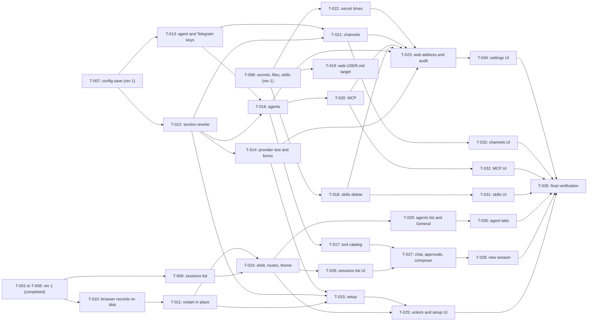

# Tasks: Web view: settings and chat sessions

- **Issue**: `—`
- **Requirements**: [requirements.md](requirements.md)
- **Contract**: [api-contract.md](api-contract.md) — Required
- **Design**: [design.md](design.md)
- **Requirements revision**: 2
- **Contract revision**: 2
- **Design revision**: 2
- **Status**: In Progress (rev 1 `T-001` to `T-008` completed; rev 2 `T-009` to `T-035` pending)

Requirements, contract, and design are Approved (2026-10-30). Revision 2 is approved on behalf of the owner (lifted gate, 2026-10-30). `T-001` to `T-008` are completed history from revision 1; they are kept unchanged.

## Execution rules

- Implement only the requirements and acceptance criteria assigned to the task.
- Stop if requirements, design, ADR, diagrams, or contract conflict with each other.
- Do not answer product or architecture questions only in code.
- Every acceptance criterion has exactly one evidence owner.
- Required verification is never optional.
- Mark a task complete only after verification evidence has been recorded.
- Code is written through the `dsh-coder` workflow in this repository (see the project `CLAUDE.md`). The main session
  plans, reviews the diff, and verifies.
- Go tooling runs inside `nix develop -c`. No global installs.

## Coverage

| Acceptance criterion | Contract operation | Evidence owner | Issue/PR | Verification | Evidence |
|---|---|---|---|---|---|
| `AC-WEB-001` | `API-WEB-001` | `T-001` | — | `cmd/lana` web start test | Pass |
| `AC-WEB-002` | `API-WEB-001` | `T-001` | — | `cmd/lana` no-listener test | Pass |
| `AC-WEB-003` | — (assets) | `T-001` | — | header test on `GET /`; offline browser check | Pass |
| `AC-WEB-004` | `API-WEB-001` | `T-001` | — | `cmd/lana` non-loopback exit 2 test | Pass |
| `AC-WEB-005` | `API-WEB-001` | `T-001` | — | `cmd/lana` web-only daemon test (fake Bot API counts zero calls) | Pass |
| `AC-WEB-006` | `API-WEB-002` | `T-002` | — | `web/auth_test.go` login table | Pass |
| `AC-WEB-007` | `API-WEB-002` | `T-002` | — | `web/auth_test.go` token scan of log, config, responses | Pass |
| `AC-WEB-008` | `API-WEB-002` | `T-002` | — | `web/auth_test.go` Origin, Host, CSRF table | Pass |
| `AC-WEB-009` | `API-WEB-003` | `T-003` | — | `web/sessions_test.go` three channels, paging | Pass |
| `AC-WEB-010` | `API-WEB-004` | `T-003` | — | `web/sessions_test.go` history equals `ChainEvents` | Pass |
| `AC-WEB-011` | `API-WEB-005`, `API-WEB-012` | `T-003` | — | `web/sessions_test.go` create with model | Pass |
| `AC-WEB-012` | `API-WEB-007`, `API-WEB-008` | `T-004` | — | `web/sse_test.go` with `MockLlm` | Pass |
| `AC-WEB-013` | `API-WEB-007` | `T-004` | — | `web/turns_test.go` inbox during turn | Pass |
| `AC-WEB-014` | `API-WEB-004`, `API-WEB-008` | `T-005` | — | `cmd/lana/web_lease_test.go` with a child `lana chat` process | Pass |
| `AC-WEB-015` | `API-WEB-008` | `T-004` | — | `web/render_test.go` tool line and status words | Pass |
| `AC-WEB-016` | `API-WEB-011` | `T-006` | — | `web/approvals_test.go` two answers | Pass |
| `AC-WEB-017` | `API-WEB-011` | `T-006` | — | `web/approvals_test.go` fake clock timeout | Pass |
| `AC-WEB-018` | `API-WEB-009` | `T-004` | — | `web/turns_test.go` cancel with pending approval | Pass |
| `AC-WEB-019` | `API-WEB-006`, `API-WEB-010` | `T-004` | — | `web/sessions_test.go` compact, fork, policy events | Pass |
| `AC-WEB-020` | `API-WEB-006`, `API-WEB-007` | `T-005` | — | `cmd/lana/web_lease_test.go` held lease, 409 with PID | Pass |
| `AC-WEB-021` | `API-WEB-007` | `T-005` | — | `cmd/lana/web_test.go` Telegram session used from web | Pass |
| `AC-WEB-022` | `API-WEB-013` | `T-007` | — | `web/config_test.go` masking in both views | Pass |
| `AC-WEB-023` | `API-WEB-014` | `T-007` | — | `web/config_test.go` invalid candidate, mode check | Pass |
| `AC-WEB-024` | `API-WEB-014` | `T-007` | — | `web/config_test.go` stale version, two saves | Pass |
| `AC-WEB-025` | `API-WEB-014` | `T-007` | — | `cmd/lana/web_test.go` saved model does not change running session | Pass |
| `AC-WEB-026` | `API-WEB-015` | `T-008` | — | `internal/webfiles/secrets_test.go` line editor and mode | Pass |
| `AC-WEB-027` | `API-WEB-016` | `T-008` | — | `web/agentfiles_test.go` over limit; next-turn prompt | Pass |
| `AC-WEB-028` | `API-WEB-017` | `T-008` | — | `web/skills_test.go` frontmatter validation | Pass |
| `AC-WEB-029` | `API-WEB-014`, `API-WEB-015` | `T-008` | — | `web/audit_test.go` log capture, no values | Pass |
| `AC-WEB-030` | — (UI) | `T-035` | — | Manual keyboard-only walk-through and VoiceOver run | Pending |
| `AC-WEB-031` | `API-WEB-008` | `T-011` | — | `cmd/lana/web_test.go` SIGTERM with open stream and turn (`WebShutdown`) | Pass |
| `AC-WEB-032` | `API-WEB-007` | `T-004` | — | `web/turns_test.go` HTTP context cancelled, turn continues | Pass |
| `AC-WEB-033` | — (UI) | `T-024` | — | `web/assets_test.go` route table; browser check | Pass |
| `AC-WEB-034` | — (UI) | `T-024` | — | Browser: theme and sidebar after reload | Pass |
| `AC-WEB-035` | `API-WEB-018` | `T-015` | — | `web/setup_test.go` needed reasons; UI in `T-025` | Pass |
| `AC-WEB-036` | `API-WEB-019` | `T-014` | — | `web/providers_test.go` fake provider (401, 200) | Pass |
| `AC-WEB-037` | `API-WEB-021` | `T-015` | — | `cmd/lana/web_setup_test.go` temporary `LANA_HOME`, PID | Pass |
| `AC-WEB-038` | `API-WEB-022`, `API-WEB-023` | `T-011` | — | `cmd/lana/restart_test.go` child process; same PID; lock held | Pass |
| `AC-WEB-039` | `API-WEB-024` | `T-010` | — | `web/browsersessions_test.go` file scan; restart keeps login | Pass |
| `AC-WEB-040` | `API-WEB-003` | `T-009` | — | `web/sessions_test.go` filters, facets; UI in `T-026` | Pass |
| `AC-WEB-041` | `API-WEB-004` | `T-027` | — | `web/render_test.go` activity summary; manual | Pass |
| `AC-WEB-042` | `API-WEB-011` | `T-027` | — | `web/approvals_test.go` outcome mapping; keyboard check | Pass |
| `AC-WEB-043` | `API-WEB-009` | `T-027` | — | `web/turns_test.go` cancel; stop button check | Pass |
| `AC-WEB-044` | `API-WEB-005`, `API-WEB-007` | `T-028` | — | Manual keyboard walk-through of the new session view | Pass |
| `AC-WEB-045` | `API-WEB-020` | `T-012` | — | `internal/webfiles/tomlsection_test.go` byte check | Pass |
| `AC-WEB-046` | `API-WEB-020`, `API-WEB-025` | `T-012` | — | `internal/webfiles/tomlsection_test.go` comments, invalid, stale | Pass |
| `AC-WEB-047` | `API-WEB-013`, `API-WEB-023` | `T-034` | — | Banner text in `web/config_test.go`; manual | Pass |
| `AC-WEB-048` | `API-WEB-025` | `T-016` | — | `web/agents_test.go` create, duplicate, name rule | Pass |
| `AC-WEB-049` | `API-WEB-025` | `T-013` | — | `config/check_test.go` new keys; `cmd/lana/web_nextturn_test.go` | Pass |
| `AC-WEB-050` | `API-WEB-016`, `API-WEB-025`, `API-WEB-026` | `T-030` | — | `web/agents_test.go`, `cmd/lana/web_nextturn_test.go` | Pass |
| `AC-WEB-051` | `API-WEB-017` | `T-018` | — | `web/skills_test.go` paging, counts, delete, runtime skip | Pass |
| `AC-WEB-052` | `API-WEB-017`, `API-WEB-025` | `T-018` | — | `web/skills_test.go` limits and agent add | Pass |
| `AC-WEB-053` | `API-WEB-027` | `T-020` | — | `web/mcp_test.go` restart with fake client | Pass |
| `AC-WEB-054` | `API-WEB-027` | `T-020` | — | `web/mcp_test.go` test ok and error | Pass |
| `AC-WEB-055` | `API-WEB-028` | `T-021` | — | `web/channels_test.go` fake Bot API `getMe`; disconnect | Pass |
| `AC-WEB-056` | `API-WEB-028` | `T-021` | — | `channels/telegram/waiting_test.go` 24 h and restart | Pass |
| `AC-WEB-057` | `API-WEB-029` | `T-023` | — | `web/server_test.go` address validation | Pass |
| `AC-WEB-058` | `API-WEB-015` | `T-022` | — | `internal/webfiles/secretsmeta_test.go`, `web/secrets_test.go` | Pass |
| `AC-WEB-059` | `API-WEB-030` | `T-023` | — | `internal/webfiles/audit_test.go`, `web/audit_test.go` | Pass |
| `AC-WEB-060` | — (UI) | `T-036` | — | browser check of the session view; `web/assets/markdown.js` | Pass |

## Task graph

## Tasks

- [x] `T-001` Add the `web` server skeleton, the `[web]` config, loopback check, embedded assets, and daemon wiring
  - Issue/PR: `—`
  - Depends on: `None`
  - Requirements: `REQ-WEB-001`, `REQ-WEB-002`, `REQ-WEB-003`, `REQ-WEB-004`
  - Acceptance criteria: `AC-WEB-001` through `AC-WEB-005`
  - Contract operations: `API-WEB-001`
  - Scope:
    - `[web]` keys and validation (`enabled`, `addr`), unknown-key error, loopback check.
    - `web.Server` start and stop; `GET /` and `GET /assets/*` from `embed.FS`; `Content-Security-Policy` and other headers.
    - `cmd/lana/daemon.go`: start the server when enabled; start line on stderr; daemon runs without Telegram when enabled (`Q-005`); port-in-use exit 1.
    - Minimal placeholder `index.html` so the page loads; the real UI is `T-009`.
    - Front-end stack per `Q-004`: vendored Preact and `htm`, no build step.
  - Verification:
    - `nix develop -c go test -count=1 ./web/ ./cmd/lana/ -run 'Web'`
    - `nix develop -c go test -count=1 ./internal/archtest/` (import rules still pass)
  - Completion evidence:
    - Status: Completed
    - Command/test: `go test -count=1 ./...`, `golangci-lint run ./...` (web/server_test.go headers, assets, no external URL, loopback, port in use; cmd/lana/web_test.go AC-WEB-001, 002, 004, 005; config/web_test.go)
    - Result: pass, 0 lint issues
    - PR/commit: —
    - Deviation: Implemented by dsh. Web-only mode does not build a runtime yet; `T-003` builds it when the backend needs it

- [x] `T-002` Add owner login, the token file, browser sessions, Host and Origin checks, and CSRF
  - Issue/PR: `—`
  - Depends on: `T-001`
  - Requirements: `REQ-WEB-005`, `REQ-WEB-006`, `REQ-WEB-007`
  - Acceptance criteria: `AC-WEB-006` through `AC-WEB-008`
  - Contract operations: `API-WEB-002`
  - Scope:
    - `web.json` create (mode `0600`, 32-byte token, SHA-256 hash), one-time print to stderr at creation (`Q-002`).
    - `POST /v1/auth/login`, `POST /v1/auth/logout`, `GET /v1/auth/session` as in the contract.
    - Middleware: cookie, `Host`, `Origin`, `X-Lana-CSRF`; error envelope with stable codes.
    - Follows ADR 0016 (owner auth).
  - Verification:
    - `nix develop -c go test -count=1 ./web/ -run 'Auth|Origin|Token'`
    - `nix develop -c go test -race -count=1 ./web/`
  - Completion evidence:
    - Status: Completed
    - Command/test: `go test -count=1 ./...`, `go test -race ./web/`, `golangci-lint run ./...` (web/auth_test.go login table, token leak scan, Origin/Host/CSRF table, idle expiry, web.json mode and hash)
    - Result: pass, 0 lint issues
    - PR/commit: —
    - Deviation: Implemented by dsh. Token creation line: `web: owner token created at <path>; copy it now, it is shown only once: <token>` (added to the contract)

- [x] `T-003` Add the session list, session detail and history, and create-session endpoints
  - Issue/PR: `—`
  - Depends on: `T-001`
  - Requirements: `REQ-WEB-008`, `REQ-WEB-009`, `REQ-WEB-010`
  - Acceptance criteria: `AC-WEB-009`, `AC-WEB-010`, `AC-WEB-011`
  - Contract operations: `API-WEB-003`, `API-WEB-004`, `API-WEB-005`, `API-WEB-012`
  - Scope:
    - Facade method `lana.Runtime.ListAllSessions(ctx, core.SessionFilter)` (additive, G-6).
    - `web/sessions.go` read handlers; history derived from `History` (ADR 0009).
    - Create session with channel `web`, address `owner` (`Q-006`); model set through `SetModel`.
    - Agent list with `MCPStatus`.
  - Verification:
    - `nix develop -c go test -count=1 . ./web/ -run 'ListAll|Sessions|Agents'`
  - Completion evidence:
    - Status: Completed
    - Command/test: `go test -count=1 ./...`, `go test -race ./web/ ./cmd/lana/` (lana_sessions_test.go ListAllSessions; web/sessions_test.go three channels and paging, history, create with model, agents, auth)
    - Result: pass, 0 lint issues
    - PR/commit: —
    - Deviation: Implemented by dsh. The store has no `before` cursor: pages after the first are filtered in memory (fine for a personal store). 500 responses use code `internal_error`

- [x] `T-004` Add send, queue, stream, tool lines, cancel, compact, fork, and settings changes for own sessions
  - Issue/PR: `—`
  - Depends on: `T-002`, `T-003`
  - Requirements: `REQ-WEB-011`, `REQ-WEB-013`, `REQ-WEB-016`, `REQ-WEB-017`
  - Acceptance criteria: `AC-WEB-012`, `AC-WEB-013`, `AC-WEB-015`, `AC-WEB-018`, `AC-WEB-019`, `AC-WEB-032`
  - Contract operations: `API-WEB-006`, `API-WEB-007`, `API-WEB-008`, `API-WEB-009`, `API-WEB-010`
  - Scope:
    - Turns start on the daemon root context (G-8); `Send` when a turn runs; `Cancel`.
    - SSE stream: `frame`, `event`, `turn`, `status`, heartbeat; `from_seq` and `Last-Event-ID`.
    - Tool line rendering: name, primary argument (60 characters), status words (`internal/toolfmt`).
    - Compact, fork, `SetAgent`, `SetModel`, `SetPolicy` with the `invalid_state` rule while a turn runs.
    - Shared lease set is used through `cmd/lana/web.go` (completed in `T-005`).
  - Verification:
    - `nix develop -c go test -race -count=1 ./web/ ./cmd/lana/ -run 'Turn|SSE|Render|Compact|Fork|Cancel'`
  - Completion evidence:
    - Status: Completed
    - Command/test: `go test -count=1 ./...`, `go test -race ./web/ ./cmd/lana/ .` (web/turns_test.go, sse_test.go, render_test.go, sessions_test.go; cmd/lana/web_test.go with MockLlm)
    - Result: pass, 0 lint issues
    - PR/commit: —
    - Deviation: Implemented by dsh. Turns run on the daemon root context in a goroutine. `turn_id` in the send response is read from `turn/start` (1-second wait, omitted if not seen). Tool line separator ` · `. A multi-field PATCH applies agent, model, then policy

- [x] `T-005` Add polling for sessions run by other processes, the `TurnActive` facade method, and lease handling
  - Issue/PR: `—`
  - Depends on: `T-003`, `T-004`
  - Requirements: `REQ-WEB-012`, `REQ-WEB-018`, `REQ-WEB-019`
  - Acceptance criteria: `AC-WEB-014`, `AC-WEB-020`, `AC-WEB-021`
  - Contract operations: `API-WEB-004`, `API-WEB-006`, `API-WEB-007`, `API-WEB-008`
  - Scope:
    - Facade method `TurnActive(sessionID) bool` (additive, G-7).
    - Holder check for `status` events (`self`, `other` with PID from `core.LeaseHeldError`, `none`).
    - Log poller about once per second for sessions not running in this process (`Q-007`).
    - `409 session_in_use` on write paths for sessions held elsewhere; reads always work.
    - Web uses the daemon's `leaseSet`, which is the same object Telegram uses (G-3).
  - Verification:
    - `nix develop -c go test -count=1 ./cmd/lana/ -run 'WebLease|Holder|Poll'` (includes the child-process `lana chat` case for `AC-WEB-014`)
    - `nix develop -c go test -count=1 . -run 'TurnActive'`
  - Completion evidence:
    - Status: Completed
    - Command/test: `go test -count=1 ./...`, `go test -race ./web/ ./cmd/lana/ .` (cmd/lana/web_lease_test.go child process: reads work, writes 409 with PID, polled events; TestWebHolderSharedLeaseSet; lana_turnactive_test.go)
    - Result: pass, 0 lint issues
    - PR/commit: —
    - Deviation: Implemented by dsh. Added `Store.LeaseHolder` (read-only probe, optional `core.LeaseProbe`) and `Registry.TurnActive`. `status` holder also uses `none`, as in design.md. Fork and cancel also return `409 session_in_use`

- [x] `T-006` Add approvals in the browser with the first-answer rule and the 10-minute timeout
  - Issue/PR: `—`
  - Depends on: `T-004`
  - Requirements: `REQ-WEB-014`, `REQ-WEB-015`
  - Acceptance criteria: `AC-WEB-016`, `AC-WEB-017`
  - Contract operations: `API-WEB-011`
  - Scope:
    - `web/approvals.go`: open requests, first answer wins, `409 approval_closed` for later answers.
    - Daemon approval router by session channel (G-2): `telegram` to the Telegram channel, `web` to the broker, others `unavailable`. `ApproveChannels("telegram", "web")`.
    - Timeout constant chosen by `Q-014`; default in code follows the answer, with one constant to change.
    - `approval` SSE event with `request_id`, `tool`, `argument`, `risk`, `expires_at`.
  - Verification:
    - `nix develop -c go test -race -count=1 ./web/ -run 'Approval'`
    - `nix develop -c go test -count=1 ./cmd/lana/ -run 'ApprovalRouter'`
  - Completion evidence:
    - Status: Completed
    - Command/test: `go test -count=1 ./...`, `go test -race ./web/ ./cmd/lana/ ./channels/telegram/` (web/approvals_test.go two answers, fake-clock timeout, cancel, SSE fields and replay; cmd/lana/approvals_test.go routing by channel; Telegram timeout `unavailable`)
    - Result: pass, 0 lint issues
    - PR/commit: —
    - Deviation: Implemented by dsh. `core.ApprovalRequest` gained `Input` for the primary argument. The rejection `reason` is validated (500 characters) but not forwarded to the model: the runtime approval interface has no field for it (follow-up). Closed IDs answer `409 approval_closed` for 1 hour, then 404

- [x] `T-007` Add the read-only settings view and the validated, versioned save of `config.toml`
  - Issue/PR: `—`
  - Depends on: `T-002`
  - Requirements: `REQ-WEB-020`, `REQ-WEB-021`, `REQ-WEB-022`, `REQ-WEB-023`
  - Acceptance criteria: `AC-WEB-022` through `AC-WEB-025`
  - Contract operations: `API-WEB-013`, `API-WEB-014`
  - Scope:
    - `config.Check(ctx, home, candidate)` (additive; same validators as `Load`).
    - Read model with masking of `mcp.*.env` and `mcp.*.headers` (G-14).
    - `internal/webfiles` atomic write (temporary file, `fsync`, rename, keep mode).
    - Write lock and `expected_version` check; `restart_required` from `loaded_sha256` (`Q-008`).
    - The owner's pending edits are not applied to the running runtime.
  - Verification:
    - `nix develop -c go test -count=1 ./config/ ./internal/webfiles/ ./web/ -run 'Check|Atomic|Mask|Stale|Save'`
    - `nix develop -c go test -count=1 ./cmd/lana/ -run 'WebConfig'`
  - Completion evidence:
    - Status: Completed
    - Command/test: `go test -count=1 ./...`, `go test -race ./web/ ./cmd/lana/ ./config/ ./internal/webfiles/` (config/check_test.go Check agrees with Load; internal/webfiles AtomicWrite; web/config_test.go masking, invalid candidate, stale version, unmask; cmd/lana TestWebConfigSaveKeepsRunningModel)
    - Result: pass, 0 lint issues
    - PR/commit: —
    - Deviation: Implemented by dsh. Separate `ConfigStore` port. PUT on a missing `config.toml` returns `409 config_missing` (not in the contract)

- [x] `T-008` Add secrets (write-only), agent files, skills, and the audit line for saves
  - Issue/PR: `—`
  - Depends on: `T-007`
  - Requirements: `REQ-WEB-024`, `REQ-WEB-025`, `REQ-WEB-026`, `REQ-WEB-027`
  - Acceptance criteria: `AC-WEB-026` through `AC-WEB-029`
  - Contract operations: `API-WEB-014`, `API-WEB-015`, `API-WEB-016`, `API-WEB-017`
  - Scope:
    - `secrets.env` line editor (`internal/webfiles`): name rule, no newline, quoting rule (G-15), mode `0600`, comments kept.
    - Secret state read model with `overridden_by_env`; values never returned.
    - Agent files through `agenthome.Paths`, limits from `agenthome.UserLimit` and `MemoryLimit`, `over_limit` refusal.
    - Skills through `agenthome.ParseSkill` and `WriteSkill`; no delete.
    - Audit line on stderr at `info` for each save: kind, file or name, changed key names; never values.
  - Verification:
    - `nix develop -c go test -count=1 ./internal/webfiles/ ./web/ -run 'Secret|AgentFile|Skill|Audit'`
    - `nix develop -c go test -count=1 ./cmd/lana/ -run 'WebNextTurn'`
  - Completion evidence:
    - Status: Completed
    - Command/test: `go test -count=1 ./...`, `go test -race ./web/ ./cmd/lana/ ./internal/webfiles/` (internal/webfiles/secrets_test.go; web/secrets_test.go, agentfiles_test.go, skills_test.go, audit_test.go; cmd/lana TestWebNextTurn)
    - Result: pass, 0 lint issues
    - PR/commit: —
    - Deviation: Implemented by dsh. Double quotes in secret values are refused (no escape syntax, G-15). `DELETE /v1/secrets/{NAME}` takes `expected_version` in a JSON body. A save with identical content is a no-op without an audit line

- [x] `T-009` Sessions list: search, filters, facets, status values, and preview (rev 2)
  - Issue/PR: `—`
  - Depends on: `T-003`, `T-004`
  - Requirements: `REQ-WEB-037`
  - Acceptance criteria: `AC-WEB-040`
  - Contract operations: `API-WEB-003` (extended)
  - Scope:
    - Query parameters `q`, `status`, `agent`, `channel` on `GET /v1/sessions`.
    - Derived `status` (`waiting_approval`, `waiting_input`, `running`, `failed`, `idle`) and `preview` (120 characters), as in `design.md`, "Status and preview for the list".
    - `facets` in the response; counts use `q` only (`Q-023`).
    - Additive: `lana.Runtime` list filter fields if `ListAllSessions` needs them (G-25).
  - Verification:
    - `nix develop -c go test -count=1 . ./web/ -run 'ListAll|Sessions|Facet|Preview'`
  - Completion evidence:
    - Status: Completed
    - Command/test: `go test -count=1 ./...`, `golangci-lint run ./...` (web/sessions_test.go AC-WEB-040: derived status, filters, q, facets, preview)
    - Result: pass, 0 lint issues
    - PR/commit: —
    - Deviation: Implemented by dsh. Status and preview are derived at read time from each session log; the list reads every session log per request (fine for a personal store; follow-up if lists grow)

- [x] `T-010` Browser session records on disk and "sign out other browsers" (rev 2)
  - Issue/PR: `—`
  - Depends on: `T-002`
  - Requirements: `REQ-WEB-036`
  - Acceptance criteria: `AC-WEB-039`
  - Contract operations: `API-WEB-002` (extended), `API-WEB-024`
  - Scope:
    - `internal/webfiles/sessionsfile.go`: read and atomic write of `web-sessions.json` (mode `0600`, hashes only).
    - `web/browsersessions.go`: records, 12-hour idle, `last_used_at` written at most once a minute, pruning.
    - `web/auth.go`: replace the in-memory map; keep the cookie and CSRF rules of `REQ-WEB-005` to `REQ-WEB-007`.
    - `GET /v1/auth/sessions` and `POST /v1/auth/sessions/revoke-others` (current browser stays).
    - Exit 2 naming the file when it cannot be parsed (`Q-020`).
  - Verification:
    - `nix develop -c go test -race -count=1 ./internal/webfiles/ ./web/ -run 'Auth|BrowserSession|SessionsFile'`
  - Completion evidence:
    - Status: Completed
    - Command/test: `go test -race -count=1 ./internal/webfiles/ ./web/ -run "Auth|BrowserSession|SessionsFile"` (TestBrowserSessionsCoversACWEB039, idle expiry, corrupt file, throttled last_used_at; sessionsfile_test.go mode 0600, hashes only)
    - Result: pass, 0 lint issues
    - PR/commit: —
    - Deviation: Implemented by dsh (verified by the orchestrator after the parallel agenthome change landed). GET /v1/auth/sessions and POST /v1/auth/sessions/revoke-others added

- [x] `T-011` Restart the daemon in place from the browser, and check the SIGTERM shutdown (rev 2)
  - Issue/PR: `—`
  - Depends on: `T-001`, `T-010`
  - Requirements: `REQ-WEB-035`, `REQ-WEB-029`
  - Acceptance criteria: `AC-WEB-038`, `AC-WEB-031`
  - Contract operations: `API-WEB-022`, `API-WEB-023`, `API-WEB-008` (shutdown event)
  - Scope:
    - `web/daemon.go`: `GET /v1/daemon` and `POST /v1/daemon/restart` with `confirm: true`; 202 before the restart; preflight returns `restart_failed` with the daemon running.
    - `cmd/lana/restart.go`: clear `FD_CLOEXEC` on the lock descriptor, set `LANA_RESTART_LOCK_FD`, `syscall.Exec(os.Executable(), os.Args, env)`; `cmd/lana/daemon.go` accepts the descriptor instead of taking `daemon.lock` again; unsets the variable.
    - Shutdown path as SIGTERM (`REQ-DMN-004`): running turns `cancelled`, SSE `shutdown`, listener closed, store closed, within 10 seconds.
    - Windows: `restart_supported: false`, `409 invalid_state`.
  - Verification:
    - `nix develop -c go test -count=1 ./cmd/lana/ -run 'Restart|WebShutdown|DaemonStatus'` (child process; PID unchanged; second start refused while locked)
    - `nix develop -c go test -race -count=1 ./web/ ./cmd/lana/`
  - Completion evidence:
    - Status: Completed
    - Command/test: `go test -race -count=1 ./web/ ./cmd/lana/`, `golangci-lint run` (TestDaemonRestartInPlace same PID and lock held, TestDaemonRestartSecondStart, TestWebShutdownCancelsTurn AC-WEB-031, web/daemon_test.go)
    - Result: pass, 0 lint issues
    - PR/commit: —
    - Deviation: Implemented by dsh. 300 ms delay before `exec` so the 202 response is flushed

- [x] `T-012` Section rewrite for `config.toml` tables (rev 2)
  - Issue/PR: `—`
  - Depends on: `T-007`
  - Requirements: `REQ-WEB-043`
  - Acceptance criteria: `AC-WEB-045`, `AC-WEB-046`
  - Contract operations: `API-WEB-020`, `API-WEB-025`, `API-WEB-028`, `API-WEB-029` (writer only)
  - Scope:
    - `internal/webfiles/tomlsection.go`: find a table span by header, replace it, append a missing table, replace one `[[routes]]` entry by `match = { chat_id = <n> }`. Header detection skips multi-line strings and arrays.
    - Candidate check with `config.Check`; changed key paths for the audit line.
    - Byte test: everything outside the span is unchanged.
  - Verification:
    - `nix develop -c go test -count=1 ./internal/webfiles/ -run 'TomlSection'`
  - Completion evidence:
    - Status: Completed
    - Command/test: `go test -count=1 ./internal/webfiles/`, `golangci-lint run ./internal/webfiles/...` (tomlsection_test.go TestTomlSection*: comments kept, routes, dotted sub-tables, multi-line strings, append, route by chat_id, stale and invalid candidates)
    - Result: pass, 0 lint issues
    - PR/commit: —
    - Deviation: Implemented by dsh. API: `RewriteTable`, `RewriteRoute`, `ConfigVersion`, `VerifyVersion`/`ErrStaleVersion`; the candidate runs `config.Check` inside the writer

- [x] `T-013` Config keys `description`, `disabled_tools`, and Telegram `enabled` (rev 2)
  - Issue/PR: `—`
  - Depends on: `T-007`
  - Requirements: `REQ-WEB-046`, `REQ-WEB-052` (config part)
  - Acceptance criteria: `AC-WEB-049`, and the `enabled` part of `AC-WEB-055`
  - Contract operations: `API-WEB-025`, `API-WEB-028` (config part)
  - Scope:
    - `core/config.go`: `AgentConfig.Description`, `AgentConfig.DisabledTools`.
    - `config/validate.go`: add both to `agentKeys` (G-23); `description` at most 120 characters, one line; `disabled_tools` syntax `<tool>` or `<mcp_server>/<tool>`.
    - `channels/telegram/config.go`: `enabled` key, default `true` (spec #6 rev 3, `REQ-DMN-005`). Implements spec #6 rev 3 `T-009` for the key; do not duplicate it if that task is done.
    - Runtime: `disabled_tools` removes the tool from the offered list for the agent (Q-024).
  - Verification:
    - `nix develop -c go test -count=1 ./config/ ./channels/telegram/ . -run 'Description|DisabledTools|Enabled'`
  - Completion evidence:
    - Status: Completed
    - Command/test: `go test -count=1 ./config/ ./channels/telegram/ ./core/ .`, `golangci-lint run` (config/agent_keys_test.go, channels/telegram/config_test.go)
    - Result: pass, 0 lint issues
    - PR/commit: —
    - Deviation: Implemented by dsh: config keys only. The runtime removal of `disabled_tools` from the offered tools (second half of AC-WEB-049) moves to `T-017`; the daemon behavior of `enabled = false` is spec #6 `T-009`

- [x] `T-014` Provider connection test and provider endpoints (rev 2)
  - Issue/PR: `—`
  - Depends on: `T-007`, `T-012`
  - Requirements: `REQ-WEB-033`, `REQ-WEB-042`, `REQ-WEB-043`
  - Acceptance criteria: `AC-WEB-036`, `AC-WEB-045`, `AC-WEB-046`
  - Contract operations: `API-WEB-019`, `API-WEB-020`
  - Scope:
    - `web/providers.go`: `POST /v1/providers/test` (one request, one output token, 15 s, inline key never stored or logged), `GET`, `PUT`, `DELETE /v1/providers/{name}` through the section writer.
    - `cmd/lana/web.go`: `TestProvider` through the provider adapter the runtime uses.
    - Save with `api_key` runs the test first; failure is `422 connection_failed`.
  - Verification:
    - `nix develop -c go test -count=1 ./web/ ./cmd/lana/ -run 'Providers|ProviderTest'`
  - Completion evidence:
    - Status: Completed
    - Command/test: `go test -count=1 ./web/ ./cmd/lana/ ./internal/archtest/`, `golangci-lint run` (web/providers_test.go AC-WEB-036, section rewrite, connection_failed, masking; cmd/lana/web_providers_test.go fake server)
    - Result: pass, 0 lint issues
    - PR/commit: —
    - Deviation: Implemented by dsh. Only the `openai_compat` adapter exists, so the test runs every kind through providers/openai. Save-time test model: the model of an agent that uses the provider, else a per-provider default. `TestProvider` is a separate `web.ProviderTester` port

- [x] `T-015` Setup status and setup save (rev 2)
  - Issue/PR: `—`
  - Depends on: `T-011`, `T-012`, `T-014`
  - Requirements: `REQ-WEB-032`, `REQ-WEB-034`
  - Acceptance criteria: `AC-WEB-035`, `AC-WEB-037`
  - Contract operations: `API-WEB-018`, `API-WEB-021`
  - Scope:
    - `web/setup.go`: `GET /v1/setup` (`needed`, `reasons`), `POST /v1/setup` (steps in `design.md`, "Setup save"; `202`; restart in place).
    - Writes `config.toml` (`version = 1` when created), `secrets.env` (`OPENAI_API_KEY`, `ANTHROPIC_API_KEY`, `OPENROUTER_API_KEY`), agent home (`agenthome` templates), `USER.md` only when missing.
    - Refuses with `setup_not_needed` when setup is not needed.
  - Verification:
    - `nix develop -c go test -count=1 ./web/ ./cmd/lana/ -run 'Setup'`
  - Completion evidence:
    - Status: Completed
    - Command/test: `go test -count=1 ./web/ ./cmd/lana/ ./internal/archtest/`, `golangci-lint run` (TestSetupState AC-WEB-035 API part, TestDaemonSetupSaveRestartsInPlace AC-WEB-037, provider mapping per Q-029)
    - Result: pass, 0 lint issues
    - PR/commit: —
    - Deviation: Implemented by dsh. USER.md is written only when missing

- [x] `T-016` Agents: create, edit, duplicate, and list fields (rev 2)
  - Issue/PR: `—`
  - Depends on: `T-012`, `T-013`
  - Requirements: `REQ-WEB-045`, `REQ-WEB-046` (config part), `REQ-WEB-047` (config part)
  - Acceptance criteria: `AC-WEB-048`, `AC-WEB-050` (config part)
  - Contract operations: `API-WEB-012` (extended), `API-WEB-025`
  - Scope:
    - `web/agents.go`: `POST /v1/agents`, `PUT /v1/agents/{name}` (any subset of the agent table), `POST /v1/agents/{name}/duplicate` (table and `AGENT.md` only, `Q-025`).
    - `GET /v1/agents` fields: `description`, `default`, `provider`, `permission`, `workspace`, `disabled_tools`, `tools_count`, `sessions_count`, `last_active_at`.
    - Name rule `[a-z0-9-]+`; `409 invalid_state` for an existing name.
  - Verification:
    - `nix develop -c go test -count=1 ./web/ -run 'Agents'`
  - Completion evidence:
    - Status: Completed
    - Command/test: `go test -count=1 ./web/ ./internal/archtest/`, `golangci-lint run ./web/...` (TestAgentsCreateDuplicateAndNameCoversACWEB048, TestAgentsEditAndListCoversACWEB050, TestAgentsList)
    - Result: pass, 0 lint issues
    - PR/commit: —
    - Deviation: Implemented by dsh. `GET /v1/agents` moved from web/sessions.go to web/agents.go (one registration)

- [x] `T-017` Tool catalog for an agent (rev 2)
  - Issue/PR: `—`
  - Depends on: `T-016`
  - Requirements: `REQ-WEB-047`
  - Acceptance criteria: `AC-WEB-050` (Tools part)
  - Contract operations: `API-WEB-026`
  - Scope:
    - Additive runtime method `ToolCatalog(agent)` (G-29) in the root package, using the tool registry and the agent's policy.
    - `web/tools.go`: `GET /v1/tools?agent=<name>`; groups in the order of `API-WEB-026`; `asks_first` and `enabled`.
  - Verification:
    - `nix develop -c go test -count=1 . ./web/ -run 'ToolCatalog|Tools'`
  - Completion evidence:
    - Status: Completed
    - Command/test: `go test -count=1 ./web/ ./cmd/lana/ ./agent/... ./internal/archtest/`, `golangci-lint run` (web/tools_test.go TestToolCatalog; cmd/lana TestNextTurnDisabledToolsNotOffered AC-WEB-049 runtime half; agent/turn_disabled_test.go)
    - Result: pass, 0 lint issues
    - PR/commit: —
    - Deviation: Implemented by dsh, including the runtime filter of `disabled_tools` moved from `T-013`. The orchestrator mounted the route in web/server.go

- [x] `T-018` Skills: delete, editor fields, and the skip of a missing listed skill (rev 2)
  - Issue/PR: `—`
  - Depends on: `T-008`
  - Requirements: `REQ-WEB-048`, `REQ-WEB-049`
  - Acceptance criteria: `AC-WEB-051`, `AC-WEB-052`
  - Contract operations: `API-WEB-017` (extended)
  - Scope:
    - `web/skills.go`: `DELETE /v1/skills/{scope}/{name}` (folder removed; `expected_version`); list fields `size`, `updated_at`; counts for "N skills · M can't load".
    - `internal/agenthome/skills.go`: a listed name with no folder is skipped without an error (Q-026).
    - Description 300 characters, body 20,000 characters.
  - Verification:
    - `nix develop -c go test -count=1 ./internal/agenthome/ ./web/ -run 'Skill'`
  - Completion evidence:
    - Status: Completed
    - Command/test: `go test -count=1 ./internal/agenthome/ ./web/`, `golangci-lint run` (TestSkillsListCountsAndDeleteCoversACWEB051, TestSkillsDeleteStaleVersionAndCSRF, TestSkillsLimitsAndAgentAddCoversACWEB052, TestVisibleSkillsSkipsMissingListed)
    - Result: pass, 0 lint issues
    - PR/commit: —
    - Deviation: Implemented by dsh. The missing-skill skip already existed; a 20,000-character body limit was added to `ParseSkill`

- [x] `T-019` Agent-file endpoint for the shared `USER.md` (rev 2)
  - Issue/PR: `—`
  - Depends on: `T-008`
  - Requirements: `REQ-WEB-025` (rev 2 change), `REQ-WEB-047`
  - Acceptance criteria: `AC-WEB-050` (USER.md part)
  - Contract operations: `API-WEB-016` (extended)
  - Scope:
    - Web side only. The shared file and migration are in spec #5 rev 4 (`REQ-HOME-003`, `REQ-HOME-004`, spec #5 `T-009` to `T-012`). Do not duplicate them here. This slice points `files/user` at `agenthome.SharedUser`, which spec #5 `T-012` adds.
    - `web/agentfiles.go`: `user` target and its 2,000-character limit; response unchanged.
  - Verification:
    - `nix develop -c go test -count=1 ./web/ -run 'AgentFile|User'`
  - Completion evidence:
    - Status: Completed
    - Command/test: `go test -count=1 ./web/ -run "AgentFile|User"`
    - Result: pass, 0 lint issues
    - PR/commit: —
    - Deviation: Done as spec #5 rev 4 `T-012` (web/agentfiles.go `user` target uses `agenthome.SharedUser`)
  
- [x] `T-020` MCP: list, form, test, and restart one client (rev 2)
  - Issue/PR: `—`
  - Depends on: `T-016`
  - Requirements: `REQ-WEB-050`, `REQ-WEB-051`
  - Acceptance criteria: `AC-WEB-053`, `AC-WEB-054`
  - Contract operations: `API-WEB-027`
  - Scope:
    - Additive runtime methods `RestartMCP(name)` and `TestMCP(def)` (G-22). The test starts and stops a temporary client; the restart uses the loaded definition.
    - `web/mcp.go`: list with `status` mapping (`running`, `stopped`, `unavailable`), `env_keys`, `header_keys`; `PUT`, `DELETE` (refused when an agent lists the server); `POST /v1/mcp/test`; `POST /v1/mcp/{name}/restart`.
  - Verification:
    - `nix develop -c go test -count=1 . ./web/ ./cmd/lana/ -run 'MCP'`
  - Completion evidence:
    - Status: Completed
    - Command/test: `go test -count=1 . ./web/ ./cmd/lana/ ./mcp/ ./internal/archtest/`, `golangci-lint run` (TestMCPRestartFakeClient AC-WEB-053, TestMCPTestOKAndError AC-WEB-054, masking, stale version, delete refused)
    - Result: pass, 0 lint issues
    - PR/commit: —
    - Deviation: Implemented by dsh in 2 runs. Facade `Runtime.RestartMCP`, `Runtime.TestMCP`; `MCPServerStatus.RunningForMS`

- [x] `T-021` Channels: Telegram form, token check, waiting chats, and routes (rev 2)
  - Issue/PR: `—`
  - Depends on: `T-012`, `T-013`
  - Requirements: `REQ-WEB-052`, `REQ-WEB-053`
  - Acceptance criteria: `AC-WEB-055`, `AC-WEB-056`
  - Contract operations: `API-WEB-028`
  - Scope:
    - Spec #6 rev 3 slices own the channel behavior: `REQ-TG-016` (waiting chats), `REQ-TG-017` (bot identity), `REQ-TG-018` (status), `REQ-TG-019` (disconnect). This slice adds the web side: `web/channels.go` and the adapter in `cmd/lana/web.go`.
    - `GET /v1/channels` (cards), `PUT /v1/channels/telegram`, `POST /v1/channels/telegram/check` (`getMe` through `Client.GetMe`), `GET /v1/channels/telegram/waiting`, `PUT` and `DELETE /v1/channels/telegram/routes/{chat_id}` (one `[[routes]]` entry each).
    - Token missing keeps the daemon running with the web view (`REQ-DMN-006`).
  - Verification:
    - `nix develop -c go test -count=1 ./channels/telegram/ ./web/ ./cmd/lana/ -run 'Waiting|Channels|Telegram'`
  - Completion evidence:
    - Status: Completed
    - Command/test: `go test -count=1 ./channels/telegram/ ./web/ ./cmd/lana/ ./internal/archtest/`, `golangci-lint run` (web/channels_test.go AC-WEB-055 with a fake getMe; AC-WEB-056 evidence is channels/telegram/pending_test.go: 24-hour expiry, 50-chat cap; waiting chats are in memory and are empty after a restart by design)
    - Result: pass, 0 lint issues
    - PR/commit: —
    - Deviation: Implemented by dsh. Removing the last route while Telegram is enabled is refused with 422 like G-21. A failed token check is 200 with ok:false

- [x] `T-022` Secrets: update time, usage, and `secrets.meta.json` (rev 2)
  - Issue/PR: `—`
  - Depends on: `T-008`
  - Requirements: `REQ-WEB-055`
  - Acceptance criteria: `AC-WEB-058`
  - Contract operations: `API-WEB-015` (extended)
  - Scope:
    - `internal/webfiles/secretsmeta.go`: names and set times, mode `0600`, written on set and remove (`Q-022`).
    - `web/secrets.go`: `updated_at` and `used_by` (config tables that name the variable).
  - Verification:
    - `nix develop -c go test -count=1 ./internal/webfiles/ ./web/ -run 'SecretsMeta|Secret'`
  - Completion evidence:
    - Status: Completed
    - Command/test: `go test -count=1 ./internal/webfiles/ ./web/ ./internal/archtest/`, `golangci-lint run` (secretsmeta_test.go; web/secrets_test.go AC-WEB-058 with a fixed clock, used_by cases)
    - Result: pass, 0 lint issues
    - PR/commit: —
    - Deviation: Implemented by dsh. Meta and config read failures are logged at warn and do not fail the list

- [x] `T-023` Web address and the audit file (rev 2)
  - Issue/PR: `—`
  - Depends on: `T-012`, `T-014`, `T-016`, `T-018`, `T-020`, `T-021`, `T-022`
  - Requirements: `REQ-WEB-054` (address), `REQ-WEB-056`
  - Acceptance criteria: `AC-WEB-057`, `AC-WEB-059`
  - Contract operations: `API-WEB-029`, `API-WEB-030`
  - Scope:
    - `web/server.go`: `PUT /v1/web` (loopback check; restart note; `url`).
    - `internal/webfiles/audit.go`: append one JSON line to `$LANA_HOME/logs/audit.jsonl` (mode `0600`, directory `0700`).
    - `web/audit.go`: `GET /v1/audit` with `before` and `limit`.
    - Wire every save path in the audit list (`API-WEB-030`) to one audit call. The stderr line stays.
  - Verification:
    - `nix develop -c go test -count=1 ./internal/webfiles/ ./web/ -run 'Audit|WebAddr'`
  - Completion evidence:
    - Status: Completed
    - Command/test: `go test -count=1 ./internal/webfiles/ ./web/ ./cmd/lana/ ./internal/archtest/`, `golangci-lint run` (audit_test.go AC-WEB-059, TestAuditCoversACWEB029, TestWebAddrSaveCoversACWEB057)
    - Result: pass, 0 lint issues
    - PR/commit: —
    - Deviation: Implemented by dsh. `auditSave` keeps the stderr line and appends the JSON line

### UI slices

Every UI slice below uses Preact and `htm` with no build step, files under `web/assets/`, and the mockup named in
`design.md`, "Screen inventory". Each UI slice has the same asset step:

> Assets: copy `design/export/icons/*.svg` to `web/assets/icons/` and `design/export/tokens.css` into `web/assets/tokens.css`
> (done in `T-024`; repeat only if the files are missing).

- [x] `T-024` Shell: router, sidebar, theme, sidebar state, and the asset copy (rev 2)
  - Issue/PR: `—`
  - Depends on: `T-009`, `T-011`
  - Requirements: `REQ-WEB-030`, `REQ-WEB-031`
  - Acceptance criteria: `AC-WEB-033`, `AC-WEB-034`
  - Contract operations: — (UI)
  - Scope:
    - Assets: copy `design/export/icons/*.svg` to `web/assets/icons/` and `design/export/tokens.css` into `web/assets/tokens.css`.
    - `web/assets/app.js`: hash router for the routes in `REQ-WEB-030`; not-found state; sidebar 280 px with collapse (localStorage); theme Light, Dark, System via `data-theme` (localStorage); daemon card and owner row at the bottom.
    - `web/assets/views/home.js` (empty state, "Go to sessions").
    - Replace the rev 1 `web/assets/app.js` and `index.html` shell in place (G-16).
    - `web/assets_test.go` (route list, no external URL, CSP) in `web/`.
  - Verification:
    - `nix develop -c go test -count=1 ./web/ -run 'Assets'`
    - Manual: each route in the table of `REQ-WEB-030` renders; theme and sidebar survive a reload (`AC-WEB-034`).
  - Completion evidence:
    - Status: Completed
    - Command/test: `go test -count=1 ./web/ -run Assets` (assets_test.go: icons and tokens embedded, no external URL, CSP, route table, localStorage)
    - Result: pass, 0 lint issues
    - PR/commit: —
    - Deviation: Implemented by dsh. Pages not built yet show placeholders until their slices land. The browser check of AC-WEB-033/034 runs with T-035

- [x] `T-025` Unlock and the setup wizard (rev 2)
  - Issue/PR: `—`
  - Depends on: `T-024`, `T-015`, `T-014`, `T-011`
  - Requirements: `REQ-WEB-005` (Unlock), `REQ-WEB-032`, `REQ-WEB-033`, `REQ-WEB-034`
  - Acceptance criteria: UI part of `AC-WEB-035`, `AC-WEB-036`, `AC-WEB-037`
  - Contract operations: `API-WEB-002`, `API-WEB-018`, `API-WEB-019`, `API-WEB-021`, `API-WEB-022`
  - Scope:
    - Assets: copy `design/export/icons/*.svg` to `web/assets/icons/` and `design/export/tokens.css` into `web/assets/tokens.css` (done in `T-024`).
    - `web/assets/views/setup.js` (steps 01, 02, 03, 03b, 04, 04b, 05 per `design.md`), replacing `views/login.js`.
    - Provider cards with default base URL and kind; "Test connection"; error inline and as an Error alert; "Save and continue" refused on failure.
    - "Continue" on step 04b calls `POST /v1/setup`, then polls `GET /v1/daemon` until `started_at` changes.
  - Verification:
    - `nix develop -c go test -count=1 ./web/ -run 'Assets|Setup'`
    - Manual: screens 01 to 05 and 03b side by side with `design/export/screens/*.png`.
  - Completion evidence:
    - Status: Completed
    - Command/test: `go test -count=1 ./web/`, `node --check` (views/login.js, views/setup.js, api/setup.js); routes and the post-login setup redirect wired in app.js
    - Result: pass, 0 lint issues
    - PR/commit: —
    - Deviation: Implemented by dsh; the orchestrator wired #/setup/{step} as a full page and the redirect after login when GET /v1/setup says needed. After the 202 the wizard polls GET /v1/auth/session (follow-up: poll GET /v1/daemon until started_at changes). "Reset to template" is disabled: no template preview endpoint

- [x] `T-026` Sessions list, filter popover, and collapsed sidebar (rev 2)
  - Issue/PR: `—`
  - Depends on: `T-024`, `T-009`
  - Requirements: `REQ-WEB-037`
  - Acceptance criteria: UI part of `AC-WEB-040`
  - Contract operations: `API-WEB-003`
  - Scope:
    - Assets: copy `design/export/icons/*.svg` to `web/assets/icons/` and `design/export/tokens.css` into `web/assets/tokens.css` (done in `T-024`).
    - `web/assets/views/sessions.js`: list pane (header, count, "+ New", search, filter popover with facets, chips, "Clear all", "Show N sessions"), rows with status dot, preview, channel badge, agent.
    - Screens: `sessions-chat` (list pane), `sessions-filter`, `sessions-chat-sidebar-collapsed`.
  - Verification:
    - `nix develop -c go test -count=1 ./web/ -run 'Assets'`
    - Manual: filter by Waiting approval; facet counts; keyboard only.
  - Completion evidence:
    - Status: Completed
    - Command/test: `go test -count=1 ./web/`; AC-WEB-040 UI wiring reviewed in web/assets/views/sessions.js (q debounce 250 ms, facets, Clear all)
    - Result: pass, 0 lint issues
    - PR/commit: —
    - Deviation: Implemented by dsh. Browser check runs with T-035

- [x] `T-027` Chat view, inline approval card, composer, stop, and policy (rev 2)
  - Issue/PR: `—`
  - Depends on: `T-026`, `T-017`, `T-016`
  - Requirements: `REQ-WEB-038`, `REQ-WEB-039`, `REQ-WEB-040`
  - Acceptance criteria: `AC-WEB-041`, `AC-WEB-042`, `AC-WEB-043`
  - Contract operations: `API-WEB-004`, `API-WEB-006`, `API-WEB-007`, `API-WEB-008`, `API-WEB-009`, `API-WEB-010`, `API-WEB-011`
  - Scope:
    - Assets: copy `design/export/icons/*.svg` to `web/assets/icons/` and `design/export/tokens.css` into `web/assets/tokens.css` (done in `T-024`).
    - `web/assets/views/session.js` (rewrite): header with channel badge, "N turns", "Compact", "Fork"; user bubbles; assistant blocks with activity summary and steps.
    - `web/assets/views/approval.js` (new): inline card with "Deny", "Allow for this session", "Allow once" (`rejected`, `allowed_session`, `allowed_once`).
    - Composer: plus menu ("Switch agent or team", disabled "Attach file"), model picker, policy picker with Trust confirmation, send that becomes stop.
    - Screen: `sessions-chat`.
  - Verification:
    - `nix develop -c go test -count=1 ./web/ -run 'Assets'`
    - Manual: approval with keyboard only; stop button cancels a running turn.
  - Completion evidence:
    - Status: Completed
    - Command/test: `go test -count=1 ./web/`; headless Chrome screenshot of #/sessions/{id} compared with design/export/screens/sessions-chat.png (layout matches)
    - Result: pass, 0 lint issues
    - PR/commit: —
    - Deviation: Implemented by dsh (views/session.js, turn.js, approval.js). Keyboard and screen-reader walk-through of AC-WEB-041..043 runs with T-035

- [x] `T-028` New session view and agent picker (rev 2)
  - Issue/PR: `—`
  - Depends on: `T-027`, `T-016`
  - Requirements: `REQ-WEB-041`
  - Acceptance criteria: `AC-WEB-044`
  - Contract operations: `API-WEB-005`, `API-WEB-007`, `API-WEB-012`
  - Scope:
    - Assets: copy `design/export/icons/*.svg` to `web/assets/icons/` and `design/export/tokens.css` into `web/assets/tokens.css` (done in `T-024`).
    - `web/assets/views/new-session.js`: picker with search, RECENT, AGENTS, model under each name, "Create agent" (opens the dialog of `T-029`), "↑↓ to move · Enter to pick"; "Start session" creates the session and sends the first message.
    - Team entries are not built here (spec #10).
    - Screens: `sessions-new-session`, `sessions-new-session-agent-picker`.
  - Verification:
    - `nix develop -c go test -count=1 ./web/ -run 'Assets'`
    - Manual: keyboard only (`AC-WEB-044`).
  - Completion evidence:
    - Status: Completed
    - Command/test: `go test -count=1 ./web/` (views/new-session.js, avatar.js)
    - Result: pass, 0 lint issues
    - PR/commit: —
    - Deviation: Implemented by dsh. Browser check of AC-WEB-044 runs with T-035

- [x] `T-029` Agents list, create dialog, and the detail header with General (rev 2)
  - Issue/PR: `—`
  - Depends on: `T-024`, `T-016`
  - Requirements: `REQ-WEB-045`, `REQ-WEB-047` (General part)
  - Acceptance criteria: `AC-WEB-048`, UI part of `AC-WEB-050`
  - Contract operations: `API-WEB-012`, `API-WEB-020`, `API-WEB-025`
  - Scope:
    - Assets: copy `design/export/icons/*.svg` to `web/assets/icons/` and `design/export/tokens.css` into `web/assets/tokens.css` (done in `T-024`).
    - `web/assets/views/agents.js`: table, search, "+ Create agent" dialog (name, template, workspace), "Default" badge.
    - `web/assets/views/agent-detail.js`: breadcrumb, avatar, "Duplicate" dialog, "Start session", tab bar with seven tabs, General tab (provider and model selects, fallbacks, permission tiles, `max_steps`, `context_window`, the restart note of `requirements.md`).
    - Screens: `agents-list`, `agents-detail-general`.
  - Verification:
    - `nix develop -c go test -count=1 ./web/ -run 'Assets'`
    - Manual: create and duplicate an agent; restart note text matches the requirement.
  - Completion evidence:
    - Status: Completed
    - Command/test: `go test -count=1 ./web/` (views/agents.js, agent-detail.js, agent-common.js)
    - Result: pass, 0 lint issues
    - PR/commit: —
    - Deviation: Implemented by dsh. The model field offers configured models plus "Custom model…" (no model catalog API). Browser check runs with T-035

- [x] `T-030` Agent detail tabs: Persona, Tools, Skills, MCP, Rules, Workspace (rev 2)
  - Issue/PR: `—`
  - Depends on: `T-029`, `T-017`, `T-019`, `T-020`, `T-018`
  - Requirements: `REQ-WEB-047`
  - Acceptance criteria: `AC-WEB-050`
  - Contract operations: `API-WEB-016`, `API-WEB-017`, `API-WEB-025`, `API-WEB-026`, `API-WEB-027`
  - Scope:
    - Assets: copy `design/export/icons/*.svg` to `web/assets/icons/` and `design/export/tokens.css` into `web/assets/tokens.css` (done in `T-024`).
    - `web/assets/views/agent-tabs.js`: Persona (file switcher, counters, Revert and Save; "About you. Shared by every agent." for `USER.md`), Tools (groups and On switches, "Asks first", "Turn all off"), Skills ("+ Add skill" dialog), MCP (On switches, "+ Add server" link), Rules, Workspace.
    - Screens: `agents-detail-persona`, `agents-detail-tools`, `agents-detail-skills`, `agents-detail-skills-add`, `agents-detail-mcp`. Rules and Workspace have no screen; follow the tab bar.
  - Verification:
    - `nix develop -c go test -count=1 ./web/ -run 'Assets'`
    - Manual: turn off `bash`; restart note shows; persona saves show at next turn.
  - Completion evidence:
    - Status: Completed
    - Command/test: `go test -count=1 ./web/`, `node --check` (views/agent-tabs/*.js, api/agent-tabs.js)
    - Result: pass, 0 lint issues
    - PR/commit: —
    - Deviation: Implemented by dsh. Browser check of AC-WEB-050 runs with T-035

- [x] `T-031` Skills list, editor, add agents, and delete (rev 2)
  - Issue/PR: `—`
  - Depends on: `T-024`, `T-018`
  - Requirements: `REQ-WEB-048`, `REQ-WEB-049`
  - Acceptance criteria: UI part of `AC-WEB-051`, `AC-WEB-052`
  - Contract operations: `API-WEB-017`, `API-WEB-025`
  - Scope:
    - Assets: copy `design/export/icons/*.svg` to `web/assets/icons/` and `design/export/tokens.css` into `web/assets/tokens.css` (done in `T-024`).
    - `web/assets/views/skills.js`: table (8 per page), scope filter, "Can't load" badge, delete with confirmation; editor with the fields of `REQ-WEB-049`; "Add agent" dialog (teams are spec #10).
    - Screens: `skills-list`, `skills-editor`, `skills-editor-add-agents`.
  - Verification:
    - `nix develop -c go test -count=1 ./web/ -run 'Assets'`
    - Manual: delete a skill; a listing agent still starts a turn.
  - Completion evidence:
    - Status: Completed
    - Command/test: `go test -count=1 ./web/`, `node --check` (views/skills.js, api/skills.js); routes wired in app.js
    - Result: pass, 0 lint issues
    - PR/commit: —
    - Deviation: Implemented by dsh; the orchestrator wired #/skills, #/skills/new, #/skills/{scope}/{name}

- [x] `T-032` MCP list, detail, and the add-server dialog with test (rev 2)
  - Issue/PR: `—`
  - Depends on: `T-024`, `T-020`
  - Requirements: `REQ-WEB-050`, `REQ-WEB-051`
  - Acceptance criteria: UI part of `AC-WEB-053`, `AC-WEB-054`
  - Contract operations: `API-WEB-027`
  - Scope:
    - Assets: copy `design/export/icons/*.svg` to `web/assets/icons/` and `design/export/tokens.css` into `web/assets/tokens.css` (done in `T-024`).
    - `web/assets/views/mcp.js`: list (search, status filter, paging), detail (status line, Restart, Save changes, Connection, Agents, Tools), add-server dialog (type Command or URL, key-value rows masked, "Test", result line, "You pick agents after adding it.").
    - Screens: `mcp-list`, `mcp-detail`, `mcp-add-server`.
  - Verification:
    - `nix develop -c go test -count=1 ./web/ -run 'Assets'`
    - Manual: test a command server; restart one client.
  - Completion evidence:
    - Status: Completed
    - Command/test: `go test -count=1 ./web/`, `node --check` (views/mcp.js, api/mcp.js); routes wired in app.js
    - Result: pass, 0 lint issues
    - PR/commit: —
    - Deviation: Implemented by dsh; the orchestrator wired #/mcp and #/mcp/{name}

- [x] `T-033` Channels list, Telegram detail, and "+ Add chat" (rev 2)
  - Issue/PR: `—`
  - Depends on: `T-024`, `T-021`
  - Requirements: `REQ-WEB-052`, `REQ-WEB-053`
  - Acceptance criteria: UI part of `AC-WEB-055`, `AC-WEB-056`
  - Contract operations: `API-WEB-028`, `API-WEB-012`
  - Scope:
    - Assets: copy `design/export/icons/*.svg` to `web/assets/icons/` and `design/export/tokens.css` into `web/assets/tokens.css` (done in `T-024`).
    - `web/assets/views/channels.js`: cards (Telegram, Web, CLI, Discord, Slack, WhatsApp "Coming soon", not interactive); Telegram detail (token check line, owners, chats table, Advanced, Disconnect); "+ Add chat" dialog with "Chats waiting for access" and the manual chat ID field.
    - Screens: `channels-list`, `channels-telegram`, `channels-telegram-add-chat`.
    - Show "add a chat first" before Telegram can be enabled (G-21, pending owner check).
  - Verification:
    - `nix develop -c go test -count=1 ./web/ -run 'Assets'`
    - Manual: check token; disconnect shows Off and the restart banner.
  - Completion evidence:
    - Status: Completed
    - Command/test: `go test -count=1 ./web/`, `node --check` (views/channels.js, api/channels.js); routes wired in app.js
    - Result: pass, 0 lint issues
    - PR/commit: —
    - Deviation: Implemented by dsh; the orchestrator wired #/channels and #/channels/telegram

- [x] `T-034` Settings: General, Providers, Secrets, Config file, and Audit log (rev 2)
  - Issue/PR: `—`
  - Depends on: `T-024`, `T-014`, `T-011`, `T-022`, `T-023`
  - Requirements: `REQ-WEB-042`, `REQ-WEB-044`, `REQ-WEB-054`, `REQ-WEB-055`, `REQ-WEB-056`
  - Acceptance criteria: UI part of `AC-WEB-047`, `AC-WEB-057`, `AC-WEB-058`, `AC-WEB-059`
  - Contract operations: `API-WEB-013`, `API-WEB-014`, `API-WEB-015`, `API-WEB-019`, `API-WEB-020`, `API-WEB-022`, `API-WEB-023`, `API-WEB-024`, `API-WEB-029`, `API-WEB-030`
  - Scope:
    - Assets: copy `design/export/icons/*.svg` to `web/assets/icons/` and `design/export/tokens.css` into `web/assets/tokens.css` (done in `T-024`).
    - `web/assets/views/settings.js` (rewrite): tabs General, Providers, Secrets, Config file, Audit log; the restart banner "Saved N min ago…" and "Restart daemon".
    - `web/assets/views/settings-providers.js` (new): table, "+ Add provider" dialog with the test.
    - Config file keeps the raw editor with line numbers.
    - Audit log: list from `GET /v1/audit` (no screen; follow Sessions list style).
    - Screens: `settings-general`, `settings-providers`, `settings-secrets`, `settings-config-file`.
  - Verification:
    - `nix develop -c go test -count=1 ./web/ -run 'Assets'`
    - Manual: change the web address (restart note); sign out other browsers; replace and remove a secret.
  - Completion evidence:
    - Status: Completed
    - Command/test: `go test -count=1 ./web/`, `node --check` (views/settings-general.js, views/settings-pages.js, api/settings.js); routes wired in app.js
    - Result: pass, 0 lint issues
    - PR/commit: —
    - Deviation: Implemented by dsh; the orchestrator wired the five tabs and removed the rev 1 views/settings.js. "Saved N min ago" uses a browser-local time (GET /v1/config has no saved-at field); the provider dialog has a test-only model field

- [x] `T-036` Markdown in assistant text and the narrower sidebar (owner feedback)
  - Issue/PR: `—`
  - Depends on: `T-027`
  - Requirements: `REQ-WEB-057`, `REQ-WEB-030` (sidebar 240 px)
  - Acceptance criteria: `AC-WEB-060`
  - Contract operations: — (UI)
  - Scope:
    - `web/assets/markdown.js` (safe renderer to Preact nodes, no raw HTML), `web/assets/styles/markdown.css`, used in `views/turn.js`, `views/team.js`, `views/question.js`.
    - Sidebar width 240 px in `web/assets/app.css`.
  - Verification:
    - `nix develop -c go test -count=1 ./web/`
    - Browser check of `AC-WEB-060`.
  - Completion evidence:
    - Status: Completed
    - Command/test: `go test -count=1 ./web/`, `node --check`; headless Chrome check of a real session (bold, lists, italic render; sidebar 240 px)
    - Result: pass, 0 lint issues
    - PR/commit: —
    - Deviation: Implemented by dsh (web/assets/markdown.js renders to Preact nodes, no raw HTML)

- [ ] `T-035` Final verification: keyboard and screen reader, full suite, race, lint, and release build (rev 2)
  - Issue/PR: `—`
  - Depends on: `T-011`, `T-015`, `T-023`, `T-025`, `T-026`, `T-027`, `T-028`, `T-029`, `T-030`, `T-031`, `T-032`, `T-033`, `T-034`
  - Requirements: `REQ-WEB-028`, all rev 2 requirements
  - Acceptance criteria: `AC-WEB-030`, and a re-run of every rev 2 AC
  - Contract operations: all `API-WEB-*`
  - Scope:
    - Keyboard-only walk-through of every flow in `requirements.md` (the rev 2 requirements and scenarios `SC-005`, `SC-006`) and a VoiceOver run; record the result below.
    - Screen check of each page in the inventory against its PNG.
    - Full suite, race, lint, release build, runtime smoke test from `design.md` (Verification strategy).
  - Verification:
    - `nix develop -c go test -count=1 ./cmd/lana/ -run 'WebShutdown|Restart'`
    - `nix develop -c go test -count=1 ./...`
    - `nix develop -c go test -race -count=1 ./web/ ./cmd/lana/`
    - `nix develop -c golangci-lint run ./...`
    - `make release`
  - Completion evidence:
    - Status: In progress
    - Command/test: —
    - Result: Automated gate passed on 2026-10-30: `gofmt` clean, `go build ./...`, `go test -count=1 ./...`, `go test -race` (web, cmd/lana, agent, channels, store, internal/question), `golangci-lint run ./...` 0 issues, `make release` (3 platforms); headless Chrome screenshots of every page compared with design/export/screens. Pending: keyboard-only walk-through and VoiceOver run by the owner
    - PR/commit: —
    - Deviation: None

## Final verification

- [ ] Every acceptance criterion has passing evidence.
- [ ] No observable behavior exists without a requirement ID.
- [ ] No behavior is outside scope.
- [ ] ADR 0016 (rev 2) matches the implementation (`web-sessions.json`, revoke-others, survival of a restart).
- [ ] Spec #5 rev 4 tasks (`T-009` to `T-013`) and spec #6 rev 3 tasks (`T-009` to `T-012`) are complete before `T-019`, `T-021` start.
- [ ] Owner has confirmed G-21 (Telegram needs one route) or changed `REQ-WEB-052`.
- [ ] ADR 0008 and diagram 0001 match the implementation (the dashboard, the `/v1` paths, the port).
- [ ] Spec #6 is revised for `REQ-DMN-003` (`Q-005`) and the approval timeout outcome (`Q-014`).
- [ ] `gofmt -l .` is empty, `golangci-lint run ./...`, `go test -race` (changed packages), and the release build pass.
- [ ] Deviations are resolved in requirements or design, not only recorded here.

## Approval

- [x] Requirements and design are Approved and their revisions are recorded (rev 2).
- [x] Contract is Approved.
- [x] Every acceptance criterion has exactly one evidence owner.
- [x] Every task has a limited scope, dependencies, and verification.
- [x] No task introduces new behavior.
- **Approved by**: Ridho, lifted gate 2026-10-30 (rev 2)
- **Approved on**: 2026-10-30 (rev 1 and rev 2)
